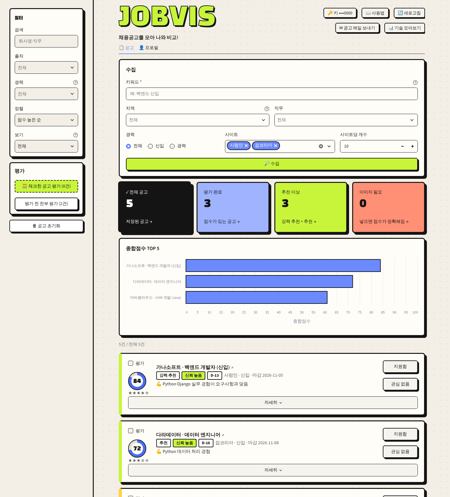

# JOBVIS

사람인·잡코리아 채용공고를 모아 내 프로필과 비교해 점수를 매기는 개인용 도구입니다.
취업 준비생이 자기 PC에서 쓰며, 공고 수집은 LLM 없이 하고 평가할 때만 LLM(기본 Gemini)을 부릅니다.



## 빠른 시작

### Docker (코드 없이 쓰기)

1. [Docker Desktop](https://www.docker.com/products/docker-desktop/)을 설치하고 켭니다.
2. 시작 파일 세 개(`JOBVIS 시작.bat`, `JOBVIS 끄기.bat`, `compose.yml`)를 한 폴더에 둡니다. 저장소의 [`start/`](start/) 폴더와 같습니다.
3. **`JOBVIS 시작.bat`** 을 더블클릭합니다. 처음 한 번 OCR을 함께 받을지 묻고, 이미지를 받느라 몇 분 걸립니다. 준비되면 브라우저가 http://localhost:8501 을 엽니다.
4. 오른쪽 위 **🔑 키 넣기**에 Gemini API 키를 넣습니다. 끌 때는 **`JOBVIS 끄기.bat`**.

명령으로 켜고 끄기, 데이터 지우기는 [docs/docker.md](docs/docker.md)에 있습니다.

### 파이썬 (코드를 받아 실행)

```bash
git clone https://github.com/wogud98/jobvis.git && cd jobvis
python -m venv .venv && source .venv/bin/activate   # Windows: .venv\Scripts\activate
pip install -r requirements.txt
cp .env.example .env                                # 키와 시트 ID 입력 (아래 설정 참고)
streamlit run app.py
```

명령줄 실행(`main.py`), 모델 바꾸기, 파일 구조는 [docs/development.md](docs/development.md)에 있습니다.

## 주요 기능

- **조건에 맞는 공고가 한 화면에 쌓임**: 키워드·지역·직무·경력으로 두 사이트 공개 페이지를 모으고, 같은 공고는 한 번만 저장합니다.
- **공고마다 점수와 이유**: 기술·경력·문화·커리어 방향 점수(0–100), 종합점수, 판정(강력 추천–비추천), 강점과 부족한 점을 카드로 봅니다.
- **무엇을 공부할지**: 📊 기술 모아보기에서 지금 목록이 많이 찾는 기술과 내가 부족한 것 순위를 봅니다.
- **고른 공고를 메일로**: ✉ 공고 메일 보내기로 한 번에 30건까지 내 메일로 받습니다(Gmail로 보냄).
- **이력서로 프로필 채우기**: PDF·Word·txt·md 파일을 올리면 빈 칸을 채웁니다. 저장은 직접 확인한 뒤에 합니다.

점수는 LLM이 항목 점수만 매기고, 종합점수·판정·보정은 코드가 계산합니다(가중치 기술 30, 경력 25, 문화 15, 방향 30). 기준은 [ai-job-search](https://github.com/MadsLorentzen/ai-job-search)(MIT)를 참고했습니다. 자세한 규칙은 화면 카드의 **자세히 → 점수 기준**에 있습니다.

## 설정과 주의사항

### 키

| 키 | 쓰는 곳 | 받는 곳 | 넣는 곳 |
| --- | --- | --- | --- |
| Gemini API 키 (무료 구간) | 평가, 이력서 채우기 | [Google AI Studio](https://aistudio.google.com/apikey) | 화면 🔑 키 넣기 또는 `.env`의 `GOOGLE_API_KEY` |
| Gmail 앱 비밀번호 (선택) | 공고 메일 보내기 | [앱 비밀번호](https://myaccount.google.com/apppasswords) (2단계 인증 필요) | 화면 ✉ 공고 메일 보내기 → 설정 |
| 구글 서비스 계정 (파이썬 실행만) | 결과를 구글 시트에 저장 | [docs/development.md](docs/development.md#구글-시트-준비) | `service_account.json`, `.env`의 `GOOGLE_SHEET_ID` |

- 화면에서 넣은 키는 `data/settings.env`(Docker는 볼륨 안)에만 저장되고 화면에는 끝 4자리만 보입니다.
- Gemini 키는 [Google Cloud 콘솔](https://console.cloud.google.com/apis/credentials)에서 Generative Language API만 쓰게 제한해 두기를 권합니다.

### 데이터

- Docker는 공고·점수를 내 PC 안의 DB(Postgres)에, 파이썬 실행은 내 구글 시트에 저장합니다. 공고 원문·키·프로필은 이 PC에만 둡니다.
- 평가와 이력서 채우기를 할 때만 공고·프로필 글이 LLM 제공자로 전송됩니다.
- 화면은 이 PC에서만 열립니다(`127.0.0.1`).

### 주의사항

- **개인 사용만**: 두 사이트 약관은 동의 없는 복제·제3자 제공·영리 이용을 금지합니다. 수집한 공고를 공유·공개하지 마세요.
- 수집은 robots.txt를 지키고 요청 사이에 3초를 쉽니다. 사이트가 막으면(403·429) 멈춥니다.
- 본문이 이미지뿐인 공고는 OCR(선택 설치, 약 560MB)이 있어야 읽습니다. 없으면 이미지를 직접 넣거나 본문 없이 평가합니다(종합점수 최대 69).
- Windows·Intel PC를 기준으로 만들었습니다. Mac(Apple Silicon)은 확인하지 않았습니다.

## 더 보기

- [docs/development.md](docs/development.md): 명령줄 실행, 모델 바꾸기, 파일 구조, 테스트
- [docs/docker.md](docs/docker.md): Docker 명령, 데이터 위치, 키 지키기
- [docs/](docs/README.md): 버전별 요구사항·설계(UML)·테스트·회고, [로드맵](docs/roadmap.md), [하네스(개발 규칙·CI)](docs/harness.md)
