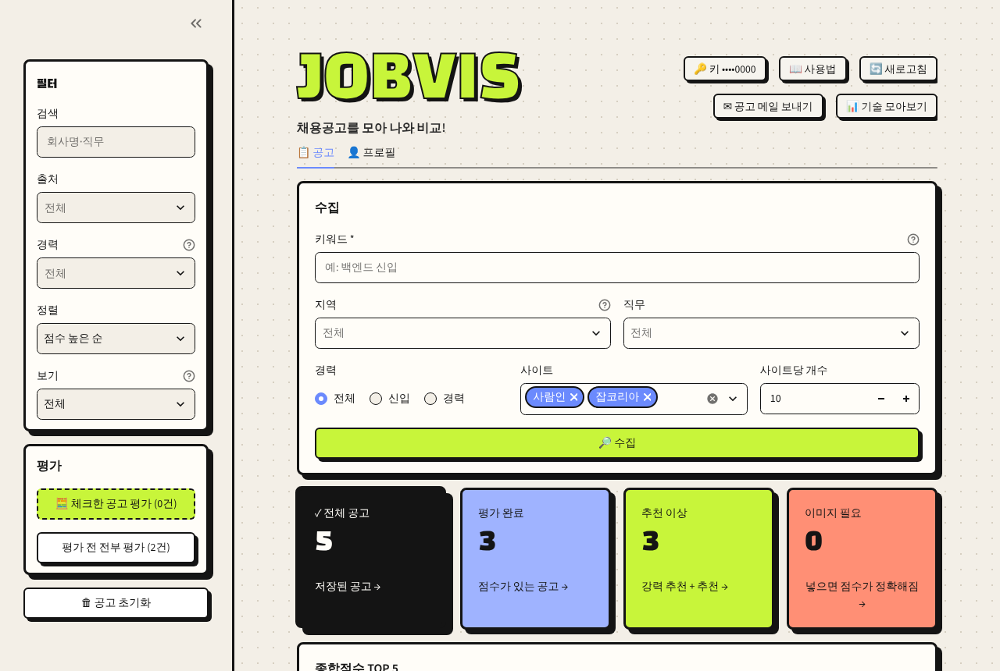
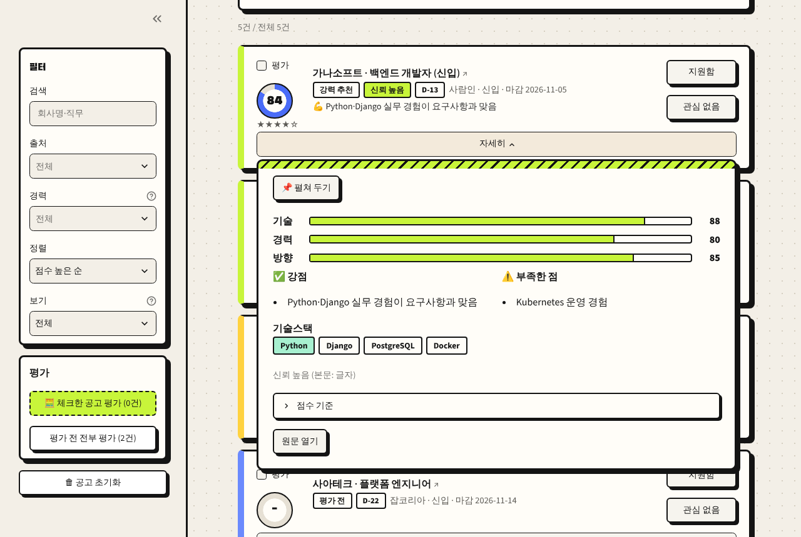
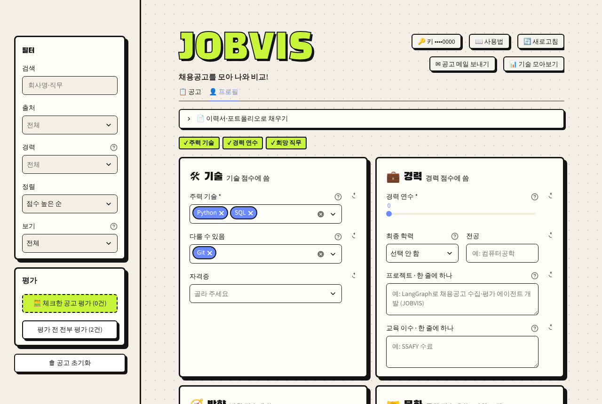
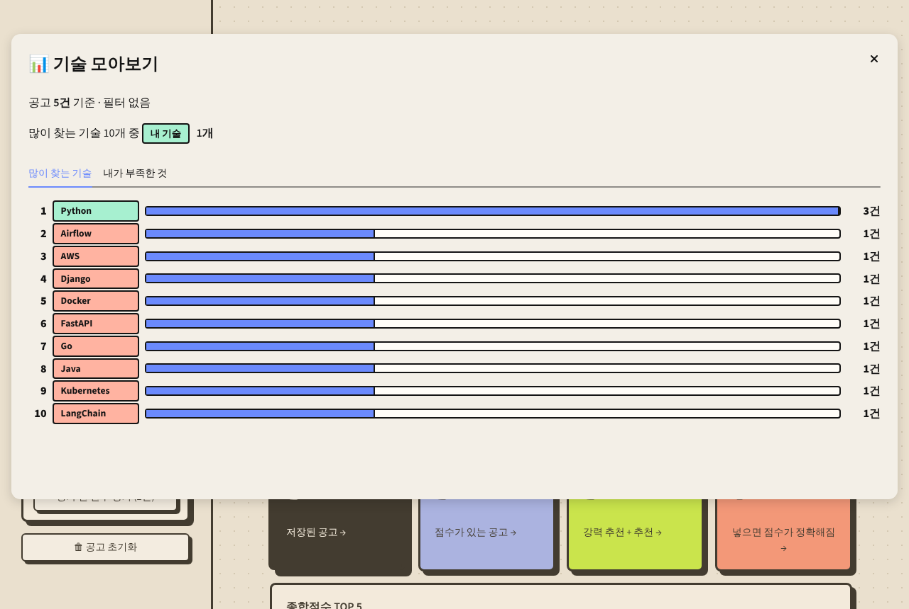
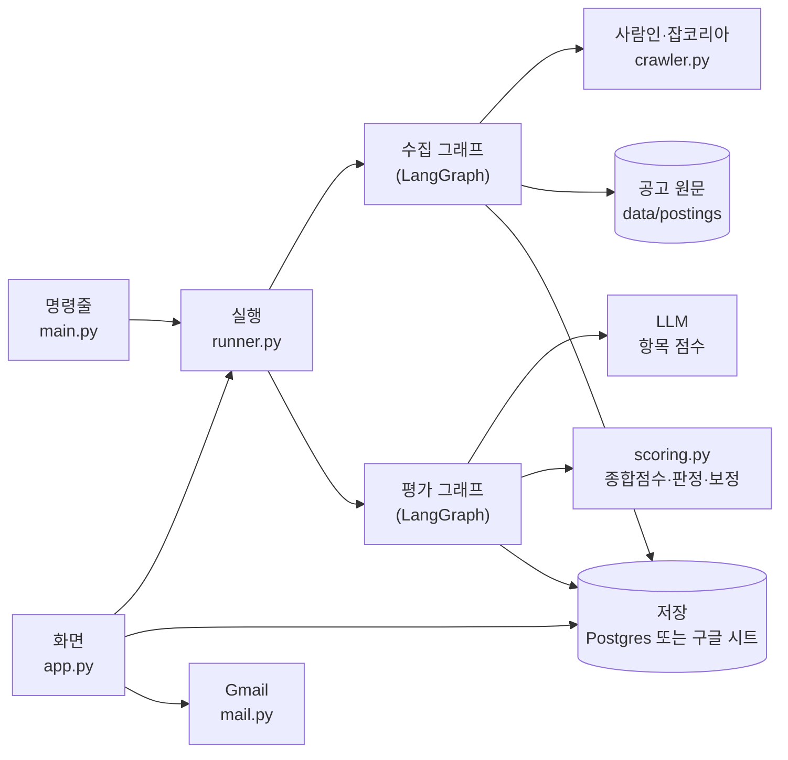

<div align="center">

# JOBVIS

**채용공고를 모아 나와 비교!**

사람인·잡코리아 채용공고를 모아 내 프로필과 비교해 점수를 매기는 개인용 도구입니다.


</div>

## 목차

- [📝 소개](#-소개)
- [🖥 화면 구성](#-화면-구성)
- [✨ 주요 기능](#-주요-기능)
- [🚀 빠른 시작](#-빠른-시작)
- [⚙ 기술 스택](#-기술-스택)
- [🛠 구조](#-구조)
- [🤔 기술적 이슈와 해결](#-기술적-이슈와-해결)
- [⚠ 설정과 주의사항](#-설정과-주의사항)

## 📝 소개

공고 수집은 LLM 없이 하고, 평가할 때만 LLM(기본 Gemini)을 불러 항목별 점수와 강점·부족한 점을 받습니다. 모든 데이터는 내 PC에 둡니다.

- 기간: 2026.10.19–2026.10.23 (v0.1–v0.7.3)
- 형태: 개인 프로젝트. AI 코딩 에이전트(Claude Code)와 함께 요구사항 → 설계 → 구현 → 테스트 순서로 개발
- 문서: 버전마다 요구사항·설계(UML)·테스트 결과를 [docs/](docs/README.md)에 남김

## 🖥 화면 구성

모두 가짜 데이터로 만든 화면입니다.

| 공고 | 자세히 |
| :---: | :---: |
|  |  |
| 수집 조건, 요약 칸, 사이드바 필터 | 항목별 점수, 강점·부족한 점, 기술스택 |
| **프로필** | **기술 모아보기** |
|  |  |
| 점수 항목별 입력, 이력서로 채우기 | 많이 찾는 기술, 내가 부족한 것 순위 |

## ✨ 주요 기능

- 🔎 **공고 모으기**: 키워드·지역·직무·경력으로 두 사이트 공개 페이지를 모으고, 같은 공고는 한 번만 저장합니다.
- 📊 **점수와 이유**: 기술·경력·문화·커리어 방향 점수(0–100), 종합점수, 판정(강력 추천–비추천), 강점과 부족한 점을 카드로 봅니다.
- 📚 **공부할 기술**: 기술 모아보기에서 지금 목록이 많이 찾는 기술과 내가 부족한 것 순위를 봅니다.
- ✉ **메일로 받기**: 고른 공고를 한 번에 30건까지 내 메일로 보냅니다(Gmail 앱 비밀번호).
- 📄 **이력서로 프로필 채우기**: PDF·Word·txt·md 파일을 올리면 빈 칸을 채웁니다. 저장은 직접 확인한 뒤에 합니다.

## 🚀 빠른 시작

### Docker (코드 없이 쓰기)

1. [Docker Desktop](https://www.docker.com/products/docker-desktop/)을 설치하고 켭니다.
2. 시작 파일 세 개(`JOBVIS 시작.bat`, `JOBVIS 끄기.bat`, `compose.yml`)를 한 폴더에 둡니다. 저장소의 [`start/`](start/) 폴더와 같습니다.
3. **`JOBVIS 시작.bat`** 을 더블클릭합니다. 처음 한 번 OCR을 함께 받을지 묻고, 이미지를 받느라 몇 분 걸립니다. 준비되면 브라우저가 http://localhost:8501 을 엽니다.
4. 오른쪽 위 **🔑 키 넣기**에 Gemini API 키를 넣습니다. 끌 때는 **`JOBVIS 끄기.bat`**.

명령으로 켜고 끄기, 데이터 지우기는 [docs/docker.md](docs/docker.md)에 있습니다.

### 파이썬 (코드를 받아 실행)

```bash
git clone https://github.com/wogud98/jobvis.git && cd jobvis
python -m venv .venv && source .venv/bin/activate   # Windows: .venv\Scripts\activate
pip install -r requirements.txt
cp .env.example .env                                # 키와 시트 ID 입력 (아래 설정 참고)
streamlit run app.py
```

명령줄 실행(`main.py`), 모델 바꾸기, 파일 구조는 [docs/development.md](docs/development.md)에 있습니다.

## ⚙ 기술 스택

| 분류 | 기술 |
| --- | --- |
| 에이전트 |    |
| 화면 |  |
| 저장 |    |
| 수집·OCR |   |
| 배포 |   |
| 개발 도구 |     |

## 🛠 구조



수집과 평가를 두 그래프로 나눴습니다. 수집은 LLM을 부르지 않고, 평가는 고른 공고나 점수 없는 공고만 합니다. 버전별 자세한 설계는 [docs/](docs/README.md)에 있습니다.

## 🤔 기술적 이슈와 해결

- **LLM 점수가 실행마다 흔들림** → LLM은 항목 점수(0–100)만 매기고, 종합점수·별점·판정은 코드가 계산하게 나눔. 계산은 테스트로 확인함. ([v0.3 설계](docs/v0.3/02-design.md))
- **제목만 보고 점수가 높게 나옴** → 요구 경력보다 부족하면 경력점수 상한(60/45/30), 본문 없이 채점하면 종합 최대 69로 보정하고 깎은 이유를 남김. ([v0.5 설계](docs/v0.5/02-design.md#점수-보정-f25f36))
- **본문이 이미지인데 이미지 서버가 robots.txt로 막힘** → 우회하지 않고 받지 않음. 사용자가 직접 저장한 이미지를 받은함에 넣으면 로컬 OCR로 읽음. ([v0.4 설계](docs/v0.4/02-design.md), [v0.5 설계](docs/v0.5/02-design.md#이미지-직접-넣기-f37f46))
- **반 사람들이 각자 키를 넣어 써야 함** → 키는 화면에서 넣어 PC 안 파일(권한 600)에만 두고, 화면에는 끝 4자리만, 오류 문구에 키 글자가 섞이면 가림. ([v0.6 설계](docs/v0.6/02-design.md))
- **화면 일부만 다시 그릴 때 테마가 사라짐** → Streamlit magic이 식 한 줄의 값(None)을 그린 것이 원인. if 문으로 고치고 같은 실수를 테스트로 막음. ([v0.6.2 설계](docs/v0.6.2/02-design.md))
- **AI 에이전트와 일관되게 개발하기** → 규칙(CLAUDE.md)·테스트(686개, 외부 API 없음)·린트·CI·비밀정보 검사로 강제함. ([하네스](docs/harness.md))

## ⚠ 설정과 주의사항

### 키

| 키 | 쓰는 곳 | 받는 곳 | 넣는 곳 |
| --- | --- | --- | --- |
| Gemini API 키 (무료 구간) | 평가, 이력서 채우기 | [Google AI Studio](https://aistudio.google.com/apikey) | 화면 🔑 키 넣기 또는 `.env`의 `GOOGLE_API_KEY` |
| Gmail 앱 비밀번호 (선택) | 공고 메일 보내기 | [앱 비밀번호](https://myaccount.google.com/apppasswords) (2단계 인증 필요) | 화면 ✉ 공고 메일 보내기 → 설정 |
| 구글 서비스 계정 (파이썬 실행만) | 결과를 구글 시트에 저장 | [docs/development.md](docs/development.md#구글-시트-준비) | `service_account.json`, `.env`의 `GOOGLE_SHEET_ID` |

- 화면에서 넣은 키는 `data/settings.env`(Docker는 볼륨 안)에만 저장되고 화면에는 끝 4자리만 보입니다.
- Gemini 키는 [Google Cloud 콘솔](https://console.cloud.google.com/apis/credentials)에서 Generative Language API만 쓰게 제한해 두기를 권합니다.

### 데이터

- Docker는 공고·점수를 내 PC 안의 DB(Postgres)에, 파이썬 실행은 내 구글 시트에 저장합니다. 공고 원문·키·프로필은 이 PC에만 둡니다.
- 평가와 이력서 채우기를 할 때만 공고·프로필 글이 LLM 제공자로 전송됩니다.
- 화면은 이 PC에서만 열립니다(`127.0.0.1`).

### 주의사항

- **개인 사용만**: 두 사이트 약관은 동의 없는 복제·제3자 제공·영리 이용을 금지합니다. 수집한 공고를 공유·공개하지 마세요.
- 수집은 robots.txt를 지키고 요청 사이에 3초를 쉽니다. 사이트가 막으면(403·429) 멈춥니다.
- 본문이 이미지뿐인 공고는 OCR(선택 설치, 약 560MB)이 있어야 읽습니다. 없으면 이미지를 직접 넣거나 본문 없이 평가합니다(종합점수 최대 69).
- Windows·Intel PC를 기준으로 만들었습니다. Mac(Apple Silicon)은 확인하지 않았습니다.

## 📎 더 보기

- [docs/development.md](docs/development.md): 명령줄 실행, 모델 바꾸기, 파일 구조, 테스트
- [docs/docker.md](docs/docker.md): Docker 명령, 데이터 위치, 키 지키기
- [docs/](docs/README.md): 버전별 요구사항·설계(UML)·테스트·회고, [로드맵](docs/roadmap.md)
- 점수 기준은 [ai-job-search](https://github.com/MadsLorentzen/ai-job-search)(MIT)를 참고했습니다.
