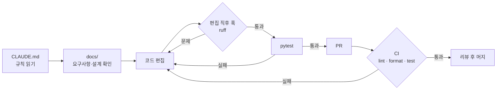

# 하네스 엔지니어링

JOBVIS는 AI 코딩 에이전트와 함께 만듭니다. AI가 빠르게 코드를 쓰더라도 품질과 개발 과정이 지켜지도록, 저장소 자체에 "틀(하네스)"을 갖춰 두었습니다.

## 구성

| 장치 | 파일 | 역할 |
| --- | --- | --- |
| 작업 규칙 | `CLAUDE.md` | AI가 매 작업마다 읽는 규칙. 개발 과정, 완료 기준, 하지 말 것 |
| 자동 테스트 | `tests/` | 외부 API 없이 가짜 데이터로 흐름 전체를 검증 |
| 린트·포맷 | `pyproject.toml` (ruff) | 코드 스타일과 흔한 버그 패턴 검사 |
| 편집 직후 검사 | `.claude/hooks/check-python.sh` | AI가 파이썬 파일을 고치면 바로 포맷하고 린트. 문제가 있으면 AI에게 돌려줘 스스로 고치게 함 |
| 세션 준비 | `.claude/hooks/session-start.sh` | 클라우드 AI 세션이 시작될 때 개발 도구 설치 |
| CI | `.github/workflows/ci.yml` | PR마다 린트, 포맷, 테스트를 GitHub에서 자동 실행 |
| PR 체크리스트 | `.github/pull_request_template.md` | 요구사항 → 설계 → 테스트 과정을 PR마다 확인 |

## 흐름

## 왜 이렇게 했나

- 규칙을 대화가 아니라 저장소에 둬서, 어떤 AI 세션이든 같은 규칙으로 일한다.
- 검사를 사람이 기억하는 대신 훅과 CI가 강제한다. AI가 스스로 오류를 보고 고치는 되먹임 고리가 생긴다.
- 테스트가 외부 API를 부르지 않아서 키 없이도, 비용 없이도 매번 돌릴 수 있다.
