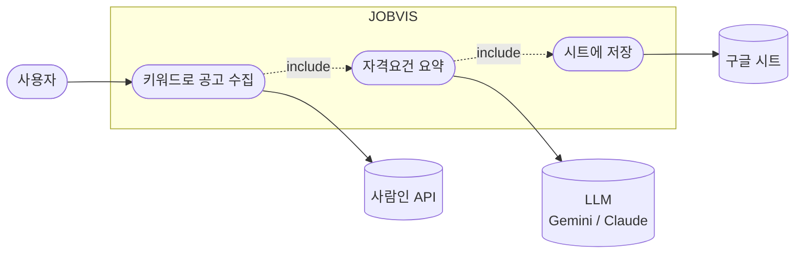
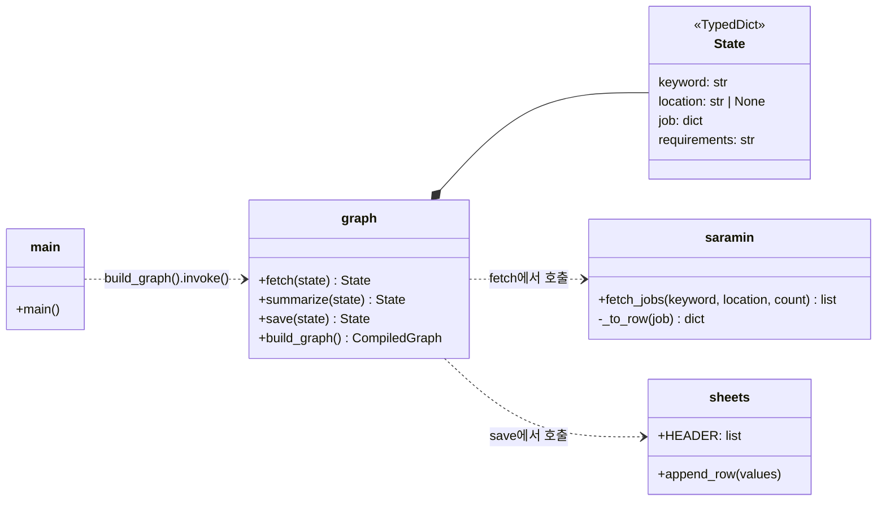
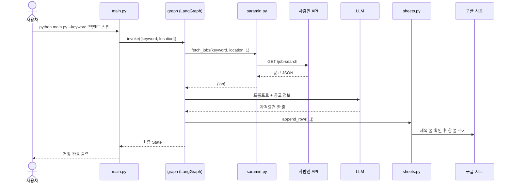
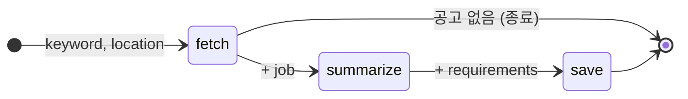

# v0.1 설계

## 유스케이스

사용자는 터미널에서 한 가지 일만 합니다. 외부 시스템 3개가 관여합니다.

## 모듈(클래스) 다이어그램

클래스 대신 모듈 단위로 나눴습니다. `State`는 노드들이 주고받는 데이터 구조입니다.

## 시퀀스 다이어그램

## 상태(그래프) 다이어그램

LangGraph에 등록된 실제 흐름입니다. 각 노드는 바뀐 칸만 돌려주고 LangGraph가 State에 합칩니다.

## 설계 결정

| 결정 | 이유 | 다시 볼 시점 |
| --- | --- | --- |
| LangGraph로 단계 연결 | 이후 조건 분기(적합도 낮으면 저장 안 함)와 반복을 노드 수정 없이 추가 | - |
| `init_chat_model` + `LLM_MODEL` 설정 | 유료 Claude 대신 무료 Gemini로 개발하고, 설정 한 줄로 교체 | - |
| 시트 저장은 gspread 직접 호출 | MCP 서버 설치·인증 없이 파이썬만으로 동작해 입문 단계에 단순 | v0.4에서 MCP 전환 |
| 공고 1건만 처리 | 최소 동작부터 확인 | v0.2 |
| 자격요건은 API 필드(경력·학력·키워드)로 요약 | 사람인 API 검색 결과에는 상세 본문이 없음 | v0.3 적합도 설계 때 |
