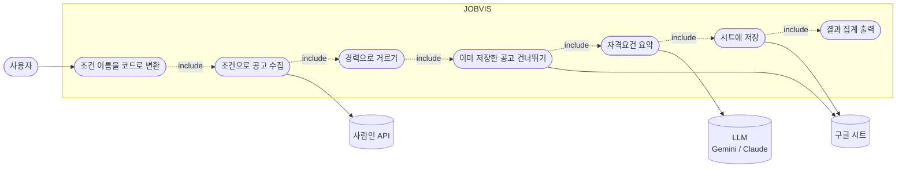
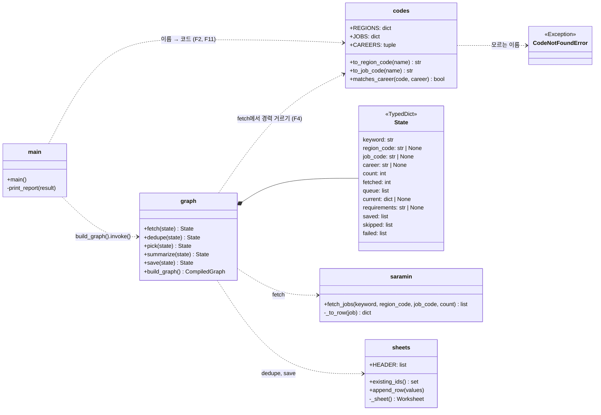
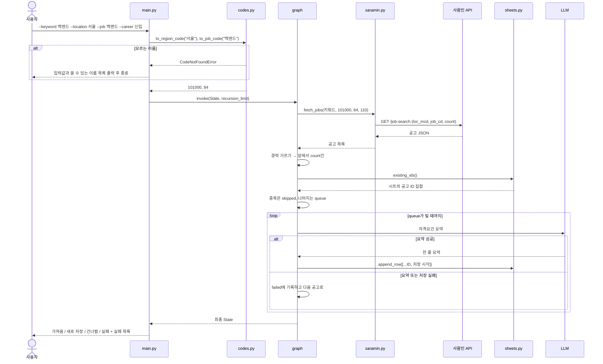
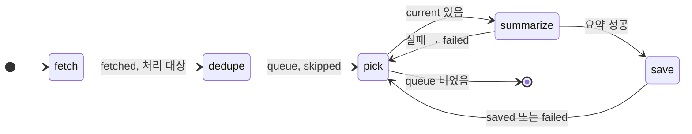

# v0.2 설계

기준 문서: [01-requirements.md](01-requirements.md) (2026-10-19 확정). 괄호 안 ID는 요구사항 번호.

## 유스케이스

v0.1과 달리 여러 공고를 처리하고, 조건 확인과 중복 확인이 앞에 붙는다.



## 모듈 다이어그램

`codes.py`가 새로 생긴다. 나머지는 v0.1 모듈을 넓힌다.



## 시퀀스 다이어그램

공고 2건 중 1건은 이미 저장돼 있고, 1건은 새로 저장되는 경우.



## 상태(그래프) 다이어그램

LangGraph에 등록할 흐름. `pick`이 queue에서 공고 하나를 꺼내고, 처리 후 다시 `pick`으로 돌아온다.



## State 칸

| 칸 | 채우는 노드 | 내용 |
| --- | --- | --- |
| keyword, region_code, job_code, career, count | main | 실행 조건. 이름은 이미 코드로 바뀐 상태 |
| fetched | fetch | 경력으로 거르고 count로 자른 뒤의 수 (집계의 "가져옴") |
| queue | fetch → dedupe → pick | 처리할 공고 목록. pick이 하나씩 꺼냄 |
| current | pick | 지금 처리 중인 공고 |
| requirements | summarize | 지금 공고의 요약. 실패하면 None |
| saved, skipped, failed | dedupe, summarize, save | 결과 목록. 노드가 돌려준 목록을 이어 붙임 (`Annotated[list, operator.add]`) |

`failed` 항목은 `{"company", "title", "step": "요약" | "저장", "error": 예외 이름}`. 예외 메시지는 키가 섞일 수 있어 넣지 않음.

## 시트 열

| 열 | v0.1 | v0.2 |
| --- | --- | --- |
| A~E | 회사명, 직무, 자격요건, 마감일, 링크 | 그대로 |
| F | - | 공고ID (F9) |
| G | - | 저장시각 `YYYY-MM-DD HH:MM` (F9) |

- 새 열을 뒤에 붙여서 v0.1에 저장한 줄도 그대로 읽힌다.
- 첫 줄이 v0.1 제목 줄이면 새 제목 줄로 바꾼다. 제목 줄이 없으면 넣는다.
- v0.1 줄에는 공고ID가 없으므로 중복 확인 대상이 아니다. 같은 공고가 한 번 더 저장될 수 있다.

## 이름 → 코드 매핑

사람인 [지역 코드표](https://oapi.saramin.co.kr/guide/code-table2), [직무 코드표](https://oapi.saramin.co.kr/guide/code-table5?mcode=2) 기준 (2026-10-19 확인).

**지역** (`loc_mcd`, 1차 지역, 국내만)

| 이름 | 코드 | 이름 | 코드 | 이름 | 코드 |
| --- | --- | --- | --- | --- | --- |
| 서울 | 101000 | 울산 | 107000 | 전북 | 113000 |
| 경기 | 102000 | 인천 | 108000 | 충북 | 114000 |
| 광주 | 103000 | 강원 | 109000 | 충남 | 115000 |
| 대구 | 104000 | 경남 | 110000 | 제주 | 116000 |
| 대전 | 105000 | 경북 | 111000 | 전국 | 117000 |
| 부산 | 106000 | 전남 | 112000 | 세종 | 118000 |

112000은 코드표에 "전남광주전체"로 적혀 있다.

**직무** (`job_cd`, IT개발·데이터 분야에서 고름)

| 이름 | 코드 | 코드표 이름 |
| --- | --- | --- |
| 백엔드, 서버 | 84 | 백엔드/서버개발 |
| 프론트엔드 | 92 | 프론트엔드 |
| 웹개발 | 87 | 웹개발 |
| 앱개발 | 86 | 앱개발 |
| 풀스택 | 2232 | 풀스택 |
| 데이터엔지니어 | 83 | 데이터엔지니어 |
| 데이터분석가 | 82 | 데이터분석가 |
| 데이터사이언티스트 | 2248 | 데이터 사이언티스트 |
| AI | 181 | AI(인공지능) |
| 머신러닝 | 109 | 머신러닝 |
| DevOps | 146 | DevOps |
| 클라우드 | 136 | 클라우드 |
| QA | 99 | QA/테스터 |
| 게임개발 | 80 | 게임개발 |
| 임베디드 | 128 | 임베디드 |
| 정보보안 | 90 | 정보보안 |
| DBA | 95 | DBA |
| SI개발 | 101 | SI개발 |

**경력** (F3, F4). 사람인 응답의 `experience-level.code`로 거른다.

| 입력 | 남기는 코드 |
| --- | --- |
| 신입 | 1 신입, 3 신입/경력, 0 경력무관 |
| 경력 | 2 경력, 3 신입/경력, 0 경력무관 |
| 생략 | 거르지 않음 |

## 실행 옵션

```bash
python main.py --keyword 백엔드 --location 서울 --job 백엔드 --career 신입 --count 10
```

| 옵션 | 필수 | 값 |
| --- | --- | --- |
| `--keyword` | O | 검색어 |
| `--location` | | 지역 이름 (위 표) |
| `--job` | | 직무 이름 (위 표) |
| `--career` | | `신입` 또는 `경력` |
| `--count` | | 1~110, 기본 10 |

## 설계 결정

| 결정 | 이유 | 다시 볼 시점 |
| --- | --- | --- |
| 공고 반복은 LangGraph 순환(`pick` → `summarize` → `save` → `pick`)으로 | v0.1에서 LangGraph를 고른 이유가 반복·분기. 공고마다 실패를 노드 단위로 기록하기 쉬움 | - |
| 병렬 처리(LangGraph `Send`)는 안 씀 | Gemini 무료 구간은 분당 요청 수 제한이 있어 동시에 보내면 실패가 늘어남 | 유료 모델 쓸 때 |
| 이름 → 코드 변환은 그래프 밖(main)에서 | 모르는 이름이면 API 호출 전에 멈춰야 함 (F11). 그래프는 코드만 받음 | - |
| 직무 매핑은 IT개발·데이터 18개만 | 사용자 희망 분야. 코드표 전체(약 260개)는 이름이 겹치고 기술 이름까지 섞여 있음 | 다른 분야가 필요할 때 |
| 경력 조건이 있으면 110건 요청 후 거름 | API에 경력 조건이 없음 (F6). 호출 수는 그대로 1번 | - |
| 실행할 때 `recursion_limit = count × 3 + 10` | LangGraph 기본 한도 25단계. 공고 1건에 3단계(pick, summarize, save)라 10건만 넘어도 멈춤 | - |
| 시트 연결은 실행당 1번 열어서 재사용 | v0.1은 저장마다 새로 연결함. 110건이면 인증이 110번 일어남 | - |
| 실패 기록에 예외 메시지 대신 예외 이름만 | 메시지에 키나 인증정보가 섞일 수 있음 (보안 규칙) | - |
| 공고 0건이면 오류 대신 집계(모두 0)를 출력하고 정상 종료 | F10의 집계 형식을 항상 지키기 위함. v0.1의 SystemExit는 없앰 | - |

## 테스트 계획

모두 가짜 데이터, 외부 API 호출 없음 (N4).

| 대상 | 정상 | 실패·경계 |
| --- | --- | --- |
| codes | 이름 → 코드, 별칭(서버 → 84) | 모르는 이름이면 CodeNotFoundError, 메시지에 쓸 수 있는 이름 포함 |
| 경력 거르기 | 신입/경력별 남는 코드 | 생략 시 전부 남음 |
| fetch | 경력 조건 있으면 110건 요청 후 count건 | 거른 결과가 count보다 적음 |
| dedupe | 시트에 있는 ID는 skipped | 시트가 비어 있음 |
| 그래프 전체 | 3건 중 1건 중복 → 저장 2, 건너뜀 1 | 요약 실패 1건, 저장 실패 1건이어도 나머지 계속. 가져옴 = 저장 + 건너뜀 + 실패 |
| 그래프 전체 | 공고 0건 → 집계 모두 0 | count 110에서 recursion_limit 안 걸림 |
| sheets | v0.1 제목 줄을 새 제목 줄로 교체 | 제목 줄 없으면 넣음 |

## 미확인

- Gemini 무료 구간의 분당·하루 요청 한도. 110건 요약이 한 번에 되는지는 실제 키로 실행해야 앎. 한도에 걸린 공고는 실패로 기록되고 다음 실행 때 다시 처리됨.
- 사람인 하루 호출 한도 횟수 (문서에 없음).
