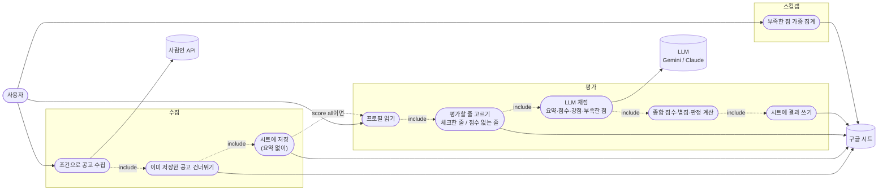
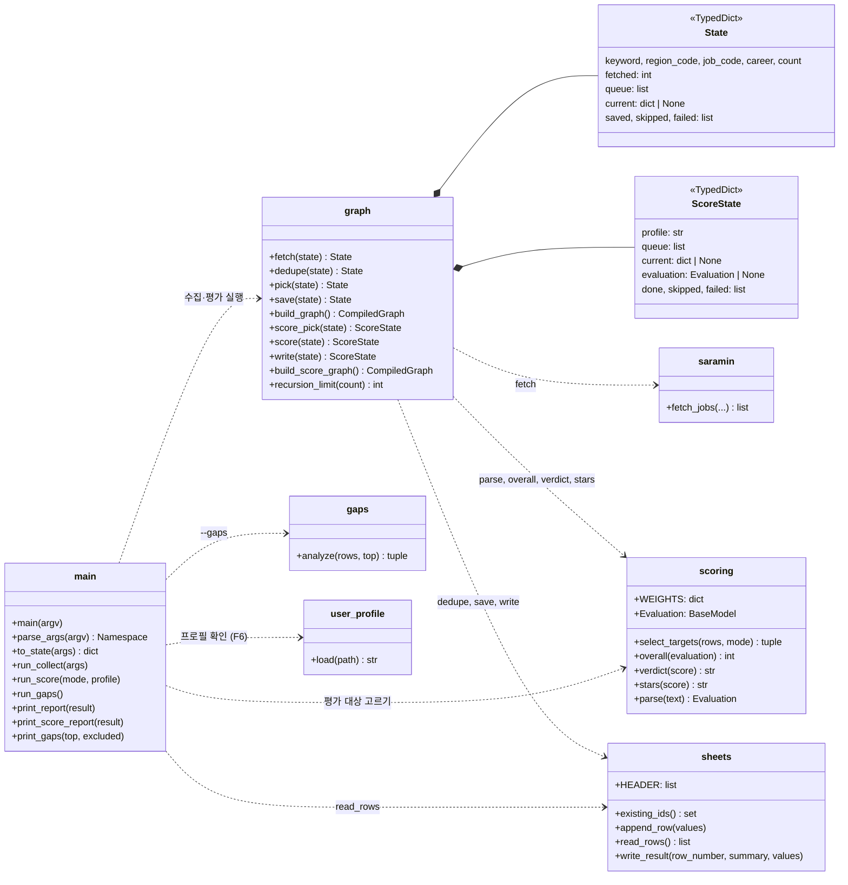
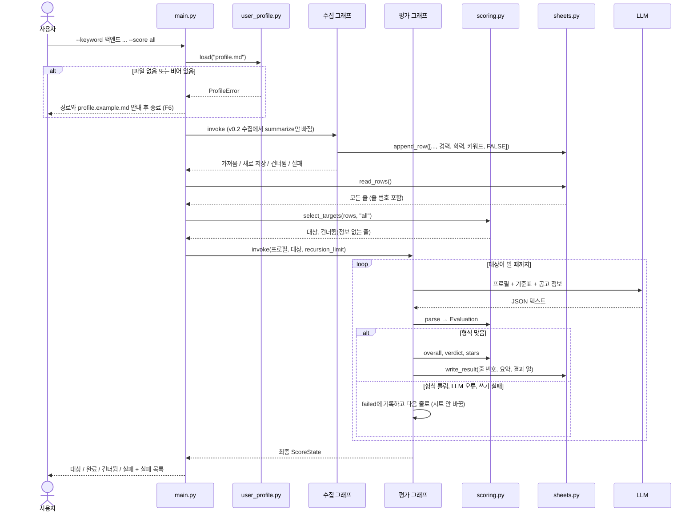
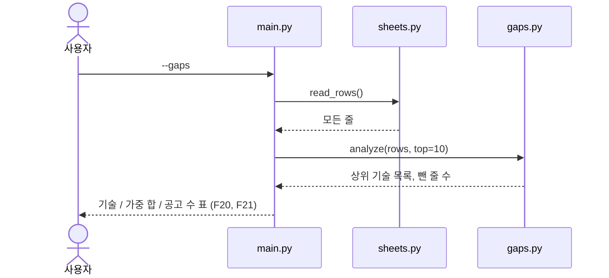
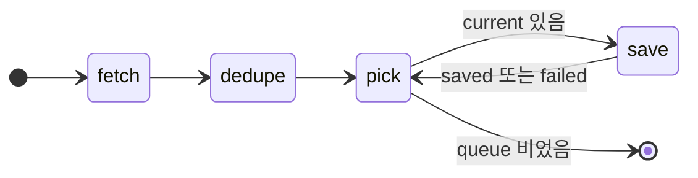
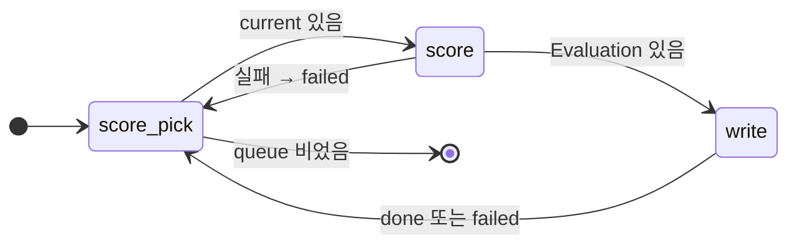

# v0.3 설계

기준 문서: [01-requirements.md](01-requirements.md) (2026-10-20 확정). 괄호 안 ID는 요구사항 번호.

## 유스케이스

수집, 평가, 스킬 갭 분석이 따로 실행된다. 수집 뒤에 평가를 이어 붙일 수 있다.



## 모듈 다이어그램

`scoring.py`, `gaps.py`, `user_profile.py`가 새로 생긴다. `graph.py`는 그래프가 두 개가 된다.



`codes.py`, `CodeNotFoundError`, `SaraminAPIError`는 v0.2 그대로라 그림에서 뺐다.

## 시퀀스 다이어그램

### 수집 + `--score all`



### `--gaps`



## 상태(그래프) 다이어그램

수집 그래프는 v0.2에서 `summarize`를 뺀 것이다.



평가 그래프. 대상은 main이 골라서 넣는다.



## State 칸

수집 `State`는 v0.2에서 `requirements` 칸만 빠진다.

평가 `ScoreState`:

| 칸 | 채우는 곳 | 내용 |
| --- | --- | --- |
| profile | main | 프로필 파일 내용 |
| queue | main → score_pick | 평가할 줄 목록. 각 항목은 `read_rows()`의 줄(dict) |
| current | score_pick | 지금 평가 중인 줄 |
| evaluation | score | 검증을 통과한 LLM 응답. 실패하면 None |
| done, skipped, failed | main, score, write | 결과 목록 (`Annotated[list, operator.add]`). skipped는 main이 처음에 넣음 |

`failed` 항목은 v0.2와 같은 `{"company", "title", "step": "채점" | "저장", "error": 예외 이름}`.

## 시트 열

| 열 | v0.2 | v0.3 | 채우는 단계 |
| --- | --- | --- | --- |
| A | 회사명 | 그대로 | 수집 |
| B | 직무 | 그대로 (공고 제목) | 수집 |
| C | 자격요건 | 그대로. 수집 때는 빈칸 (F2) | 평가 (F9) |
| D–G | 마감일, 링크, 공고ID, 저장시각 | 그대로 | 수집 |
| H | - | 경력 | 수집 (F3) |
| I | - | 학력 | 수집 (F3) |
| J | - | 키워드 | 수집 (F3) |
| K | - | 평가 (체크박스) | 수집 때 FALSE, 사용자가 체크 (F7) |
| L | - | 종합점수 (숫자) | 평가 (F11) |
| M | - | 별점 `★★★★☆` | 평가 (F13) |
| N | - | 판정 | 평가 (F12) |
| O | - | 기술점수 | 평가 |
| P | - | 경력점수 | 평가 |
| Q | - | 문화점수. 근거 없으면 `-` | 평가 (F10) |
| R | - | 방향점수 | 평가 |
| S | - | 강점 (쉼표로 이음) | 평가 |
| T | - | 부족한 점 (쉼표로 이음) | 평가 (F14) |
| U | - | 평가시각 `YYYY-MM-DD HH:MM` | 평가 |

- 첫 줄이 v0.1이나 v0.2 제목 줄이면 v0.3 제목 줄로 바꾼다. 앞 열은 그대로라 예전 줄도 읽힌다.
- 제목 줄을 만들거나 바꿀 때 K열 2행부터 끝까지 체크박스(데이터 확인 규칙 BOOLEAN)를 건다.
- 평가 결과는 `write_result`가 C열(요약)과 K–U열(체크 해제 + 결과)을 한 번의 `batch_update`로 쓴다. 다른 열은 건드리지 않는다.

## 평가 대상 고르기 (`select_targets`)

| 모드 | 고르는 줄 |
| --- | --- |
| `checked` (`--score`) | K열이 `TRUE`인 줄 (F7) |
| `all` (`--score all`) | L열(종합점수)이 빈 줄 (F8) |

고른 줄 중 H, I, J열이 모두 빈 줄은 평가할 정보가 없으므로 skipped로 돌린다 (F16). 제목 줄은 빼고, 줄 번호는 시트 기준(2부터)이다.

## LLM 입출력

**입력** (프롬프트): 시스템 메시지에 역할, 점수 기준표(요구사항 F10 표), 규칙(없는 내용 지어내지 않기, 문화 근거 없으면 null, 부족한 점은 짧은 기술 이름, JSON만 출력). 사람 메시지에 프로필 전문과 공고 정보(회사, 직무, 경력, 학력, 키워드).

**출력** (JSON):

```json
{
  "summary": "신입 가능, 대졸, Java·Spring 필수",
  "skills": 72,
  "experience": 60,
  "culture": null,
  "career": 80,
  "strengths": ["Java 프로젝트 경험", "백엔드 희망과 일치"],
  "gaps": ["Spring Boot", "AWS"]
}
```

`scoring.Evaluation`(Pydantic)으로 검증한다.

| 필드 | 규칙 | 어기면 |
| --- | --- | --- |
| summary | 빈 문자열 아님 | 실패 (F15) |
| skills, experience, career | 0–100 정수, 필수 | 실패 (F15) |
| culture | 0–100 정수 또는 null | 실패 (F15) |
| strengths, gaps | 문자열 목록. 3개 넘으면 앞 3개만 씀 | - |

## 계산 규칙

```text
종합점수 = 반올림( Σ(가중치 × 점수) / Σ(가중치) )   ← culture가 null이면 분자·분모에서 뺌
          가중치: skills 30, experience 25, culture 15, career 30
별 개수  = 반올림(종합점수 / 20)                     ← 0–5개, ★ 채우고 ☆로 5칸 맞춤
판정     = 80↑ 강력 추천, 60–79 추천, 40–59 보통, 40↓ 비추천
```

반올림은 사사오입(`floor(x + 0.5)`)이다. 파이썬 `round`는 2.5를 2로 만들어(은행가 반올림) 쓰지 않는다.

예: skills 72, experience 60, culture null, career 80 → (2160 + 1500 + 2400) / 85 = 71.29 → 71, ★★★★☆(71/20 = 3.55 → 4), 추천.

## 스킬 갭 계산 (`gaps.analyze`)

1. L열(종합점수)이 빈 줄은 빼고 센다 (F21).
2. T열을 쉼표로 나누고, 이름마다 `strip().casefold()`를 키로 묶는다 (F19). 표시 이름은 처음 나온 모양을 쓴다.
3. 키마다 (100 − 종합점수) / 100을 더하고, 나온 공고 수를 센다 (F18).
4. 가중 합 내림차순, 같으면 공고 수 내림차순, 그다음 이름 순으로 상위 10개 (F20).

## 실행 옵션

| 옵션 | 값 | 비고 |
| --- | --- | --- |
| `--keyword` | 검색어 | 수집할 때 필수. 평가만, 갭만 할 때는 생략 |
| `--location`, `--job`, `--career`, `--count` | v0.2 그대로 | 수집 옵션 |
| `--score` | 값 없음 → `checked`, `all` | `--keyword`와 함께 쓰면 `all`만 허용 |
| `--profile` | 파일 경로 | 기본 `profile.md` (F5) |
| `--gaps` | - | 다른 옵션과 함께 쓰지 않음 |

- 옵션이 하나도 없으면 사용법을 출력하고 끝낸다.
- `--keyword`와 `--score`(값 없음)를 같이 쓰면 오류로 멈춘다. 방금 수집한 줄은 체크돼 있지 않으므로 의미가 없다.

## 프로필 파일

`profile.example.md`를 저장소에 두고, 사용자는 복사해서 `profile.md`로 쓴다. `profile.md`는 `.gitignore`에 넣는다 (N3). 형식은 자유 마크다운이며 예시에는 아래 제목을 둔다.

- 보유 기술 (주력 / 다룰 수 있음)
- 경험 (프로젝트, 인턴, 교육)
- 희망 방향 (직무, 하고 싶은 일)
- 선호하는 일하는 방식 (문화 채점에 씀)

## 설계 결정

| 결정 | 이유 | 다시 볼 시점 |
| --- | --- | --- |
| 수집과 평가를 서로 다른 그래프로 | 따로 실행해야 하고(F7, F8) State 칸도 겹치지 않음. 하나로 합치면 분기만 늘어남 | - |
| 평가 대상 고르기는 그래프 밖(main)에서 | `recursion_limit`을 대상 수로 정하려면 그래프 실행 전에 대상을 알아야 함 | - |
| LLM 출력은 JSON 텍스트를 받아 Pydantic으로 검증 | `with_structured_output`은 제공자마다 동작이 다르고, 테스트용 가짜 모델(`FakeListChatModel`)이 지원하지 않음. JSON 텍스트는 Gemini·Claude 모두 같은 방식으로 다룸. 코드 블록(```json)으로 감싸 와도 `JsonOutputParser`가 벗김 | 검증 실패가 잦으면 |
| 종합점수·별점·판정은 코드가 계산 | LLM이 계산하면 실행마다 산수가 흔들림. 테스트로 확인할 수 있음 | - |
| 평가 결과는 줄 번호로 씀 | 시트를 한 번 읽어 모든 줄을 고르고, 결과는 그 줄 번호에 바로 씀. 공고ID로 다시 찾으면 줄마다 읽기 요청이 늘어남 | 평가 중 사용자가 줄을 지우는 문제가 생기면 |
| 결과 쓰기는 줄마다 `batch_update` 1번 | 요약(C)과 결과(K–U)가 떨어져 있어도 요청 한 번으로 씀 | - |
| 체크박스는 프로그램이 K열에 건다 | 사용자가 매번 규칙을 만들 필요가 없음. 제목 줄을 만들거나 바꿀 때 한 번만 | - |
| 실패한 줄은 시트를 바꾸지 않음 | `--score`면 체크가 남고, `--score all`이면 점수가 비어 다음 실행 때 다시 평가됨 | - |
| 프로필 모듈 이름은 `user_profile` | 파이썬 표준 라이브러리에 `profile` 모듈이 있어 헷갈림 | - |
| 의존성 추가 없음 | Pydantic과 `JsonOutputParser`는 이미 설치된 `langchain`에 들어 있음 | - |

## 테스트 계획

모두 가짜 데이터, 외부 API 호출 없음 (N1, N5).

| 대상 | 정상 | 실패·경계 |
| --- | --- | --- |
| scoring.overall | 네 항목 가중 평균 | culture null이면 세 항목으로 다시 나눔. x.5는 올림 |
| scoring.stars, verdict | 0, 20, 71, 100점 | 경계값 39/40, 59/60, 79/80 |
| scoring.parse | JSON, 코드 블록으로 감싼 JSON | 항목 누락, 101점, -1점, 요약 빈칸, JSON 아님 → 오류. 강점 4개 → 3개 |
| select_targets | checked: TRUE 줄만, all: 점수 빈 줄만 | 정보(H–J) 없는 줄은 skipped, 제목 줄 제외 |
| gaps.analyze | 가중 합 순위, 대소문자·공백 무시 | 점수 없는 줄 제외 수, 분석할 줄 0개 |
| user_profile.load | 내용 읽기 | 파일 없음, 공백만 있음 → ProfileError |
| 수집 그래프 | LLM 안 부름, 자격요건 빈칸, H–K열 저장 | v0.2 테스트(중복, 저장 실패, 0건) 유지 |
| 평가 그래프 | 2건 → 완료 2, write_result 호출 값 확인 | LLM 형식 오류 1건, LLM 예외 1건, 쓰기 실패 1건이어도 나머지 계속. 대상 = 완료 + 건너뜀 + 실패 |
| sheets | v0.2 제목 줄을 v0.3으로 교체, 체크박스 규칙 요청 | write_result가 C열과 K–U열만 씀 |
| main | 옵션 조합별 실행 경로 | 프로필 없으면 수집 전에 멈춤, `--keyword`+`--score`(값 없음) 오류, 옵션 없음 |

## 미확인

- K열 체크박스 규칙이 `append_row`로 늘어난 줄에도 적용되는지. 실제 시트에서 확인해야 앎. 안 되면 줄을 붙일 때 규칙을 다시 거는 방식으로 바꿈.
- Gemini 무료 구간에서 공고 정보만으로 채점했을 때 점수 품질과 JSON 형식을 얼마나 지키는지. 실제 키로 실행해야 앎.
- Gemini 무료 구간의 분당·하루 요청 한도. `--score all`로 많은 줄을 평가하면 한도에 걸릴 수 있고, 걸린 줄은 실패로 남아 다음 실행 때 다시 평가됨.
