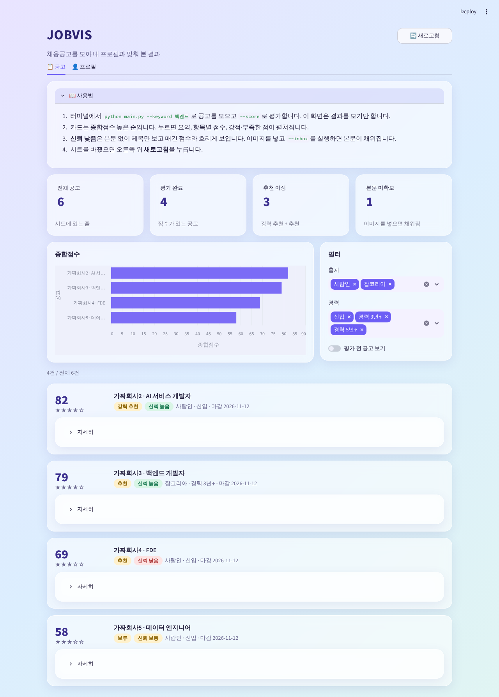
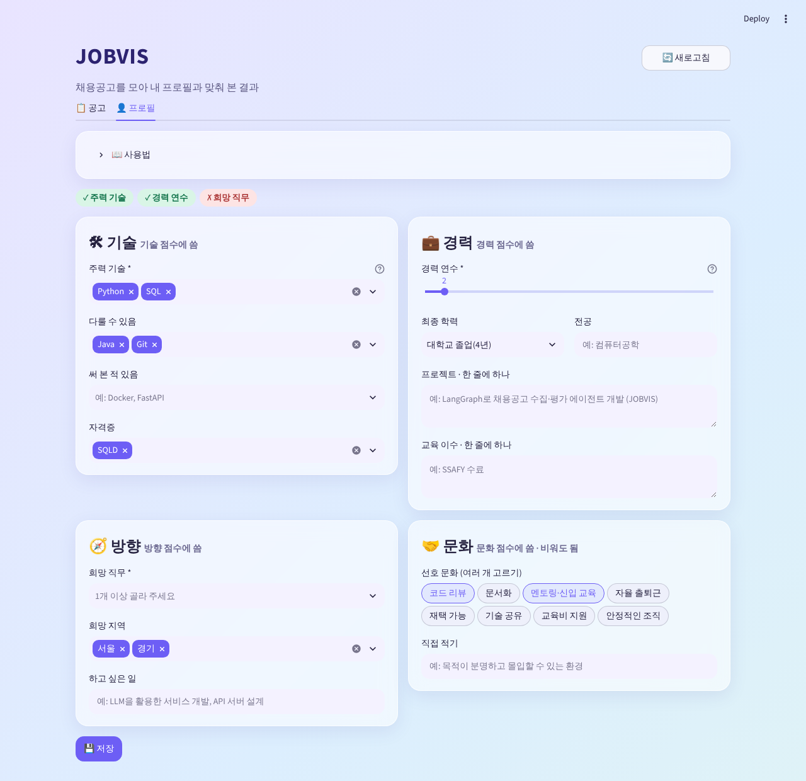

# v0.5.1 요구사항

2026-10-21 확정(PR #25). v0.5 화면을 PC에서 써 본 사용자 피드백을 반영한다. 기능은 v0.5와 같고, 화면을 알아보기 쉽고 입력하기 편하게 바꾼다.

## 목표

1. 공고 탭을 처음 열어도 무엇을 보는 화면인지, 어떻게 쓰는지 바로 안다.
2. 프로필 탭에서 무엇을 어떻게 적을지 고민하지 않고 고르거나 예시를 보고 적는다.
3. 심플하되 밋밋하지 않은 테마: 벤토 그리드 + 글래스모피즘.

## 사용자 피드백 (2026-10-21)

- 공고 페이지 직관성 부족. 첫 화면 보자마자 어리둥절함. 사용법을 간략하게 토글로 적어 두면 좋겠음
- 프로필 입력란: 입력 형식이 있긴 하지만 너무 자유분방해서 사용자 입장에서 뭘 어떻게 적어야 하는지 감이 안 옴. 편의성을 높일 방안 필요
- 테마: 심플한 건 좋지만 지금은 너무 간단함. 벤토 그리드와 글래스모피즘 스타일

## 시안

가짜 데이터로 그린 시안. 색·간격은 구현하며 조금 바뀔 수 있다.

| 공고 탭 | 프로필 탭 |
| --- | --- |
|  |  |

## 기능 요구사항

### 공고 탭

| ID | 내용 |
| --- | --- |
| F1 | 탭 맨 위에 "사용법" 토글을 둔다. 기본은 접힘. 내용은 4줄 이내: 수집·평가는 터미널에서 하고 화면은 보기만 함, 카드 순서와 펼치면 보이는 것, 신뢰 낮음의 뜻과 이미지 넣기(`--inbox`), 새로고침 |
| F2 | 사용법 아래에 요약 칸 4개를 한 줄로 둔다: 전체 공고, 평가 완료(점수 있음), 추천 이상(강력 추천 + 추천), 본문 미확보. 칸마다 한 줄 설명을 붙인다. 필터와 상관없이 시트 전체 기준 |
| F3 | 요약 칸 아래에 막대 차트(넓게)와 필터(좁게)를 나란히 둔다. 필터 내용과 차트 동작은 v0.5와 같음 |
| F4 | 공고 카드는 늘 보이는 머리 부분과 "자세히" 펼침으로 나눈다. 머리: 종합점수(크게), 별점, 회사 · 직무, 판정과 신뢰 배지, 출처 · 경력 · 마감. 펼침 내용(요약, 항목 점수, 강점, 부족한 점, 보정, 원문 링크, 이미지 넣기)은 v0.5와 같음 |
| F5 | 신뢰 배지는 높음·보통·낮음을 색으로 구분한다. 신뢰 낮음 카드는 v0.5처럼 흐리게 보인다 (v0.5 F34) |
| F6 | 평가 전·제외 카드는 점수 자리에 "-"를 보인다 |

### 프로필 탭

| ID | 내용 |
| --- | --- |
| F7 | 탭 맨 위에 "사용법" 토글(기본 접힘): 필수 3칸만 채우면 평가할 수 있음, 채울수록 근거가 정확해짐, 목록은 골라서 넣고 없으면 직접 입력, 저장하면 `profile.yaml`에 씀 |
| F8 | 필수 3칸(주력 기술, 경력 연수, 희망 직무)을 채웠는지 배지로 보인다. 입력하는 동안 바로 바뀐다 |
| F9 | 입력란을 점수 항목 4묶음(기술, 경력, 방향, 문화) 카드로 나누고 2×2로 배치한다. 묶음 제목 옆에 "○○ 점수에 씀"을 적는다 |
| F10 | 기술 3칸(주력, 다룰 수 있음, 써 본 적 있음), 자격증, 희망 직무, 희망 지역은 추천 목록에서 고르는 칸으로 바꾼다. 목록에 없는 값은 직접 입력해 추가할 수 있다 |
| F11 | 추천 목록은 코드에 고정된 목록이다(LLM·인터넷을 쓰지 않음). 파일에 이미 있는 값은 목록에 없어도 선택된 채로 보인다 |
| F12 | 선호 문화는 추천 항목을 눌러 고르는 버튼 묶음과, 목록에 없는 것을 한 줄에 하나씩 적는 칸으로 받는다. 파일에 있던 문화 항목은 잃지 않는다 |
| F13 | 학력은 "최종 학력" 고르기(고등학교 졸업, 전문대 졸업(2–3년), 대학교 졸업(4년), 석사, 박사)와 "전공" 입력으로 나눈다. 저장은 v0.5와 같은 한 줄 글자("대학교 졸업(4년), 컴퓨터공학"). 파일의 학력이 이 형식이 아니면 전공 칸에 전체를 그대로 보인다 |
| F14 | 프로젝트, 교육 이수, 하고 싶은 일은 글자 입력으로 두고, 비었을 때 예시 문구(placeholder)를 보인다. 프로젝트·교육은 v0.5처럼 한 줄에 하나 |
| F15 | 칸마다 짧은 도움말(물음표 표시)을 붙인다. 예: 주력 기술 "실무나 프로젝트에서 주로 쓴 것" |
| F16 | 저장 동작(필수 칸 검사, 틀리면 저장 안 함, 깨진 파일은 덮어쓰지 않음, 파일을 다시 읽음)은 v0.5 F17–F21과 같다 |

### 테마

| ID | 내용 |
| --- | --- |
| F17 | 밝은 테마 하나. 연한 보라·하늘·민트 그라데이션 배경, 강조색은 보라 계열. `.streamlit/config.toml`로 정한다 |
| F18 | 사용법, 요약 칸, 차트, 필터, 공고 카드, 프로필 묶음을 반투명 흐림 카드(글래스모피즘)로 그린다. 둥근 모서리와 옅은 그림자 |
| F19 | 크기가 다른 카드를 격자로 배치한다(벤토 그리드): 요약 4칸, 차트 2 : 필터 1, 프로필 2×2 |
| F20 | 위쪽에 제목 "JOBVIS"와 한 줄 소개, 오른쪽에 새로고침 버튼 |

## 비기능 요구사항

| ID | 내용 |
| --- | --- |
| N1 | 새 의존성 없음. 테마는 Streamlit 설정 파일과 `app.py`의 CSS로 만든다 |
| N2 | `profile.yaml` 형식은 v0.5와 같다. 화면에서 저장한 파일을 `--score`가 그대로 읽는다 |
| N3 | 시트에 쓰지 않음, LLM·공고 사이트를 부르지 않음 등 v0.5 F8, N4는 그대로 |
| N4 | 요약 칸 숫자, 추천 목록 합치기(파일 값 + 고정 목록), 학력 나누기·합치기는 Streamlit 밖 함수로 두고 가짜 데이터로 테스트한다. 빈 시트, 평가 전만 있는 시트, 목록에 없는 파일 값, 형식이 다른 학력 글자, 문화 직접 적기와 고르기가 겹칠 때를 포함한다 |
| N5 | 글자 대비가 배경 위에서도 읽히게 한다. CSS는 Streamlit 내부 클래스 이름 대신 `key`로 붙는 클래스와 `data-testid`에만 건다. Streamlit을 올렸을 때 덜 깨지게 하려고 |

## 하지 않는 것

- 어두운 테마. 밝은 테마 하나로 시작하고 써 보고 정한다
- 화면에서 수집·평가 실행, 수집 키워드 추천 검색어(화면에 검색어 입력이 없음). v0.5와 같음
- 레이더 차트
- 추천 목록을 공고에서 자동으로 뽑거나 LLM으로 만들기
- 모바일 화면, 배포

## 확인할 것

없음. 버전 이름 v0.5.1은 PR #25 머지로 확정(2026-10-21). 추천 목록 내용은 [설계](02-design.md#추천-목록)에 적고 써 보며 고친다.
