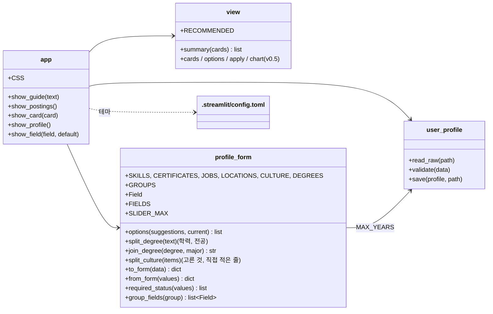
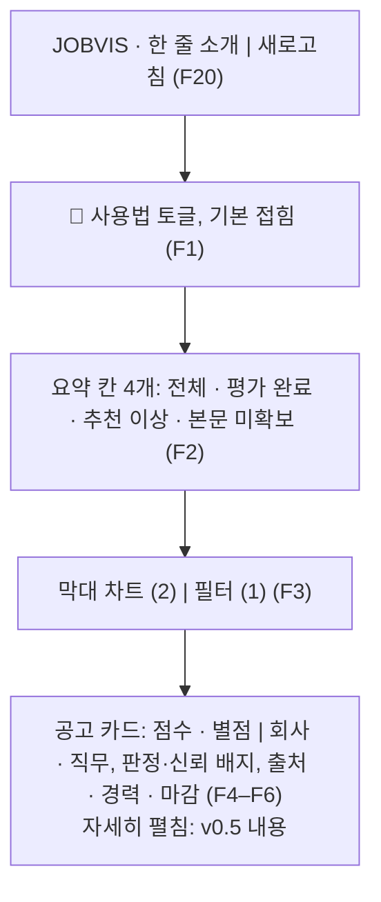
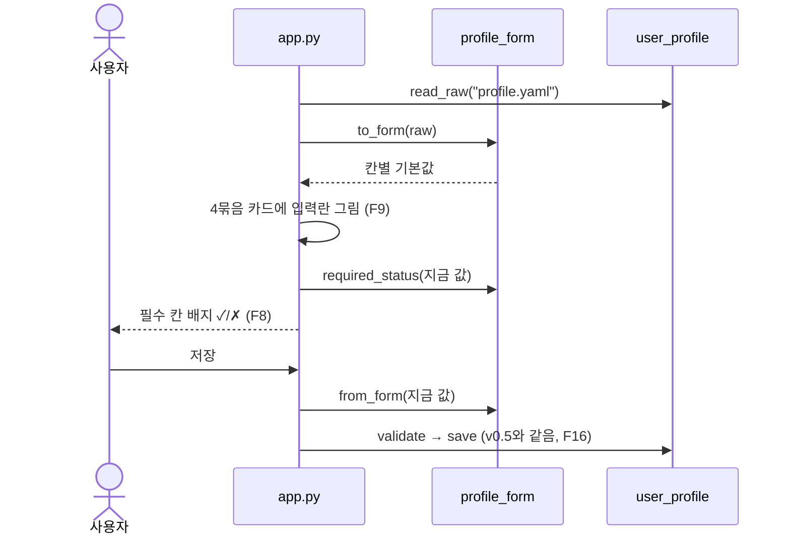

# v0.5.1 설계

기준 문서: [01-requirements.md](01-requirements.md) (2026-10-21 확정, F1–F20, N1–N5). 괄호 안 ID는 요구사항 번호. 기준 코드는 v0.5 구현(PR #24).

화면만 바꾸는 작은 버전이라 사용자 결정(2026-10-21)으로 설계와 구현을 한 PR에 담았다. 수집·평가·시트·`profile.yaml` 형식은 v0.5 그대로다.

## 모듈 다이어그램

v0.5에서 바뀐 곳만. `user_profile`의 입력란 함수(`FORM_FIELDS`, `to_form`, `from_form`)는 새 모듈 `profile_form`으로 옮겼다. 추천 목록과 학력·문화 나누기가 붙으며 커져서, 파일 검사·저장(`user_profile`)과 화면 입력란을 나눴다.

## 공고 탭 (F1–F6)

- `view.summary(cards)`는 필터 전 전체 카드로 센다. 추천 이상은 판정이 "강력 추천"·"추천"인 카드, 본문 미확보는 본문 칸이 `postings.MISSING`인 카드.
- 사용법·시트 오류·빈 시트 안내 순서: 사용법은 시트를 읽기 전에 그려서 오류가 나도 보인다.
- 카드 머리는 `st.markdown(unsafe_allow_html=True)`로 배지를 그린다. 시트 글자(회사, 직무, 판정, 출처 등)는 `html.escape`로 바꾼 뒤 넣는다. 시트는 사람이 고칠 수 있어서.
- 신뢰 배지 색: 높음 초록, 보통 노랑, 낮음 빨강 (F5). 신뢰 낮음 카드는 컨테이너 key를 `glass-dim-card-…`로 줘 CSS로 흐리게 한다.
- 평가 전·제외 카드 점수 자리는 "-" (F6). 판정 배지는 "평가 전" 또는 "제외 (경력 요구)".

## 프로필 탭 (F7–F16)

### 칸 종류

| 종류 | 칸 | 화면 | 파일 |
| --- | --- | --- | --- |
| pick | 주력·다룰 수 있음·써 본 적 있음, 자격증, 희망 직무, 희망 지역 | `st.multiselect(accept_new_options=True)`. 보기 = 추천 목록 + 파일에만 있는 값 (F10, F11) | 목록 |
| years | 경력 연수 | 슬라이더 0–30 (파일 값이 크면 그 값까지) | 정수 |
| degree | 최종 학력 | 고르기(선택 안 함 + 5개) + 전공 입력 (F13) | "대학교 졸업(4년), 컴퓨터공학" 한 줄 |
| lines | 프로젝트, 교육 이수 | 여러 줄 입력, 예시 문구 (F14) | 목록 |
| text | 하고 싶은 일 | 한 줄 입력, 예시 문구 | 글자 |
| culture | 선호 문화 | `st.pills(multi)` + 직접 적기 여러 줄 (F12) | 목록 |

- 학력 나누기: 글자가 학력 이름과 같거나 "학력 이름,"으로 시작하면 (학력, 나머지). 아니면 (빈 학력, 전체)를 전공 칸에. 합칠 때는 빈 쪽을 빼고 ", "로 잇는다.
- 문화 나누기: 추천 목록에 있는 항목은 버튼으로, 나머지는 직접 적기 칸에 줄로. 합칠 때 고른 것 + 직접 적은 줄, 겹치면 한 번만.
- 모든 목록은 앞뒤 공백·빈 항목·겹치는 항목을 지운다.
- 필수 칸 배지: 주력 기술·희망 직무는 1개 이상이면 ✓, 경력 연수는 0도 값이라 늘 ✓.
- `st.form`을 쓰지 않는다. 폼 안에서는 저장을 누르기 전까지 값이 바뀌지 않아 배지가 실시간으로 안 바뀌기 때문(F8). 배지는 `st.empty()` 자리를 먼저 잡고 입력란을 그린 뒤 채운다.
- 입력란에 key를 주지 않는다(v0.5 F21과 같은 이유). 파일이 바뀌면 기본값이 바뀌어 입력란이 새 값으로 다시 그려진다.

### 추천 목록

`agent/profile_form.py`에 고정 (F11). 써 보면서 고친다.

| 목록 | 항목 |
| --- | --- |
| 기술 (3칸 공통) | Python, Java, C, C++, C#, JavaScript, TypeScript, Kotlin, Go, SQL, Oracle, MySQL, PostgreSQL, Spring Boot, Django, FastAPI, Node.js, React, Vue, Linux, Git, Docker, Kubernetes, AWS, GCP, LangChain, LangGraph, PyTorch, TensorFlow, OpenCV, Pandas |
| 자격증 | 정보처리기사, 정보처리산업기사, SQLD, SQLP, ADsP, ADP, 빅데이터분석기사, 리눅스마스터 1급·2급, 정보보안기사, 네트워크관리사 2급, AWS SAA, 컴퓨터활용능력 1급, TOEIC, OPIc |
| 희망 직무 | 백엔드 개발, 프론트엔드 개발, 풀스택 개발, AI 서비스 개발, ML 엔지니어, 데이터 엔지니어, 데이터 분석, DevOps·인프라, 임베디드·펌웨어, 시뮬레이션·M&S, QA·테스트, FDE(Forward Deployed Engineer), 솔루션 엔지니어, 기술 지원 |
| 희망 지역 | 17개 시·도, 재택·원격 |
| 선호 문화 | 코드 리뷰 문화, 문서화가 잘 된 팀, 멘토링·신입 교육, 기술 공유·스터디, 교육비·성장 지원, 자율 출퇴근, 재택 가능, 수평적인 소통, 목적과 방향이 분명한 조직, 안정적으로 오래 다닐 곳, 몰입할 수 있는 환경, 빠르게 실행하는 팀 |
| 최종 학력 | 고등학교 졸업, 전문대 졸업(2–3년), 대학교 졸업(4년), 석사, 박사 |

## 테마 (F17–F20)

- `.streamlit/config.toml`: `base = "light"`, 강조색 `#6d5ef5`, 모서리 `0.8rem`. `streamlit run app.py`를 저장소 폴더에서 실행해야 읽힌다(README 실행 방법과 같음).
- `app.py`의 `CSS`를 `st.markdown(unsafe_allow_html=True)`로 넣는다.
  - 배경: 연보라 → 하늘 → 민트 대각선 그라데이션.
  - 글래스 카드: `st.container(border=True, key="glass-…")`가 붙이는 `st-key-glass-…` 클래스와 `stExpander`에 반투명 흰색(55%), `backdrop-filter: blur(14px)`, 둥근 모서리 20px, 옅은 그림자.
  - Streamlit 내부 클래스(`st-emotion-cache-…`)에는 걸지 않는다 (N5).
- 벤토 그리드는 `st.columns` 비율로: 요약 1:1:1:1, 차트 2 : 필터 1, 프로필 2×2 (F19).

## 설계 결정

| 결정 | 이유 | 다시 볼 시점 |
| --- | --- | --- |
| 입력란 함수를 `profile_form`으로 분리 | 추천 목록·학력·문화 규칙이 붙어 `user_profile`(파일 검사·저장·프롬프트)과 섞임. Streamlit 없이 테스트 (N4) | - |
| 프로필 탭에 `st.form`을 쓰지 않음 | 필수 칸 배지를 입력하는 동안 바꾸려고 (F8). 저장은 버튼을 눌렀을 때만이라 동작은 같음 | 입력할 때 화면이 느리면 |
| 추천 목록은 코드 상수 | 요구사항(F11). 설정 파일로 빼면 파일이 하나 더 늘어남 | 목록을 자주 고치게 되면 |
| 학력은 한 줄 글자로 저장 | `profile.yaml` 형식 유지 (N2). `--score`와 예전 파일이 그대로 동작 | - |
| 카드 머리는 HTML 배지 + escape | Streamlit 기본 요소로는 배지 색을 못 정함. 시트 글자는 사람이 고칠 수 있어 escape | - |
| 의존성 없음 | N1. `st.pills`, `accept_new_options`, `container(key=)`는 Streamlit 1.50 이상에 있음(1.66.0 확인) | - |

## 테스트 계획

| 대상 | 정상 | 실패·경계 |
| --- | --- | --- |
| view.summary | 4칸 수 | 빈 시트, 평가 전만, 제외 줄 |
| profile_form.to_form / from_form | 예시 파일 왕복, 목록 정리 | 틀린 값 → 빈 값, 글자 하나 → 한 항목, 필수 칸 없음 → 검사 실패 |
| options | 파일에만 있는 값이 보기에 남음 | - |
| split_degree / join_degree | 형식 맞는 글자 | 형식 다른 글자, 쉼표 없는 학력 이름 시작, 빈 글자 |
| 문화 | 고른 것과 직접 적은 것 나누고 합침 | 같은 항목을 고르고 또 적음 |
| required_status | 다 채움 | 빈 칸, 공백만 |
| app.py (AppTest) | 탭·사용법·요약 칸 값·카드 머리·배지·자세히, 저장 | 평가 전 카드 "-", 시트 글자 escape, 목록에 없는 파일 값, 필수 칸 없이 저장 |

## 미확인

- 윈도우 PC 브라우저에서 `backdrop-filter` 흐림과 글자 대비. 리눅스 크로미움 헤드리스로만 찍어 봄.
- `accept_new_options`로 새 값을 입력해 추가하는 동작. AppTest로는 보기에 있는 값만 넣어 봄.
