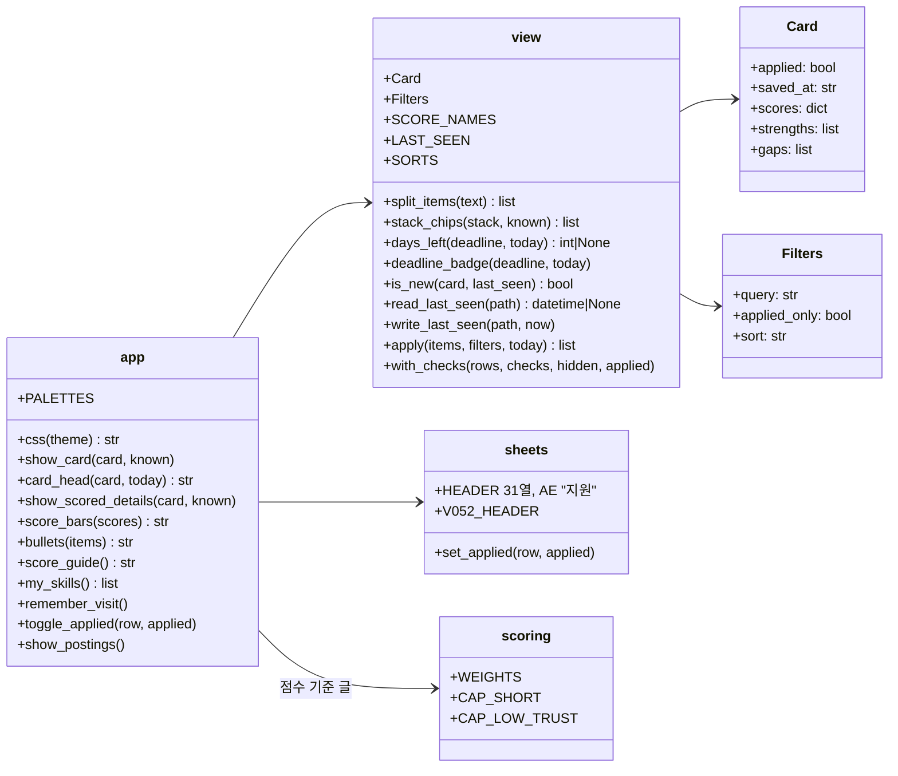
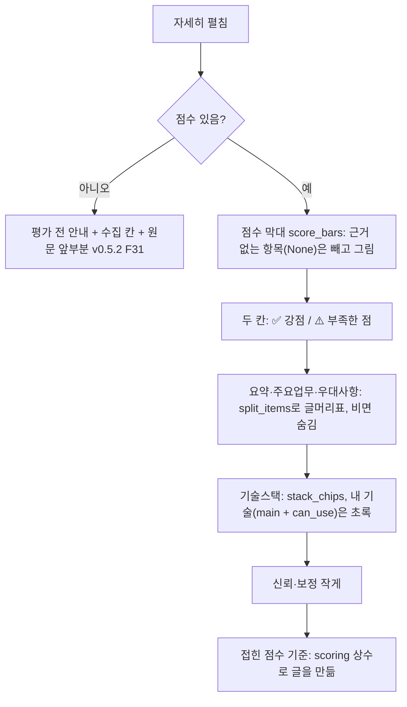
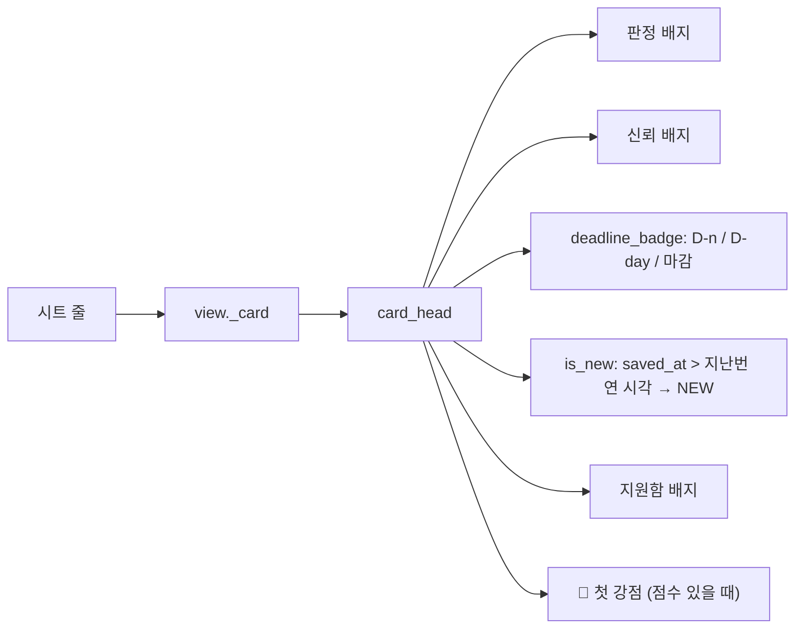
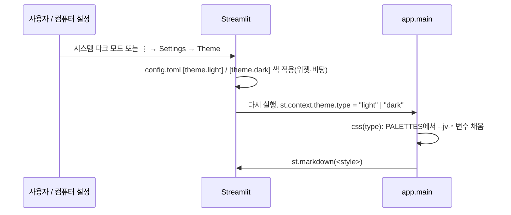

# v0.5.3 설계

기준 문서: [01-requirements.md](01-requirements.md) (2026-10-22 확정, F1–F15, N1–N3). 괄호 안 ID는 요구사항 번호. 기준 코드는 v0.5.2(PR #34까지).

수집·평가 그래프, State, 점수 계산은 바뀌지 않음. 바뀌는 곳은 화면(`app.py`), 화면 계산(`agent/view.py`), 시트 열 하나(`agent/sheets.py`), 테마 설정(`.streamlit/config.toml`).

## 모듈 다이어그램

굵게 적은 것이 v0.5.3에서 더하거나 바꾼 것.

- `Card`에 `applied`, `saved_at`, `scores`(기술·경력·문화·방향, 근거 없으면 None), `strengths`, `gaps`(목록)를 더함 (F1, F2, F9, F11, F12).
- `Filters`의 `lowest_first`를 `sort`("score_desc", "score_asc", "deadline")로 바꾸고 `query`, `applied_only`를 더함 (F8, F10, F11).
- 시트 열 이름은 그대로 두고 맨 끝에 AE "지원"을 더함. 예전 30열 머리글(`V052_HEADER`)은 `_sheet()`에서 자동으로 늘림 (F11).

## 자세히 (F1–F6)

- 글 나누기(`split_items`): 쉼표(반각·전각), 세미콜론, 줄바꿈, 앞뒤를 띄운 " · "·" / "로 나눔. "CI/CD", "Python·LangGraph"처럼 붙은 빗금·가운뎃점은 나누지 않음. 강점·부족한 점은 평가 노드가 ", "로 이어 저장하므로 같은 함수로 나뉨 (F2, F3).
- 기술 비교(`stack_chips`): 대소문자와 공백을 지우고 비교. 칩 순서는 공고에 적힌 순서 (F4).
- 막대 색: 70 이상 `jv-high`, 40–69 `jv-mid`, 40 미만 `jv-low`. 요약 칸·배지와 같은 색 (F1, F15).
- 문화 "-"는 `_score`가 None으로 바꾸므로 막대에서 빠짐. 계산은 `scoring`이 그대로 함 (F6).

## 카드 머리 (F7–F12)

- 마감(`days_left`): 시트 마감은 "YYYY-MM-DD", "상시", 빈칸. 날짜가 아니면 None이라 배지 없음. 0–7일 남으면 `D-n`(0이면 `D-day`), 지났으면 "마감" 배지와 흐린 카드(`box-dim-card-*`) (F7).
- 마감 임박 순(`_deadline_key`): 남은 마감 오름차순 → 날짜 없음 → 지난 공고. 같으면 시트 줄 순 (F8).
- NEW(`remember_visit`): 세션 상태에 지난번 시각이 없을 때만 `data/last_seen.txt`를 읽고 지금 시각으로 씀. 그래서 같은 세션에서 다시 그려도 NEW가 유지되고, 그 세션에서 수집한 공고도 NEW. 파일이 없거나 깨졌거나 쓸 수 없으면 None으로 두고 NEW 없음 (F9, N3).
- 검색(`_matches`): 띄어쓰기로 나눈 낱말이 모두 회사명·직무에 들어 있으면 남김. 대소문자 무시 (F10).
- 지원함(`toggle_applied`): 체크·관심 없음과 같은 방식. 버튼 콜백에서 `sheets.set_applied`로 AE 칸만 쓰고, 세션 상태 덮어쓰기(`applied_overrides`)로 시트를 다시 읽지 않고 바로 보임. 실패하면 덮어쓰지 않고 오류 글(`runner.error_text`, 경로·키는 숨김)을 보임 (F11).

## 다크 모드 (F13–F15)

- Streamlit 위젯 색은 `config.toml`의 `[theme.light]`·`[theme.dark]`가, 직접 그린 네오 브루탈리즘 부분(테두리, 그림자, 막대, 칩)은 CSS 변수 `--jv-ink`, `--jv-paper`, `--jv-card`, `--jv-green`, `--jv-muted`, `--jv-sub`, `--jv-highlight`가 맡음 (F13, F14).
- CSS 글에 `%`가 많아 `%` 서식 대신 `/*VARS*/` 자리를 바꿔 넣음.
- `st.context.theme.type`이 없거나 모르는 값이면 밝은 색 (N1).
- 색 면(요약 4칸, 배지, 막대 채움, 내 기술 칩)은 두 테마 모두 같은 파스텔색과 검정 글자 `#111111` (F15).

## 결정

| 결정 | 이유 |
| --- | --- |
| 테마 전환은 Streamlit 설정 메뉴 | Streamlit 1.66은 코드에서 테마를 바꾸는 API가 없음. 직접 버튼을 만들면 위젯 색은 안 바뀜 |
| NEW 기준을 파일 하나(`data/last_seen.txt`)로 | 시트에 열을 더하지 않고, 한 사람이 한 PC에서 쓰는 지금 구조에 맞음. `data/`는 이미 커밋 제외 |
| 지원 여부는 시트 새 열 AE | 관심없음(AD)과 같은 방식. 시트에서도 보이고 PC를 바꿔도 남음 |
| 문화는 화면에서만 숨김 | 근거 있는 공고에서는 점수에 쓰이고, 계산은 이미 근거 없으면 빼고 나눔(v0.3) |
| 점수 기준 숫자는 상수에서 | 가중치·상한을 바꾸면 안내 글도 같이 바뀌게 |

## 바뀐 기존 코드

- `view.Filters.lowest_first` → `sort`. 화면 정렬 상자는 "점수 높은 순", "점수 낮은 순", "마감 임박 순".
- `app.SUMMARY_FIELDS`, `SCORE_FIELDS` → `LIST_FIELDS`(요약·주요업무·우대사항). 점수 칸은 막대로.
- `sheets.HEADER` 31열. `_sheet()`이 30열 머리글도 늘림.
- `.streamlit/config.toml`: `[theme]` 하나(`base = "light"`) → 공통 `[theme]` + `[theme.light]` + `[theme.dark]`.
