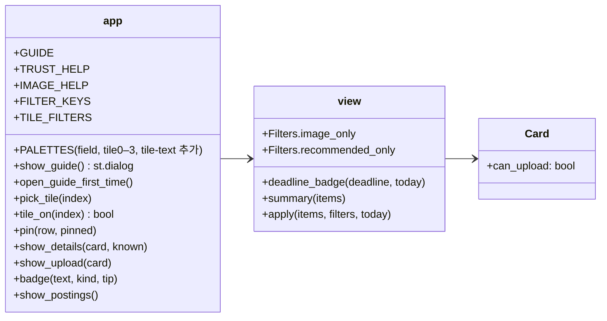
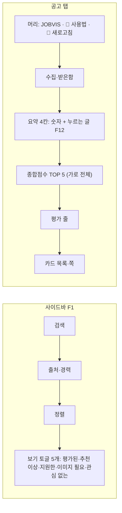
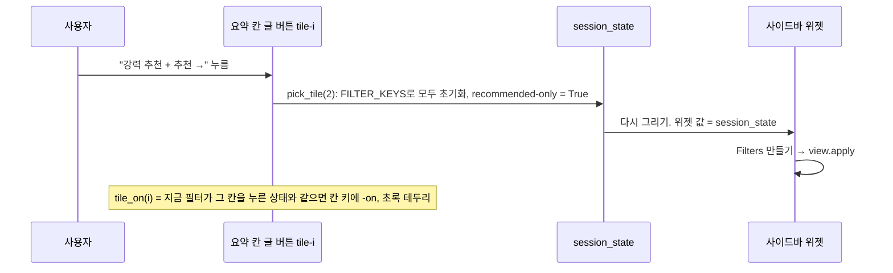
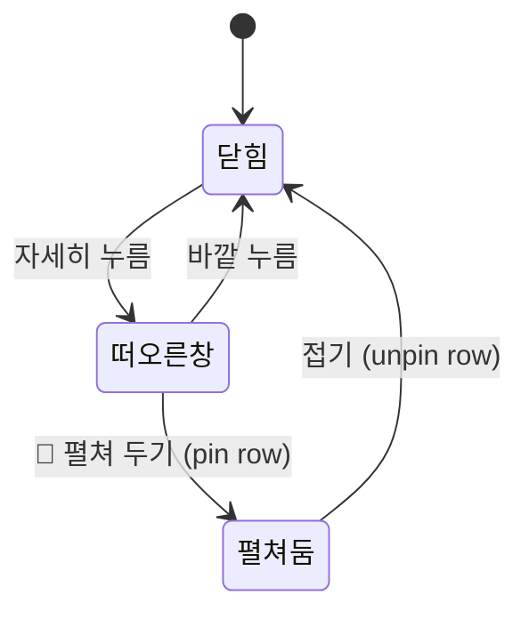

# v0.5.4 설계

기준 문서: [01-requirements.md](01-requirements.md) (2026-10-22 확정, F1–F13, N1–N2). 괄호 안 ID는 요구사항 번호. 기준 코드는 v0.5.3(PR #35).

수집·평가 그래프, State, 점수 계산, 시트 열은 바뀌지 않음. 바뀌는 곳은 `app.py`, `agent/view.py`, `.streamlit/config.toml`.

## 모듈 다이어그램

v0.5.4에서 더하거나 바꾼 것만.

- `Filters`에 `image_only`(F2), `recommended_only`(F12)를 더함. 기준은 각각 `Card.can_upload`, `RECOMMENDED`(강력 추천·추천)로 기존 것을 씀.
- `deadline_badge`는 7일을 넘어도 `("D-n", "plain")`을 돌려줌(F4).
- `summary` 넷째 칸은 "이미지 필요" = `can_upload` 수(F3).
- `app.main()`은 `if __name__ == "__main__"`에서만 부름. 테스트에서 `import app`으로 `css()`를 부를 때 화면(사용법 창 포함)을 그리지 않게 함. Streamlit과 AppTest는 스크립트를 `__main__`으로 돌려 동작은 같음.

## 화면 배치

사이드바는 탭과 상관없이 보이므로 맨 위에 "공고 탭 목록에 적용"을 적음. 시트를 못 읽었거나 공고가 없으면 사이드바에 안내 한 줄만 둠.

## 요약 칸 필터 (F3, F12)

- 필터 위젯마다 key를 주고(`search`, `sources`, `experiences`, `scored-only`, `recommended-only`, `applied-only`, `image-only`, `hidden-only`), 콜백에서 그 key 값을 바꿈. 위젯을 그리기 전에 콜백이 돌아 값이 바로 반영됨.
- 정렬은 칸 필터가 아니라 그대로 둠.
- 글 버튼은 `type="tertiary"`에 CSS로 테두리·그림자를 지우고 마우스를 올리면 밑줄.

## 자세히 (F5, F6)

- 떠 있는 창은 `st.popover("자세히", width="stretch", key="more-{row}")`. 내용은 전과 같은 `show_details`(점수 막대, 강점·부족한 점, 글머리표, 기술 칩, 점수 기준, 원문 열기, 이미지 넣기).
- 펼쳐 둔 줄 번호는 `session_state["pinned"]`(set). 펼쳐 둔 카드는 popover 대신 `box-pinned-{row}` 칸에 같은 내용을 그림.
- 창이 길면 화면 높이 75%에서 스크롤.

## 사용법 창 (F9)

- `@st.dialog("📖 사용법", width="large")`로 `GUIDE`를 보임. 머리 버튼(key `guide`)으로 열고, X나 바깥을 눌러 닫음.
- `remember_visit()`이 읽은 지난번 연 시각이 없으면(처음) `open_guide_first_time()`이 세션에 한 번만 띄움.
- 공고 탭·프로필 탭의 사용법 접기 칸과 `POSTINGS_GUIDE`, `PROFILE_GUIDE`는 `GUIDE` 하나로 합침.

## 배지 도움말 (F7, F10)

`badge(text, kind, tip)`가 `title` 속성을 붙여 마우스를 올리면 글이 뜸. 신뢰 배지는 `TRUST_HELP`(최대 점수는 `scoring.CAP_LOW_TRUST`), 이미지 필요 배지는 `IMAGE_HELP`.

## 어두운 테마 (F11, F13)

| 변수 | 밝은 | 어두운 |
| --- | --- | --- |
| `--jv-paper` 바탕 | #fffdf5 | #0e1013 |
| `--jv-card` 칸 | #ffffff | #2a2f38 |
| `--jv-field` 입력란 | #ffffff | #1a1d23 |
| `--jv-tile0–3` 요약 칸 | #ffe066 #a5d8ff #8ce99a #ffc9c9 | #5c4a12 #1d3f5e #1f4d33 #5c2626 |
| `--jv-tile-text` 요약 칸 글자 | #111111 | #f1f1f1 |

`config.toml`의 `[theme.dark]`도 `backgroundColor = "#0e1013"`, `secondaryBackgroundColor = "#1a1d23"`(입력란·사이드바)로 맞춤. 배지·막대 색 면은 v0.5.3 F15대로 두 테마 같은 색과 검정 글자.

## 바뀐 기존 코드

- `show_guide(text)`(접기 칸) → `show_guide()`(새 창).
- 필터 카드 `box-filters`와 차트·필터 높이 맞춤 CSS(v0.5.1 F21) 없앰.
- `show_upload` 안내 문구: 터미널 `--inbox` → 화면 받은함 읽기.
