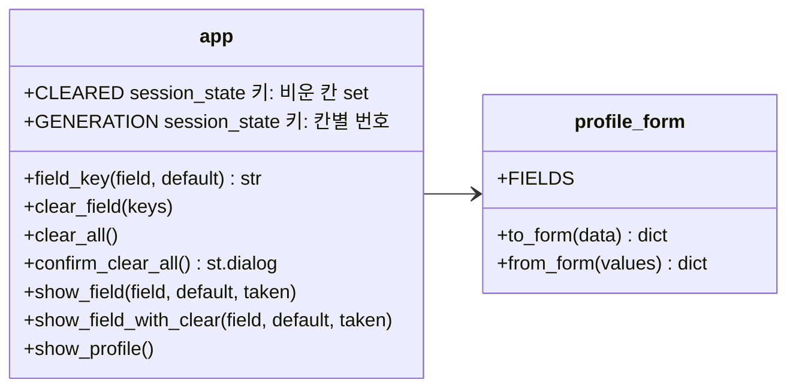
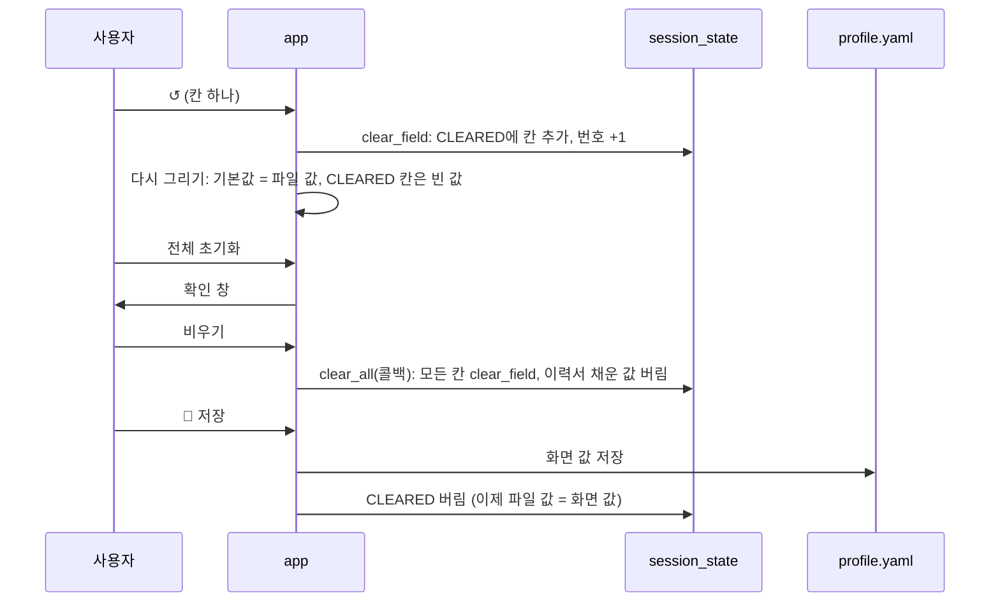

# v0.5.5 설계

기준 문서: [01-requirements.md](01-requirements.md) (2026-10-22 확정, F1–F3, N1). 바뀌는 곳은 `app.py`의 프로필 탭뿐.

## 모듈 다이어그램

- 빈 값은 `profile_form.to_form(None)`에서 가져와 칸 종류마다 따로 정하지 않음.
- `pick_key`를 `field_key`로 바꾸고 모든 입력란에 key를 줌. key는 `field-{칸}-{번호}-{기본값 해시}`. 기본값이 바뀌거나(파일·이력서) 번호가 오르면(↺) 새 key라 새 값으로 그려짐. 전에는 고르기 칸만 key가 있고 나머지는 key 없이 기본값으로 다시 그렸음(v0.5 F21). key 없는 입력란은 이미 빈 칸을 다시 비울 때 값이 바뀌지 않아 key로 바꿈.
- 예전 key 지우기는 고르기 칸만 함. 고르기 칸은 값을 session_state에 직접 넣기 때문.

## 흐름

- 확인 창 버튼은 `on_click=clear_all` 콜백에서 비움. 확인 창은 창 안만 다시 그려지므로 콜백이어야 값이 확실히 바뀜.
- 이력서로 채우면 CLEARED를 버림. 채운 값이 비운 표시에 가려지지 않게.
- ↺는 입력란 오른쪽 좁은 열의 tertiary 버튼. CSS로 테두리·그림자를 지우고 흐린 글자, 마우스를 올리면 초록.
