# v0.5 설계

기준 문서: [01-requirements.md](01-requirements.md) (2026-10-21 확정, F1–F49, N1–N8). 괄호 안 ID는 요구사항 번호. 기준 코드는 v0.4 구현(PR #22까지 머지된 main).

v0.5는 네 묶음이다. 보기 화면(F1–F10), 프로필(F11–F24), 점수 보정(F25–F36), 이미지 직접 넣기(F37–F49). 화면은 시트를 읽기만 하고, 수집·평가·OCR은 터미널에서 한다.

## 유스케이스

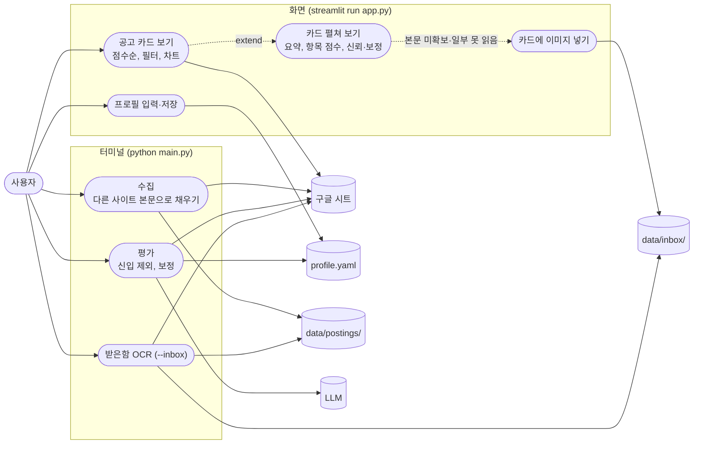

화면이 쓰는 곳은 `profile.yaml`과 `data/inbox/`뿐이다 (F8). 시트에는 쓰지 않는다.

## 모듈 다이어그램

새 파일은 `app.py`(저장소 맨 위), `agent/view.py`, `agent/inbox.py`. `user_profile.py`는 다시 쓰고, `scoring.py`, `sheets.py`, `graph.py`, `main.py`, `postings.py`가 바뀐다.

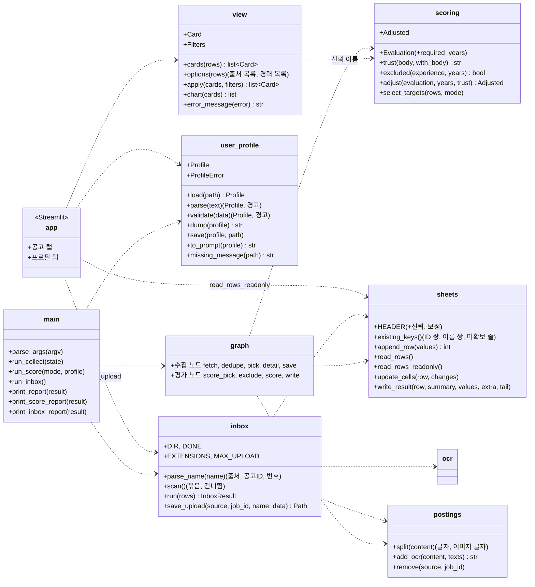

- `app.py`는 Streamlit 화면 그리기만 한다. 정렬·필터·카드 내용·차트 자료는 `view.py`, 프로필 검사·YAML은 `user_profile.py`, 이미지 저장 이름은 `inbox.py`에 둔다. 셋 다 Streamlit을 import하지 않아 가짜 데이터로 테스트한다 (N5).
- 보정 계산은 새 모듈 대신 `scoring.py`에 넣는다. 종합점수·별점·판정을 이미 여기서 계산하고, 보정은 그 계산 순서 안에 끼어든다 (F35).
- `inbox.py`는 그래프로 만들지 않는다. LLM 호출도 갈림길도 없는 파일 반복이라 함수 하나로 충분하다. 노드 함수가 아니므로 `graph.py`에 두지 않는다.
- `crawler.py`, `saramin.py`, `jobkorea.py`, `ocr.py`, `codes.py`, `gaps.py`는 바뀌지 않는다.

## 보기 화면 (F1–F10, F34, F47–F49)

### 화면 구성

```text
JOBVIS                                           [새로고침]
[공고] [프로필]
─ 공고 탭 ───────────────────────────────────────────────
필터: 출처 [사람인 ✓][잡코리아 ✓][미상 ✓]  경력 [신입 ✓][경력무관 ✓]…  [ ] 평가 전 공고 보기
종합점수 막대 차트 (필터를 지난 공고, 점수 있는 것만)
┌ 82 ★★★★☆ 강력 추천 | ○○회사 · 백엔드 개발자 | 마감 2026-11-12 | 사람인 | 신뢰 높음 ┐
│ (펼침) 요약 / 주요업무 / 우대사항 / 기술스택                                         │
│        기술 72 · 경력 60 · 문화 - · 방향 80                                          │
│        강점 … / 부족한 점 …                                                           │
│        보정: 경력 75→60 (3년 요구, 2년)                                               │
│        [원문 열기]                                                                  │
│        (본문 미확보·이미지 일부 못 읽음이면) 이미지 넣기 [끌어다 놓기]                  │
└────────────────────────────────────────────────────────────────────────────────────┘
```

| 요소 | Streamlit | ID |
| --- | --- | --- |
| 탭 | `st.tabs(["공고", "프로필"])` | F1 |
| 새로고침 | `st.button` → 시트 읽기 캐시(`st.cache_data`)를 비우고 다시 읽음 | F7 |
| 필터 | `st.multiselect` 두 개(기본은 전부 선택), `st.toggle` | F6 |
| 차트 | `st.bar_chart`. 막대 이름은 "회사 · 직무"(같은 이름이면 뒤에 번호), 값은 종합점수 | F5, N3 |
| 카드 | `st.expander`. 제목 줄에 점수·별점·판정·회사·직무·마감일·출처·신뢰 | F2, F3, F34 |
| 원문 링크 | `st.link_button`(새 탭) | F4 |
| 흐리게 | 신뢰 낮음이면 제목 줄 글자를 `:gray[…]`로 | F34 |
| 이미지 넣기 | `st.file_uploader(accept_multiple_files=True)` | F47 |
| 오류·빈 시트 | `st.error`, `st.info` | F9, F10 |

### Card

`view.cards(rows)`가 시트 줄마다 만든다.

| 칸 | 값 |
| --- | --- |
| row | 시트 줄 번호 |
| company, title, deadline, url | 시트 그대로 |
| source | 사이트 이름. 출처 칸이 빈 예전 줄은 "미상" (F6) |
| source_code | `saramin` / `jobkorea`. 빈 출처는 `sheets.source_code`처럼 `saramin`으로 봄. 이미지 저장 이름에만 씀 |
| job_id | 공고ID |
| score | 종합점수 정수. 비었거나 숫자가 아니면 None |
| stars, verdict | 시트 그대로. 점수가 없으면 판정은 "평가 전". 단 "제외 (경력 요구)"는 그대로 |
| experience | 경력 칸 (필터용) |
| trust | "신뢰" 칸. 비었는데 판정에 "(본문 미확보)"가 붙은 v0.4 줄이면 "낮음" |
| adjust | "보정" 칸 |
| body | "본문" 칸 (상태) |
| details | 요약(자격요건), 주요업무, 우대사항, 기술스택, 항목 점수 4개, 강점, 부족한 점. 빈 칸은 "없음" (F3) |
| dim | `trust == "낮음"` (F34) |
| can_upload | 본문이 "본문 미확보"나 "이미지 일부 못 읽음"이고 공고ID가 있음 (F47) |

- 정렬: 점수 있는 카드는 점수 내림차순(같으면 시트 줄 순), 그 뒤에 점수 없는 카드(평가 전, 제외)를 시트 줄 순으로 (F2).
- `apply(cards, filters)`: 출처·경력이 고른 값에 있고, "평가 전 공고 보기"가 꺼져 있으면 점수 없는 카드를 뺀다. 경력이 빈 줄은 "(없음)" 값으로 묶어 필터에 나온다.
- `chart(cards)`: 필터를 지난 카드 중 점수 있는 것만 `[(막대 이름, 점수)]`.

### 시트 읽기 (F7–F9)

- `sheets.read_rows_readonly()`: 인증하고 첫 시트의 모든 값을 읽어 `read_rows`와 같은 dict로 돌려준다. `_sheet()`와 달리 제목 줄을 고치거나 체크박스 규칙을 걸지 않는다 (F8). 예전 제목 줄이어도 열 위치로 읽고 모자란 칸은 빈칸.
- 화면은 열 때 한 번 읽어 `st.cache_data`에 두고, 새로고침을 누르면 캐시를 비우고 다시 읽는다. 이미지를 저장해도 시트는 바뀌지 않으므로 다시 읽지 않는다.
- `view.error_message(error)`가 예외를 화면 문구로 바꾼다. 예외 메시지는 쓰지 않는다(경로·키가 섞일 수 있음).

| 예외 | 문구 |
| --- | --- |
| `KeyError`(환경 변수 없음), `FileNotFoundError` | 인증 정보를 찾지 못함. `.env`의 `GOOGLE_SERVICE_ACCOUNT_FILE`, `GOOGLE_SHEET_ID`와 인증 파일 위치를 확인 |
| `gspread.SpreadsheetNotFound`, `gspread.exceptions.APIError`(403·404) | 시트를 열지 못함. 시트 ID와 서비스 계정 공유 설정을 확인 |
| `requests.ConnectionError`, `requests.Timeout` | 네트워크 오류. 인터넷 연결 확인 후 새로고침 |
| 그 밖 | 시트 읽기 실패 (예외 이름) |

- 줄이 하나도 없으면 "공고 없음, 터미널에서 수집하세요"와 `python main.py --keyword 백엔드` 예시 (F10).

### 이미지 넣기 (F47–F49)

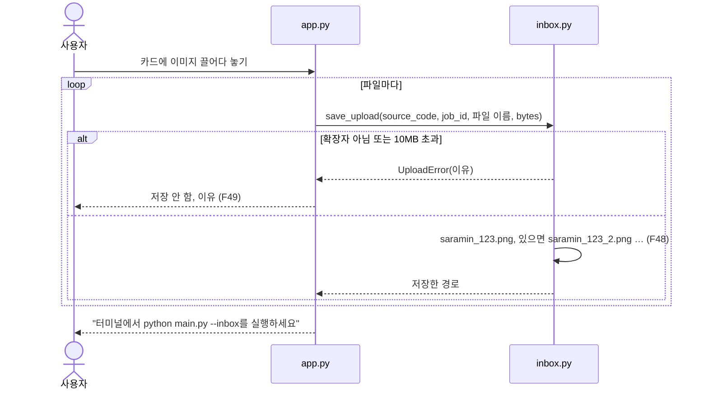

- 저장 이름의 번호는 `data/inbox/`와 `data/inbox/done/`을 함께 보고 정한다. 이미 처리한 이미지와 이름이 겹치면 done으로 옮길 때 덮어쓰기 때문이다.
- `st.file_uploader`의 `type`에 확장자를 넣지만, 크기·확장자 검사는 `save_upload`에서 다시 한다(테스트할 수 있게).
- 화면은 OCR을 돌리지 않는다 (F48).

## 프로필 (F11–F24)

### Profile 모델

Pydantic 모델로 검사한다. 칸 이름과 형식은 요구사항의 YAML 예시 그대로다.

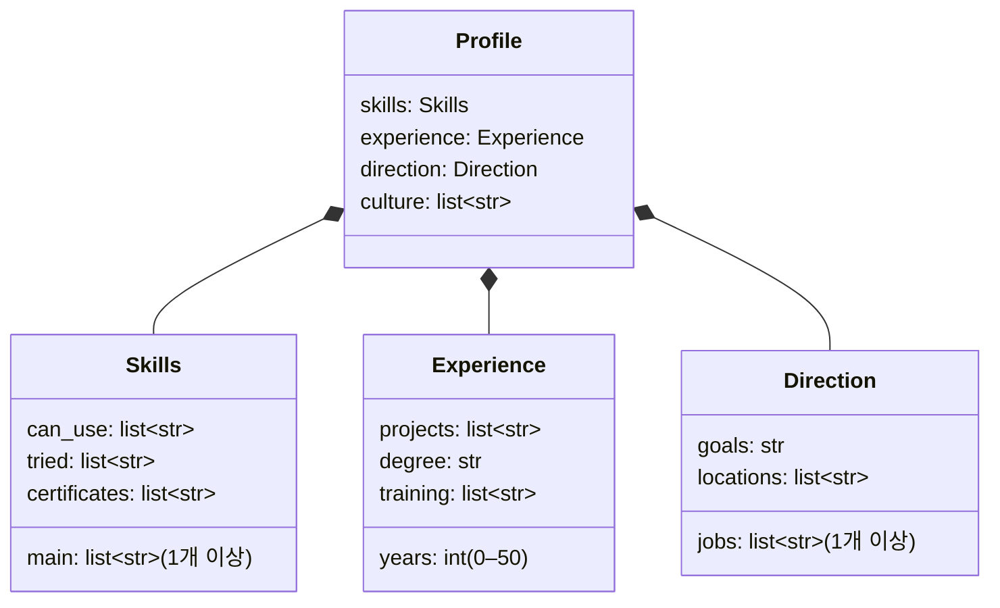

- 목록 칸에 글자 하나를 적으면(`main: Python`) 한 항목 목록으로 받는다. 빈 항목과 앞뒤 공백은 지운다.
- `years`는 정수만. `2.5`, `"2년"`, `true`는 틀림 (F12).
- 모르는 칸(F14)은 YAML dict와 모델 칸 이름을 비교해 `skills.mian`처럼 경로로 경고한다. 검사에는 영향이 없다.
- 오류 문구는 칸 경로와 이유만: "experience.years: 0–50 사이 정수여야 함". Pydantic 메시지에는 입력값이 들어가므로 그대로 쓰지 않는다 (N2).

### 읽기 흐름 (`--score`)

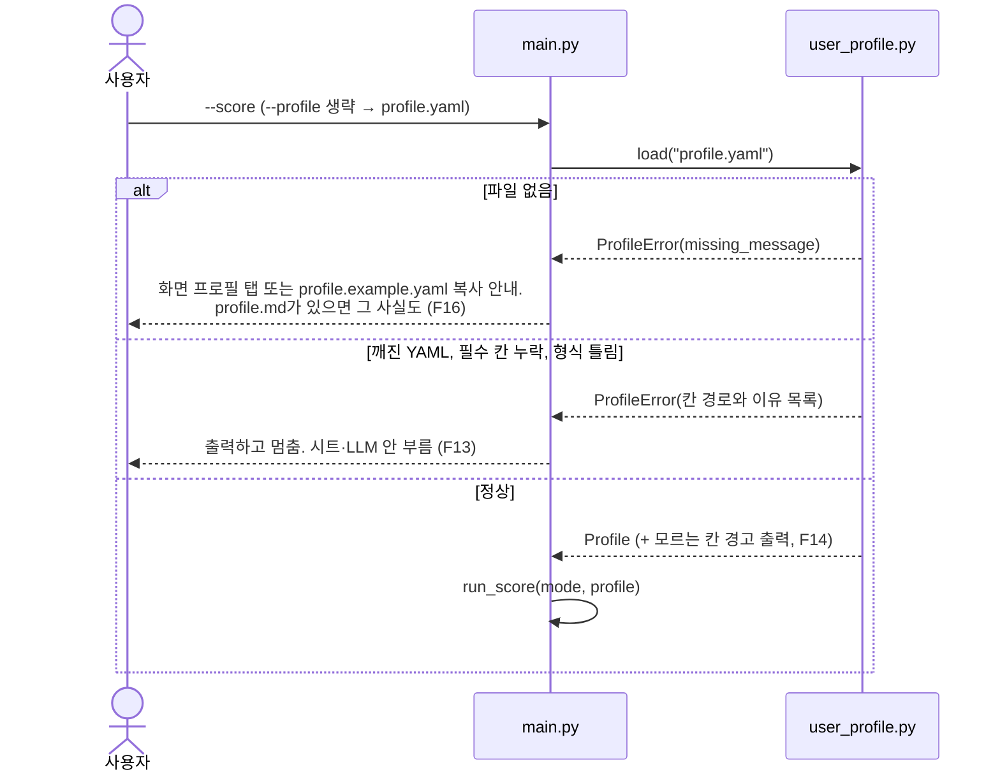

`ProfileError`는 v0.3처럼 사이트 요청과 LLM 호출 전에 난다. `--keyword ... --score all`이어도 수집 전에 멈춘다.

### 프롬프트 (F22–F24)

`to_prompt(profile)`이 LLM에 넘길 글을 만든다. 빈 칸은 "없음".

```text
## 기술
- 주력: Python, SQL
- 다룰 수 있음: Java, Git, Linux
- 써 본 적 있음: Docker, FastAPI
- 자격증: 정보처리기사
## 경력
- 경력 연수: 0년 (신입)
- 학력: 대학교 졸업(4년), 컴퓨터공학
- 프로젝트: LangGraph로 채용공고 수집·평가 에이전트 개발 (JOBVIS)
- 교육 이수: ○○ 부트캠프 백엔드 과정 수료
## 방향
- 희망 직무: 백엔드 개발, AI 서비스 개발
- 하고 싶은 일: LLM을 활용한 서비스 개발, API 서버 설계
- 희망 지역: 서울, 경기
## 문화
- 선호 문화 정보 없음
```

`ScoreState.profile`에는 이 글을, `ScoreState.years`에는 `experience.years`를 넣는다. 프롬프트 템플릿의 `{profile}` 자리는 v0.4 그대로다.

### 프로필 탭 (F17–F21)

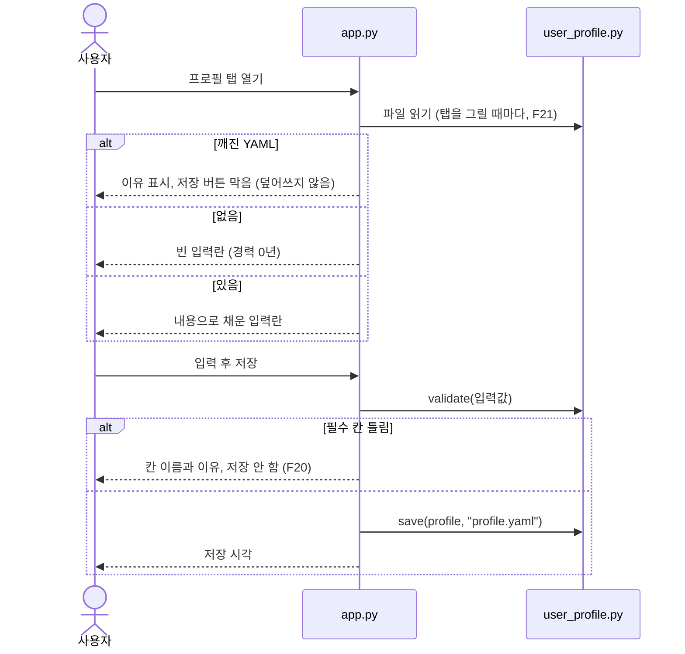

| 칸 | 입력 | ID |
| --- | --- | --- |
| 경력 연수 | `st.slider(0, 30, step=1)`. 파일 값이 30보다 크면 최댓값을 그 값으로 늘림(F12는 50까지 허용) | F18 |
| 목록 칸 | `st.text_area`, 한 줄에 하나 | F19 |
| 학력, 하고 싶은 일 | `st.text_input` | F17 |

- 입력란은 `st.form` 안에 두고 저장 버튼을 눌렀을 때만 검사·저장한다.
- 저장은 `yaml.safe_dump(allow_unicode=True, sort_keys=False)`로 요구사항 예시와 같은 칸 순서. 주석은 남지 않는다(파일을 직접 고친 주석은 화면 저장 때 사라짐을 탭에 적음).
- 저장은 임시 파일에 쓰고 바꿔 끼운다(`Path.replace`). 쓰다 실패해도 기존 파일이 깨지지 않는다.

## 점수 보정 (F25–F36)

### LLM 입출력

- 시스템 프롬프트의 `career` 기준표를 F30으로 바꾸고, 규칙에 F31 두 줄을 더한다: "제목만 보고 career를 80 이상 주지 마", "본문 주요업무에서 근거를 못 찾으면 career는 70 이하".
- 출력 JSON에 `required_years`를 더한다 (F25). 규칙: "공고가 요구하는 최소 경력 연수. 신입·경력무관은 0, 적혀 있지 않으면 null, '3~5년'이면 3".

| 필드 | 규칙 | 어기면 |
| --- | --- | --- |
| required_years | 0 이상 정수 또는 null | 빠지면 null. 음수·글자면 검증 실패(F15, 그 줄만 실패) |

### 계산 순서 (F35)

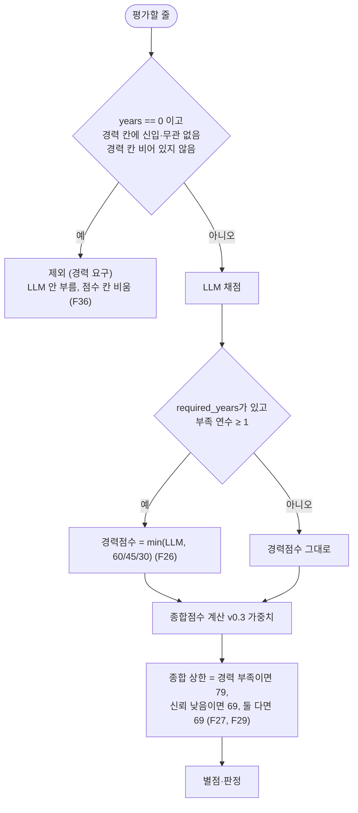

- 부족 연수 = `required_years − years`. 1 → 60, 2 → 45, 3 이상 → 30. LLM 점수가 상한 이하면 그대로이고 보정 문구도 남기지 않는다.
- 종합 상한도 계산한 점수가 상한보다 높을 때만 적용한다. F27의 "경력이 부족한 공고"는 부족 연수가 1 이상인 공고로 읽었다. LLM 경력점수가 이미 상한 아래라 경력점수를 깎지 않았어도 종합 79 상한은 건다.
- 신뢰(F28): `trust(body, with_body)`. `with_body`가 거짓(원문 파일 없음, 본문 미확보, 빈 원문)이면 낮음. 아니면 본문 상태가 "이미지 일부 못 읽음"이면 보통, 나머지(글자, 글자+이미지, 예전 줄의 빈 상태)는 높음.
- 신입 제외(F36)의 글자 판단은 `codes.matches_career`와 같은 낱말("신입", "무관")을 쓴다. 경력 칸이 비면 제외하지 않는다.

### Adjusted

`scoring.adjust(evaluation, years, trust)`가 돌려주는 값.

| 칸 | 내용 |
| --- | --- |
| experience | 보정 뒤 경력점수 |
| total, stars, verdict | 보정 뒤 종합점수·별점·판정 |
| note | "보정" 열 문구. 여러 개면 ", "로 이음. 예: `경력 75→60 (3년 요구, 2년), 종합 82→79 (경력 부족)` |

종합 상한이 둘 다 걸리면 문구는 낮은 쪽 하나만 남긴다: `종합 74→69 (신뢰 낮음)`.

### 평가 그래프

`exclude` 노드가 생긴다. `score_pick`이 꺼낸 줄이 신입 제외 대상이면 LLM을 거치지 않고 `exclude`로 간다.

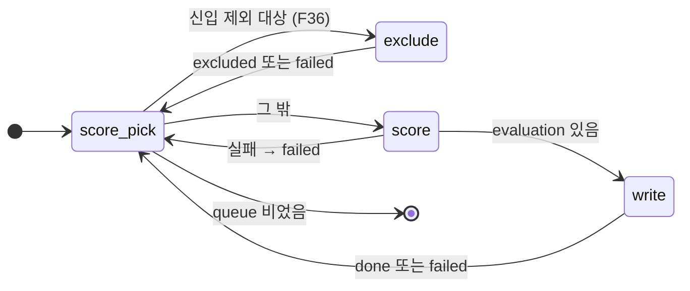

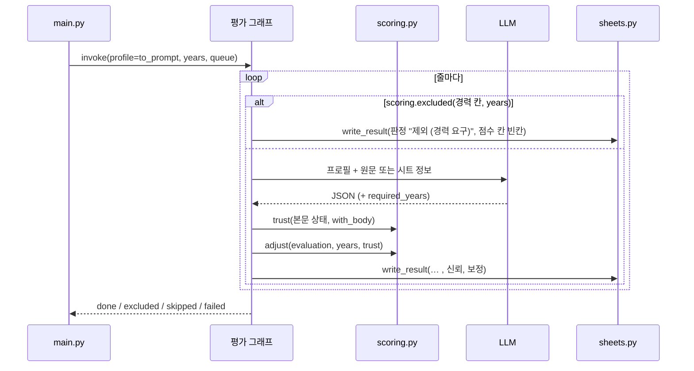

- `write`는 더 이상 판정에 "(본문 미확보)"를 붙이지 않는다 (F33).
- 제외 줄: 체크 해제, 종합점수·별점·항목 점수·강점·부족한 점은 빈칸, 판정 "제외 (경력 요구)", 평가시각, 신뢰·보정 빈칸. C열 요약과 Y–AA는 건드리지 않는다.
- `select_targets(rows, "all")`은 판정이 "제외 (경력 요구)"인 줄을 고르지 않는다. 점수 칸이 비어 있어 매번 다시 골라지기 때문이다. 다시 보고 싶으면 체크하고 `--score`로 평가한다(경력 연수를 바꾼 뒤 등).
- 결과 출력: `평가 대상 12 / 완료 8 / 제외 2 / 건너뜀 1 / 실패 1` (F36).

## 이미지 직접 넣기 (F37–F46)

### 받은함 (`--inbox`)

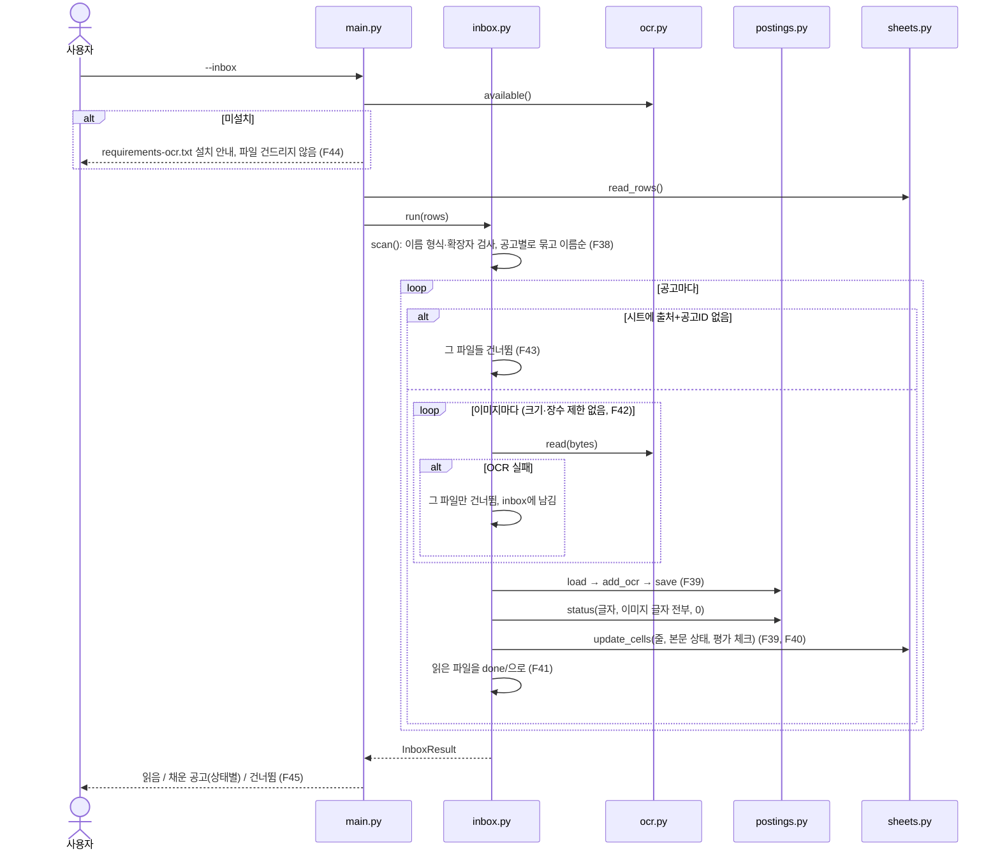

- 파일 이름 규칙: `^(saramin|jobkorea)_(\w+?)(?:_(\d+))?\.(png|jpe?g|webp)$` (대소문자 무시). 번호 없는 것이 1번이다. 정렬은 (출처, 공고ID, 번호).
- 시트 줄 찾기: `(sheets.source_code(출처 칸), 공고ID)`. 출처 칸이 빈 예전 줄은 사람인으로 본다(v0.4와 같음).
- 원문 파일 고치기: `postings.split(content)`로 글자와 이미지 글자를 나누고, 이미지 글자 뒤에 새 글자를 붙인 뒤 `compose`로 다시 쓴다. 파일이 없으면 글자 부분은 빈칸으로 새로 만든다 (F39).
- 본문 상태는 `status(글자, 이미지 글자 전부, unread=0)`로 다시 정한다. 사람이 이미지를 넣었으니 "못 읽은 이미지"는 0으로 본다. 그래서 "이미지 일부 못 읽음"이던 줄도 200자를 넘으면 "글자+이미지"가 된다.
- 상태가 바뀐 줄만 시트를 고치고 체크를 켠다 (F40). 상태가 같아도 원문 파일은 고친다.
- 두 번 붙지 않게(F41) 원문을 쓴 뒤에 파일을 옮긴다. 옮기다 실패하면 출력에 남긴다. 옮길 자리에 같은 이름이 있으면 뒤에 번호를 붙인다.
- 한 공고의 파일이 일부만 OCR에 성공하면 성공한 것만 붙이고 옮긴다. 실패한 파일은 남아서 다음 실행 때 다시 읽는다.

`InboxResult`: `read`(읽은 파일 수), `filled`(공고별 `{"source", "id", "company", "status"}`), `skipped`(`{"file", "reason"}`). 이유는 "이름 형식", "모르는 확장자", "시트에 없는 공고", "OCR 실패(예외 이름)", "옮기기 실패".

```text
읽은 이미지 3장 / 본문을 채운 공고 2건 (글자+이미지 2) / 건너뜀 1
  건너뜀: saramin_999.png (시트에 없는 공고)
다음: python main.py --score 로 체크된 공고를 다시 평가하세요
```

### 다른 사이트 본문 쓰기 (F46)

수집 그래프의 노드는 그대로이고, `dedupe`와 `save`가 하는 일이 는다.

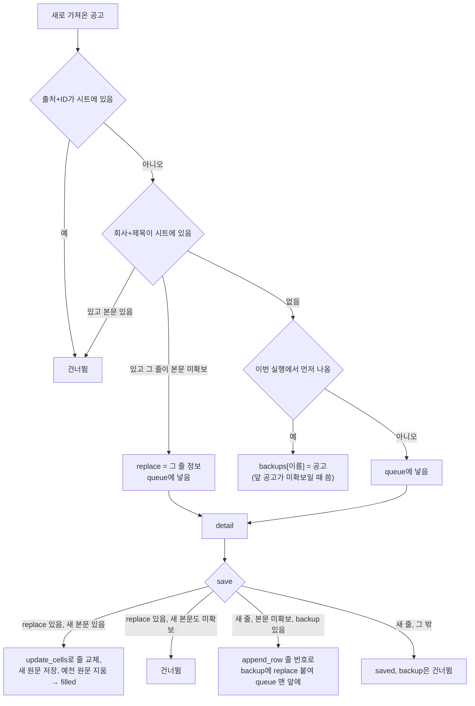

- `existing_keys()`가 세 번째 값으로 본문 미확보 줄을 돌려준다: `{(회사 정규화, 제목 정규화): {"row", "source", "id"}}`.
- 줄 교체(`update_cells`)로 쓰는 칸: 링크, 공고ID, 마감일, 경력, 출처, 지역, 본문, 평가(체크 켬). 회사명·직무·저장시각·평가 결과 칸은 두지 않고 그대로 둔다. 학력·키워드는 새 공고 값이 있을 때만 쓴다.
- 원문 파일: 새 출처·공고ID 이름으로 저장한 뒤 예전 파일을 지운다(`postings.remove`). 저장 순서가 거꾸로면 실패할 때 둘 다 잃는다.
- 같은 실행(F46 끝): 먼저 처리한 공고가 새 줄로 저장되고 본문 미확보면, `append_row`가 돌려준 줄 번호로 backup 공고를 교체 대상으로 바꿔 바로 처리한다. 먼저 공고가 본문 있음이면 backup은 건너뜀에 넣는다. 먼저 공고가 본문 실패(시트 저장 안 됨)면 backup을 보통 새 공고로 queue 맨 앞에 넣는다.
- `append_row`는 gspread 응답의 `updates.updatedRange`에서 줄 번호를 읽어 돌려준다.

State에 붙는 칸:

| 칸 | 채우는 곳 | 내용 |
| --- | --- | --- |
| backups | dedupe, save | `{(회사, 제목) 정규화: 공고}`. 이번 실행에서 뒤에 나온 같은 공고 |
| filled | save | 본문을 채운 줄 `{"source", "company", "title", "status"}` (`Annotated[list, operator.add]`) |

공고 dict에는 교체 대상일 때 `replace = {"row", "source", "id"}`가 붙는다.

결과 출력에 한 줄을 더한다: `본문 채움 1건: 잡코리아 공고 본문으로 바꿈 (○○회사 | 백엔드 개발자)`. 사이트별 줄의 "새로 저장"에는 넣지 않고 "건너뜀"에도 넣지 않는다. 가져옴 = 저장 + 건너뜀 + 실패 + 채움.

## 시트 열

v0.4의 A–AA열은 그대로 두고 뒤에 붙인다.

| 열 | v0.5 | 채우는 단계 |
| --- | --- | --- |
| N | 판정. "(본문 미확보)"를 붙이지 않음. "제외 (경력 요구)"가 늚 (F33, F36) | 평가 |
| P | 경력점수. 보정 뒤 값 (원래 값은 AC에) | 평가 |
| X | 본문 상태. `--inbox`와 F46도 고침 | 수집, 받은함 |
| K | 평가 체크. `--inbox`와 F46이 켬 (F40, F46) | 받은함, 수집 |
| AB | 신뢰 (높음 / 보통 / 낮음) | 평가 (F32) |
| AC | 보정 | 평가 (F32) |

- 첫 줄이 v0.4 제목 줄(A–AA)이면 v0.5 제목 줄로 바꾼다. 그보다 예전 제목 줄도 바로 v0.5로 (v0.4 규칙 그대로).
- `write_result(row, summary, values, extra, tail)`: C, K–U, Y–AA, AB–AC를 한 번의 `batch_update`로. 제외 줄은 `summary=None`, `extra=None`이면 C와 Y–AA를 건너뛴다.
- `update_cells(row, {"제목": 값})`: 제목 이름으로 열을 찾아 그 칸들만 한 번의 `batch_update`로 쓴다. 받은함과 F46이 쓴다.

## main 실행 옵션

| 옵션 | 바뀜 | ID |
| --- | --- | --- |
| `--profile` | 기본 `profile.yaml` | F11 |
| `--inbox` | 새로 생김. 다른 작업 옵션(`--keyword`, `--score`, `--gaps`)과 함께 쓰면 오류 | F37 |

- `profile.yaml`이 없을 때 안내(F16):

```text
프로필 파일이 없습니다: profile.yaml
만드는 방법: streamlit run app.py 를 열어 프로필 탭에서 저장하거나, profile.example.yaml 을 profile.yaml 로 복사해 채우세요.
예전 profile.md 가 있습니다. 내용을 옮겨 적어 주세요 (자동으로 바꾸지 않습니다).
```

## 파일

| 파일 | 바뀜 |
| --- | --- |
| `app.py` | 새로 |
| `profile.example.yaml` | 새로 (요구사항 예시 그대로, 주석 포함). `profile.example.md` 지움 (F15) |
| `.gitignore` | `profile.yaml` 추가. `profile.md`는 예전 파일 보호로 남김. `data/`는 이미 있음 (N1, N7) |
| `requirements.txt` | `streamlit>=1.50`, `PyYAML>=6.0` 추가 (N3) |
| `README.md` | 프로필 만드는 방법, `streamlit run app.py`, `--inbox` |

## 설계 결정

| 결정 | 이유 | 다시 볼 시점 |
| --- | --- | --- |
| 화면 로직은 `view.py`, `app.py`는 그리기만 | Streamlit 없이 테스트할 수 있음 (N5). 화면을 바꿔도 정렬·필터 규칙은 그대로 | 화면이 커지면 탭별 파일로 |
| 화면용 시트 읽기를 따로 둠 (`read_rows_readonly`) | `_sheet()`는 제목 줄을 고치고 체크박스 규칙을 거는 쓰기를 함. 화면은 시트에 쓰지 않음 (F8) | - |
| 프로필 검사는 Pydantic | 이미 평가 응답 검사에 씀. 의존성이 늘지 않음. 칸 경로가 오류 위치로 나옴 | - |
| 프로필 오류에 입력값을 쓰지 않음 | 개인정보 (N2) | - |
| 보정은 `scoring.py`에 | 종합점수 계산 순서 한가운데에 들어가서 나누면 순서(F35)가 두 곳에 흩어짐 | 보정 규칙이 크게 늘면 |
| 신입 제외는 그래프 노드(`exclude`) | LLM을 부르지 않는 갈림길이 그래프 그림에 드러남. 출력 집계(`excluded`)도 State에서 바로 | - |
| `--score all`은 제외 줄을 다시 고르지 않음 | 점수가 비어 매번 골라지고 매번 같은 결과가 됨 | - |
| 받은함은 그래프가 아닌 함수 | LLM도 갈림길도 없음. 노드로 쪼개면 읽기만 어려워짐 | - |
| 받은함 상태는 unread 0으로 다시 계산 | 사람이 고른 이미지를 넣은 것이라 남은 못 읽은 이미지를 알 수 없음. 남아 있다면 사용자가 더 넣으면 됨 | 다시 "일부 못 읽음"이 필요하다는 사용 경험이 나오면 |
| 원문 저장 → 시트 → 파일 옮기기 순서 | 중간에 멈춰도 이미지가 inbox에 남아 다시 처리됨. 시트까지 썼는데 옮기기만 실패하면 다음 실행 때 글자가 두 번 붙을 수 있어, 옮기기 실패를 출력에 남김 | - |
| F46 같은 실행 중복은 backup으로 | 시트 줄 번호를 알아야 교체할 수 있어 앞 공고 저장을 먼저 끝냄 | - |
| 의존성 | `streamlit`(화면), `PyYAML`(이미 설치돼 있음). 차트는 `st.bar_chart` | - |

## 테스트 계획

모두 가짜 데이터, 외부 요청 없음 (CLAUDE.md, N5, N6, N8). 시트·OCR·LLM은 가짜로 바꾸고, 파일은 `tmp_path`에서.

| 대상 | 정상 | 실패·경계 |
| --- | --- | --- |
| view.cards | 점수순 정렬, 같은 점수는 줄 순, 평가 전·제외는 아래 | 점수 칸에 글자, 빈 칸 "없음", 출처 빈 줄 "미상", v0.4 판정 "(본문 미확보)" → 신뢰 낮음 |
| view.apply / options / chart | 출처·경력 필터, 평가 전 끄기 | 경력 빈 줄 "(없음)", 같은 막대 이름 번호 |
| view.error_message | 인증·시트·네트워크 문구 | 메시지에 경로나 키가 있어도 문구에 안 나옴 |
| sheets.read_rows_readonly | 열 위치로 읽음 | 예전 제목 줄이어도 쓰기 호출 없음 |
| user_profile | 예시 파일 읽기, 목록 한 글자, to_prompt 네 제목 | 필수 칸 누락 셋, years 2.5·"2년"·51, 깨진 YAML, 모르는 칸 경고, 빈 파일, 파일 없음 + profile.md 있음 안내, 오류에 입력값 없음, 문화 빈칸 "선호 문화 정보 없음" |
| user_profile.save | 칸 순서, 한글 그대로 | 저장 실패해도 기존 파일 유지 |
| scoring.adjust | 부족 0·1·2·3·5년, 상한보다 낮은 점수 그대로 | required_years null, 경력 부족 + 신뢰 낮음(69), 보정 문구 |
| scoring.trust / excluded | 신뢰 세 단계 | 경력 칸 "경력 3년↑"·"신입·경력"·"경력무관"·빈칸, years 1 이상이면 제외 안 함 |
| Evaluation | required_years 0·3·null | 빠짐 → null, 음수·글자 → 실패 |
| 평가 그래프 | 보정 값과 AB·AC 저장, 판정에 "(본문 미확보)" 없음 | 제외 줄은 LLM 안 부름(가짜 LLM 호출 수 0), 프롬프트에 방향 규칙·to_prompt 글 |
| select_targets | all에서 제외 줄 안 고름 | checked면 제외 줄도 고름 |
| inbox.parse_name / scan | 번호 있음·없음, 이름순 | 틀린 이름, 모르는 확장자, 대문자 확장자 |
| inbox.run | 원문에 붙임, 상태 바뀌면 체크, done 이동 | 시트에 없는 공고, 원문 파일 없음, OCR 실패한 파일만 남음, 여러 장 순서, 다시 실행해도 안 붙음, done 이름 겹침 |
| inbox.save_upload | 이름 번호 올림(inbox·done 둘 다 봄) | 확장자 아님, 10MB 초과 |
| main --inbox | 결과 출력 | OCR 미설치면 파일 안 건드림, 다른 옵션과 함께 쓰면 오류 |
| 수집 그래프 F46 | 시트의 미확보 줄을 새 공고로 교체, 예전 원문 지움, 체크 켬 | 새 본문도 미확보 → 건너뜀, 같은 실행 두 사이트(앞 미확보/앞 본문 있음/앞 실패), 결과의 "본문 채움" 수 |
| main --score | profile.yaml 읽기 | 프로필 없음 안내, 필수 칸 틀리면 시트·LLM 전에 멈춤 |
| app.py | `streamlit.testing.v1.AppTest`로 가짜 시트 줄 3개를 넣어 탭 두 개와 카드 수 확인 | 시트 읽기 오류 문구, 빈 시트 안내 |

## 미확인

- `st.file_uploader`의 끌어다 놓기가 윈도우 PC 브라우저에서 사람인 이미지(webp 등)를 그대로 받는지. 구현 뒤 PC에서 확인.
- 사람이 저장한 공고 이미지에서 PaddleOCR이 v0.4 시험처럼 읽는지(13–16초/장). 실제 이미지로 확인 전.
- 보정 상한 숫자(60/45/30, 79, 69)가 실제 공고에서 알맞은지. 요구사항대로 넣고 써 보며 판단.
- LLM이 `required_years`를 "3~5년" → 3처럼 일관되게 주는지. 가짜 응답으로만 시험함.
- gspread `append_row` 응답의 `updatedRange` 형식(줄 번호 읽기). 구현 때 문서와 실제 응답으로 확인.
