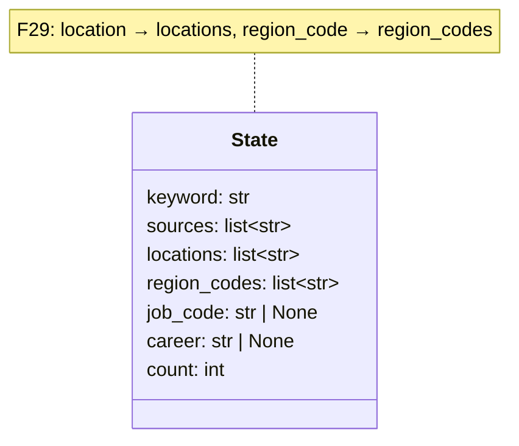
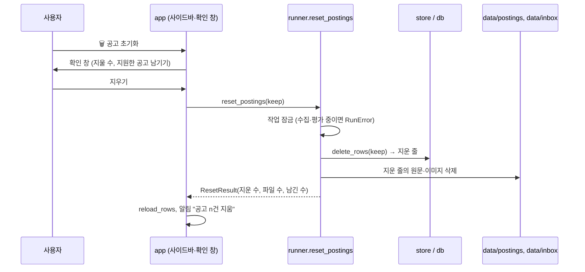
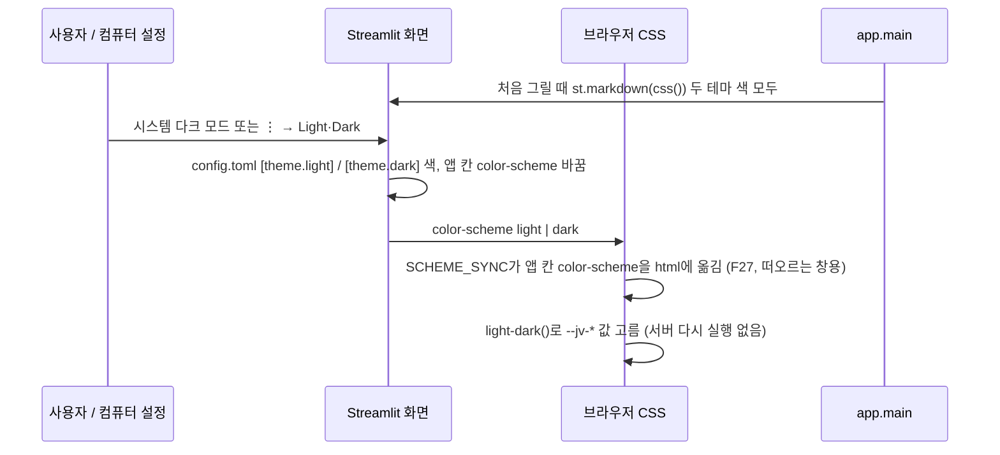

# v0.6.1 설계

모듈 구조, 호출 순서, 저장 칸은 v0.6과 같다. 그래서 UML은 [v0.6 설계](../v0.6/02-design.md)를 그대로 쓴다. 바뀌는 곳은 `app.py`(화면·CSS·키 삭제), `agent/resume.py`(합치기), `agent/settings.py`(`delete_key`, `redact` 함수 추가), `runner.error_text`·`reports`(가리기 호출), `docker-compose.yml`·`Dockerfile`이다. 새 모듈과 State 필드는 없다. 보완 3차(F21–F23)는 `app.py`에 `chart_spec()` 함수 하나, 팔레트 이름 몇 개, `.streamlit/config.toml` 어두운 테마 값만 바뀐다. 보완 4차(F24–F25)는 `reload_profile()` 추가와 `css(theme)` → `css()`(테마 흐름은 아래 D21 그림).

## 결정

| ID | 결정 | 이유 |
| --- | --- | --- |
| D1 | 제목 색은 테마 색표에 `title`을 더해 밝은 `#111111`, 어두운 `#ffffff` (F1) | 밝은 바탕에서 흰 글자는 안 보임 |
| D2 | 키 칸은 `key-card` 컨테이너, 폼 안 `st.columns([5, 1])`에 입력란(이름 숨김)과 저장 (F2) | 카드 하나 높이를 3줄 → 2줄 |
| D3 | 카드는 `[체크+점수, 회사·직무, 버튼]` 세 칸. CSS로 체크 칸 4.6rem·버튼 칸 7rem 고정, 가운데 칸만 줄어듦, 카드 안 칸 줄바꿈 금지 (F4) | 네 칸일 때 좁은 창에서 가운데 칸이 없어지고 글자가 잘림 |
| D4 | 결과는 `st.toast`. 같은 작업(`label-started`)은 `session_state`에 기록해 한 번만 (F5) | 작업이 끝난 뒤 화면을 다시 그릴 때마다 알림이 또 뜨지 않게 |
| D5 | 고르기 칸은 키워드 목록 칸에 `flex-wrap: wrap`, 바깥 칸 `max-height` 해제 (F7) | Streamlit 1.66은 한 줄 + 가로 스크롤이라 마우스 휠로 못 움직임 |
| D6 | `resume._same()`: 띄어쓰기를 하나로 줄이고 소문자로 바꾼 글자로 비교. 채울 때 목록 칸 모두 거침 (F8) | 글자가 아예 다른 중복("…네트워크" vs "…과정")은 프롬프트 규칙으로만 줄임 |
| D7 | 프로필 칸 높이는 칸을 감싼 `stLayoutWrapper`가 늘어나게 하고 칸 `height: 100%` (F9) | 칸 자체가 아니라 감싼 칸이 내용 높이로 멈춰 있었음 |
| D8 | `settings.redact(text)`: 지금 환경의 `GOOGLE_API_KEY`·`ANTHROPIC_API_KEY` 값(8자 이상)을 `••••`로 바꿈. `runner.error_text`(작업·버튼 오류 전부), `reports`의 실패·멈춤 줄에서 부름 (F12) | 오류 글이 화면으로 나가는 길목이 이 둘. 짧은 값은 흔한 글자까지 가려서 건너뜀 |
| D9 | Docker CMD에 `--client.showErrorDetails=type` (F12) | 잡지 못한 예외의 메시지·경로가 화면에 안 나감. 로그에는 남음 |
| D10 | `settings.delete_key()`: `dotenv.unset_key`로 `data/settings.env`에서 지우고 `os.environ`에서 뺌. 파일에서 지웠는지 돌려줘 화면 안내를 고름 (F14) | `.env`는 사용자 파일이라 고치지 않음 |

## 보완 결정 (F15–F20)

| ID | 결정 | 이유 |
| --- | --- | --- |
| D11 | `reload_after_job()`: 화면을 그릴 때마다 마지막 작업이 끝났고 아직 다시 읽지 않았으면(`session_state["reloaded_job"]`이 `label-started`와 다르면) `reload_rows()`. 진행 막대가 끝을 볼 때도 같은 표시를 남겨 두 번 읽지 않음 (F16) | 진행 막대는 그 회차에 작업이 돌고 있을 때만 그려진다. 재현은 못 했지만 작업이 그 사이에 끝나면 다시 읽기를 놓칠 수 있는 길이 이것뿐 |
| D12 | 키는 `@st.dialog` 창. 저장은 폼 버튼 콜백(`save_key`)에서 하고, 저장 뒤 창 안에서 `st.rerun()`으로 닫음. 오류·삭제 안내가 남아 있으면 다음 회차에 창을 다시 띄움 (F17) | 창 안 버튼은 창 부분만 다시 그리므로 콜백이어야 저장이 확실함 |
| D13 | 창은 한 번에 하나라, 키가 없으면 키 창이 먼저, 키를 넣은 뒤 사용법 창 (F17) | 처음 쓰는 사람이 키부터 넣게 |
| D14 | 이력서 칸은 `st.expander(expanded=프로필 비었음 or 채운 값 있음)` (F18) | 막지 않고 접어서 글을 줄임 |
| D15 | 사이드바 `background: var(--jv-paper)`, 필터는 `box-filter` 컨테이너(카드 CSS 그대로) (F20) | 메인 카드와 같은 규칙을 그대로 씀 |

## 보완 결정 (F21–F23)

| ID | 결정 | 이유 |
| --- | --- | --- |
| D16 | 팔레트에 `sel`·`sel-text`를 두고 `-on` 칸의 면·글자에 씀 (F21) | 요약 칸 4색과 겹치지 않는 색이 뒤집은 색뿐 |
| D17 | 팔레트에 글자색 `text`를 따로 둠. 지금까지 `ink`(테두리·그림자)를 글자에도 써서 어두운 테마에서 테두리를 차분하게 하면 글자가 흐려졌음. 판정 배지·내 기술 칩 색(`high`·`mid`·`low`·`closed`·`badge-text`)도 팔레트로 옮김 (F22) | 어두운 테마 배지가 밝은 테마 색 그대로라 눈부심 |
| D18 | `.streamlit/config.toml` `[theme.dark]`를 팔레트와 같은 값으로 맞춤(바탕 `#14161a`, 글자 `#e5e7eb`, 테두리 `#4b5563`, 주 색 `#059669`) (F22) | 입력란·버튼 같은 Streamlit 기본 요소도 같은 계열로 |
| D19 | TOP 5는 `st.bar_chart` 대신 `st.vega_lite_chart(spec=chart_spec(data))`. 명세에 `params`(선택·확대)가 없어 움직이지 않음. 축 0–100 고정, 이름 260px까지 (F23) | `st.bar_chart`는 늘 `.interactive()`를 붙여 끌기·확대가 됨. 새 의존성 없이 Streamlit 안에서 해결 |

## 보완 결정 (F24–F25)

| ID | 결정 | 이유 |
| --- | --- | --- |
| D20 | `reload_profile()`: `CLEARED`·`FILL`을 버리고 모든 칸의 `GENERATION`을 올림. 🔄 새로고침에서 `reload_rows()` 다음에 부름 (F24) | 입력란 key가 바뀌어야 저장 안 한 입력도 버려지고 파일 값으로 다시 그려짐. ↺·전체 초기화와 같은 방식 |
| D21 | `css()`는 인자 없이 모든 색을 `--jv-이름: light-dark(밝은, 어두운)`으로 넣음. `st.context.theme.type`은 쓰지 않음 (F25) | Streamlit이 테마에 따라 앱 칸에 `color-scheme`을 정하므로 브라우저가 바로 고름. 서버가 다시 그릴 때까지 기다리지 않음. Chrome·Edge 123, Firefox 120, Safari 17.5 이상 필요 |

## 보완 결정 (F26)

| ID | 결정 | 이유 |
| --- | --- | --- |
| D22 | 피그마 색은 팔레트 이름으로만 넣음(`lime`, `blue`, `accent`, `track`, `mint`, `dot`, `title-edge` 추가, `green`·`highlight` 뺌). `config.toml` 두 테마도 같은 값 | F25 `light-dark()` 구조를 그대로 써서 두 테마가 같이 바뀜 |
| D23 | 글꼴은 CSS `@import`로 Google Fonts의 Black Han Sans를 제목·숫자·칸 제목에만 씀. 본문은 Streamlit 기본 글꼴 | 새 의존성 없음. 인터넷이 없으면 기본 글꼴로 보일 뿐 동작은 같음 |
| D24 | 점수 도넛 원은 `.jv-score`에 `style="--p:점수"`를 주고 `conic-gradient`로 그림. 평가 전은 `--p` 없이 빈 원 | 이미지·라이브러리 없이 CSS만으로 |
| D25 | 카드 색 띠는 카드 머리 글 끝의 빈 표시 ``를 CSS `:has()`로 찾아 카드 왼쪽 테두리를 바꿈. 카드 key는 그대로 | key를 바꾸면 기존 테스트·상태 key가 흔들림 |
| D26 | 주 버튼 색은 CSS로 라임·검정 글자. `primaryColor`는 토글·선택 표시용으로 코발트 | Streamlit 주 버튼 글자는 흰색이라 라임 면에서 안 읽힘 |

## 보완 결정 (F27)

| ID | 결정 | 이유 |
| --- | --- | --- |
| D27 | 원인: 떠오르는 창은 앱 칸(`.stApp`) 밖(body 아래)에 그려져서, Streamlit이 앱 칸에만 정한 `color-scheme`을 받지 못하고 `light-dark()`가 밝은 값을 고름. `st.html(SCHEME_SYNC, unsafe_allow_javascript=True)`로 작은 스크립트를 넣어 앱 칸의 `color-scheme`을 0.3초마다 `html`에 옮겨 적음. 스크립트가 못 돌면 `:root { color-scheme: light dark }`로 컴퓨터 설정을 따름 | CSS만으로는 앱 칸 밖에서 Streamlit 테마를 알 방법이 없음. 스크립트는 고정 글이고 사용자 입력이 들어가지 않음 |

| D28 | 요약 칸도 프로필 칸(D7)과 같이 감싼 `stLayoutWrapper`를 늘리고 칸 `height: 100%` (F28) | 같은 방법이 이미 프로필에서 확인됨 |

## 보완 결정 (F29–F30)

| ID | 결정 | 이유 |
| --- | --- | --- |
| D29 | State `location`·`region_code`(글자 하나)를 `locations`·`region_codes`(목록)로 바꿈. `runner.collect_state`가 목록이나 "서울,경기" 글자를 받아 겹친 이름을 빼고 코드로 바꿈. 모르는 이름이 하나라도 있으면 요청 전에 멈춤(v0.2 F11 그대로). 사람인 `loc_mcd`는 코드를 쉼표로 이음. 잡코리아는 `codes.matches_location`이 이름 중 하나라도 들어 있으면 남김. 화면 기본값은 `runner.default_regions(profile)` | 화면·터미널이 같은 함수를 씀(v0.5.2 F14). 사람인 검색 화면이 여러 지역을 쉼표로 넘기는 모양을 따름(실제 응답은 미확인) |
| D30 | `db.delete_rows(keep_applied)`가 지울 줄을 읽고 지운 뒤 돌려줌. `store.delete_rows`는 DB일 때만, 시트면 `StorageError`. `runner.reset_postings`가 작업 잠금 안에서 지우고, 지운 줄의 (출처, 공고ID)로 `data/postings/출처_ID.txt`와 `data/inbox`·`done`의 같은 이름 이미지를 지움. 이름 형식이 아닌 파일·남긴 공고 파일은 그대로. 화면은 `st.dialog` 확인 창, 지우기는 버튼 콜백에서(창 안만 다시 그려질 때도 지움), 못 지우면 창에 이유를 다시 보임 | 남긴 공고의 원문·이미지까지 지우면 다시 평가할 때 본문이 사라짐. 작업 중 지우면 수집이 지운 공고를 다시 쓸 수 있어 같은 잠금으로 막음 |

v0.5.3 다크 모드 흐름은 아래로 바뀜.

CSS는 v0.5.1 N5처럼 key로 붙는 `st-key-*` 클래스와 `data-testid`에만 건다. Streamlit 판을 올리면 F4·F7·F9 모양을 다시 확인한다.
