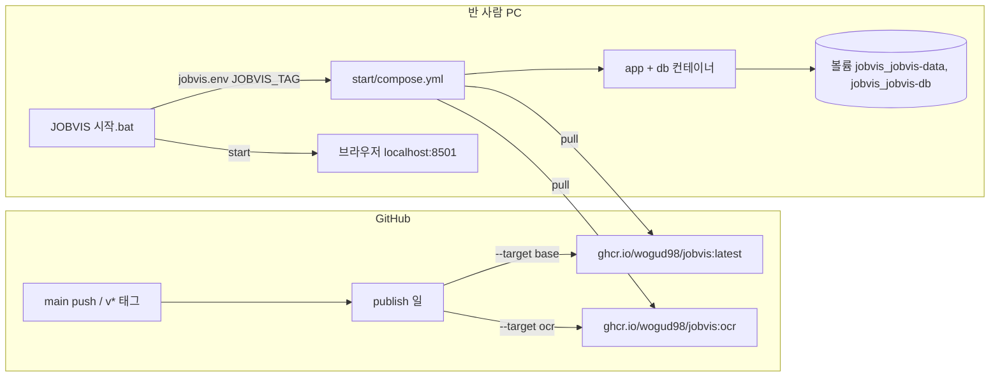
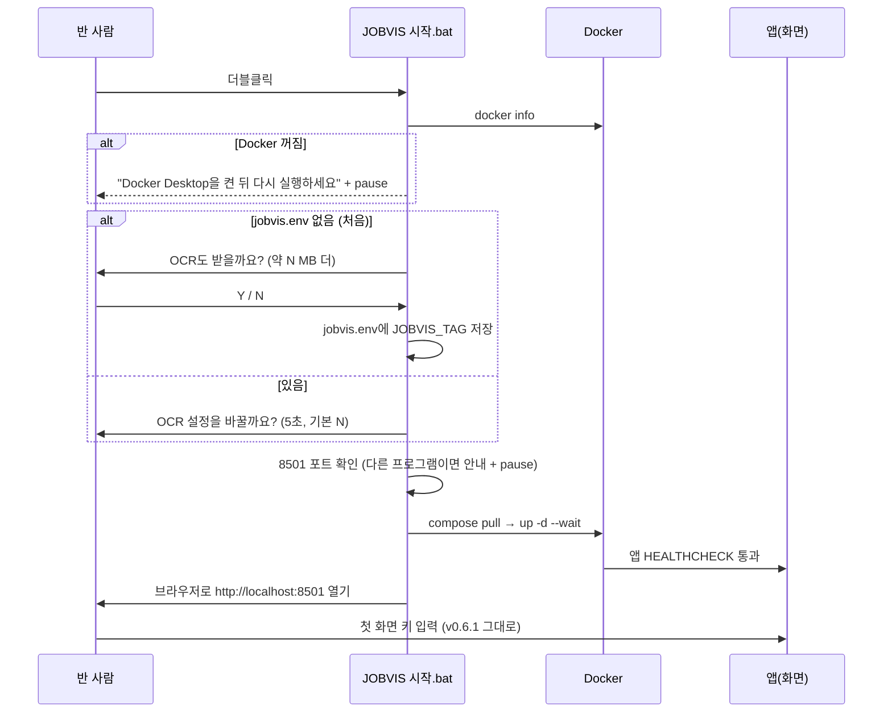
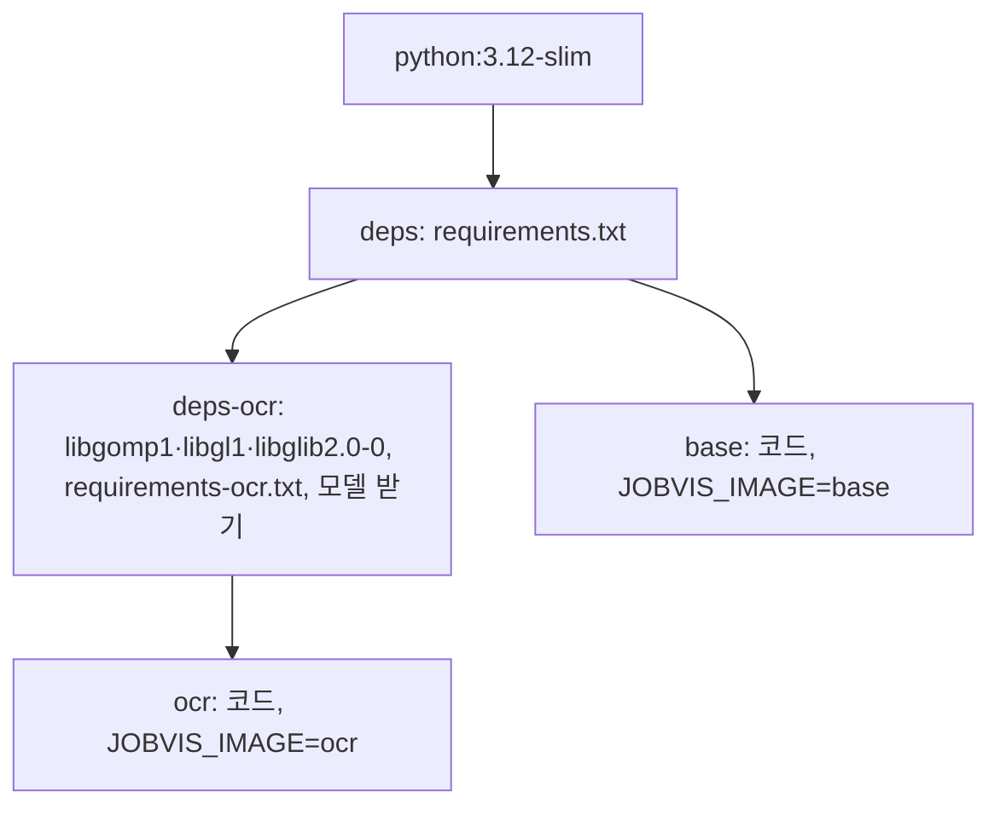

# v0.6.2 설계

기준 문서: [01-requirements.md](01-requirements.md) (2026-10-22 확정, F1–F11, N1–N4). 기준 코드는 v0.6.1(PR #50).

수집·평가 그래프, 화면 동작, DB 표는 바뀌지 않음. 바뀌는 곳은 "이미지를 어떻게 만들고 나누어 주나"와 "반 사람이 어떻게 켜나"임.

## 정할 것 확인

| 질문 | 확인 | 결정 |
| --- | --- | --- |
| 저장소가 private이어도 GHCR 이미지만 공개할 수 있나 | GitHub 문서: 저장소와 연결된 패키지는 "접근 권한은 저장소를 따르지만 공개 범위는 따르지 않음". 패키지 설정 Danger Zone에서 따로 공개로 바꿈. 공개 컨테이너 패키지는 로그인 없이 받음. **한 번 공개하면 다시 비공개로 못 바꿈** ([문서](https://docs.github.com/en/packages/learn-github-packages/configuring-a-packages-access-control-and-visibility)) | 됨. 처음 올린 뒤 재리가 패키지 설정에서 공개로 바꿈(한 번만) |
| 기본 이미지가 실제로 줄어드나 | CI 실측: OCR 없음 받는 크기 약 257MB·풀린 크기 730MB, OCR 포함 약 819MB·2.23GB | 받는 크기 약 3배 차이라 나눔(F5–F8 유지). OCR은 약 560MB 더 받음 |
| 시작 파일 묶음 받는 방법 | 저장소가 private이라 Releases는 반 사람이 못 받음 | 지금은 저장소 `start/` 폴더를 zip으로 반 채팅방에 나눔. 저장소를 public으로 바꾼 뒤 Releases로 옮김(다음 버전 후보) |

## 결정

| 번호 | 결정 | 이유 |
| --- | --- | --- |
| D1 | `Dockerfile` 단계: `deps`(requirements.txt) → `deps-ocr`(+ 시스템 라이브러리, OCR 라이브러리, 한국어 모델) / `base` = `deps` + 코드, `ocr` = `deps-ocr` + 코드. `--target`으로 고름. 저장소 compose는 `target: ocr`이라 v0.6과 같음 (F5, F8, F10) | 파일 하나로 두 이미지를 만들고 라이브러리 층을 나눠 씀. 코드만 바뀌면 OCR 층(라이브러리·모델)을 다시 만들지 않음 |
| D2 | 이미지 이름 `ghcr.io/wogud98/jobvis`. 태그는 기본 `latest`, OCR `ocr`. 버전 태그(`v0.6.2`)를 올리면 `0.6.2`, `0.6.2-ocr`도 붙임 (F9) | 시작 파일은 태그 하나(`JOBVIS_TAG`)만 바꿔 고름 |
| D3 | 새 일 `publish`(`.github/workflows/publish.yml`): main push와 `v*` 태그 push에서 두 이미지를 만들어 `GITHUB_TOKEN`(`packages: write`)으로 올림. 올리기 전 `scripts/check_image.sh`가 이미지 `/app`에 `.env`·`service_account.json`·`profile.yaml`·`data/`·`*.json`이 없는지 검사. 이미지에 `org.opencontainers.image.source` 라벨을 붙여 저장소와 연결 (F9, N4) | 따로 키를 만들지 않음. 검사가 실패하면 올리지 않음 |
| D4 | 기존 `Docker` 일(CI)은 두 단계를 모두 빌드하고, 기본 이미지에 `paddleocr`가 없는지·OCR 이미지에 모델이 있는지 확인 (N3) | PR에서 깨지는 것을 main 전에 잡음 |
| D5 | 기본 이미지는 `JOBVIS_IMAGE=base` 환경변수를 가짐. `ocr.INSTALL_HINT`가 이 값을 보고 "OCR을 쓰려면 `JOBVIS 시작.bat`을 다시 열고 OCR 포함을 고르세요(약 N MB 더 받음)"로 바뀜 (F7) | 화면 안내 자리는 v0.5.2 F11 그대로. pip 안내는 Docker 사용자에게 틀린 말 |
| D6 | 시작 파일 묶음은 저장소 `start/` 폴더: `JOBVIS 시작.bat`, `JOBVIS 끄기.bat`, `compose.yml`(빌드 없이 GHCR 이미지만 씀) (F1–F4) | 묶음은 파일 3개. 소스 코드 없이 됨 |
| D7 | 두 compose 파일 모두 맨 위 `name: jobvis`. 볼륨 이름이 폴더 이름과 상관없이 `jobvis_jobvis-data`, `jobvis_jobvis-db` (F6, F10) | 저장소에서 쓰던 사람이 묶음으로 바꿔도, 묶음 폴더 이름이 달라도 키·프로필·공고가 이어짐 |
| D8 | OCR 답은 묶음 폴더의 `jobvis.env`에 `JOBVIS_TAG=latest` 또는 `ocr`로 남김. `docker compose --env-file jobvis.env`로 읽음 (F5) | 사람이 열어 봐도 뜻이 보임. 키는 넣지 않음. `.gitignore`에 추가 |
| D9 | 바꾸기: 시작할 때 "OCR 설정을 바꿀까요? (5초 안에 Y)"를 `choice /t 5 /d N`로 물음. Y면 다시 물어 `jobvis.env`를 고쳐 씀 (F6) | 파일을 지우거나 고칠 줄 몰라도 됨. 기다리면 그냥 켜짐 |
| D10 | 시작 순서: `chcp 65001` → `docker info`로 Docker 확인 → 처음이면 OCR 물음 → 8501 포트를 다른 프로그램이 쓰는지 확인(`netstat`) → `docker compose pull` → `up -d --wait`(앱 HEALTHCHECK) → `start http://localhost:8501`. 실패하면 원인·할 일을 보이고 `pause` (F1, F2, F4) | `--wait`가 앱이 준비될 때까지 기다려 줌. 키는 어디에도 출력하지 않음(키는 볼륨 안 파일에만 있음) |
| D11 | `.gitattributes`에 `*.bat text eol=crlf` (F1) | 줄 끝이 LF면 cmd가 줄을 잘못 읽음 |
| D12 | README 맨 위 "반 사람용 시작하기"를 묶음 기준으로 고치고, `git clone` 빌드는 "직접 빌드하기"로 아래에 둠 (F11) | |

## 보완 결정 (F12)

| 번호 | 결정 | 이유 |
| --- | --- | --- |
| D13 | `sheets.collect_keys`가 본문 미확보 줄 정보에 `scored`(종합점수 칸이 비었는지)를 더함. 같은 실행에서 방금 저장한 줄은 `scored: False`. `graph._fill`은 `scored`일 때만 `"평가": True`를 씀 | 다시 평가할 이유가 있는 줄(이전 점수가 옛 본문 기준)만 표시. 평가 전 줄은 "평가 전 전부 평가"에 이미 들어감 |

## 구성

## Dockerfile 단계

## 테스트 계획

- `ocr.INSTALL_HINT`: `JOBVIS_IMAGE=base`면 시작 파일 안내, 아니면 pip 안내 (F7).
- `start/compose.yml`: `build` 없음, 이미지 `ghcr.io/wogud98/jobvis:${JOBVIS_TAG:-latest}`, `name: jobvis`, 포트 `127.0.0.1:8501`, 키 환경변수 없음, 볼륨·DB 설정이 루트 `docker-compose.yml`과 같음 (F2, D7).
- `.bat`: CRLF, `chcp 65001`, `--env-file jobvis.env`, 실패 때 `pause`, 키 관련 글자(`GOOGLE_API_KEY` 등) 없음 (F1–F4). 실제 실행은 Windows에서 손으로(N1).
- Docker CI: 두 단계 빌드, 기본 이미지에 `paddleocr` 없음, 비밀 파일 없음(N3, N4). 크기는 CI 로그와 작업 환경에서 잼(N2).
