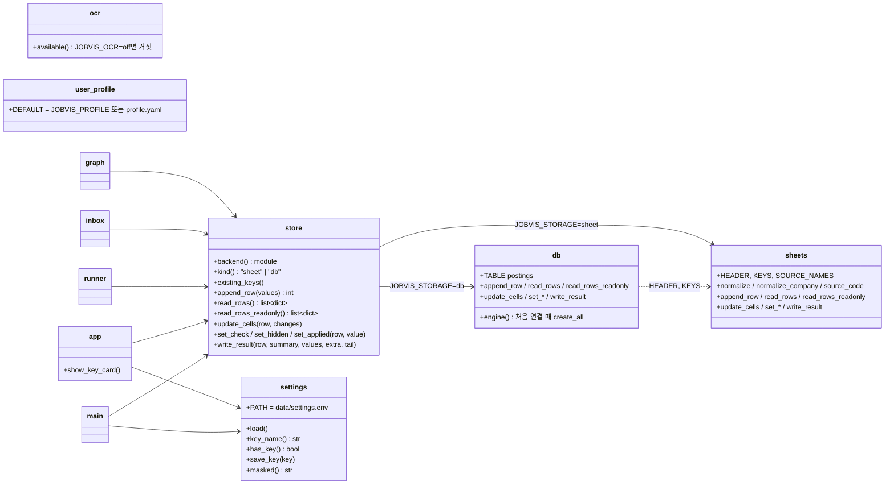
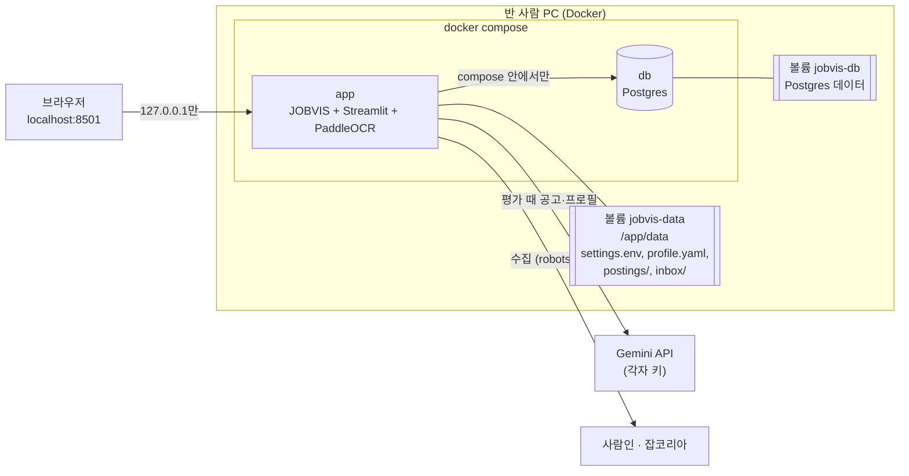
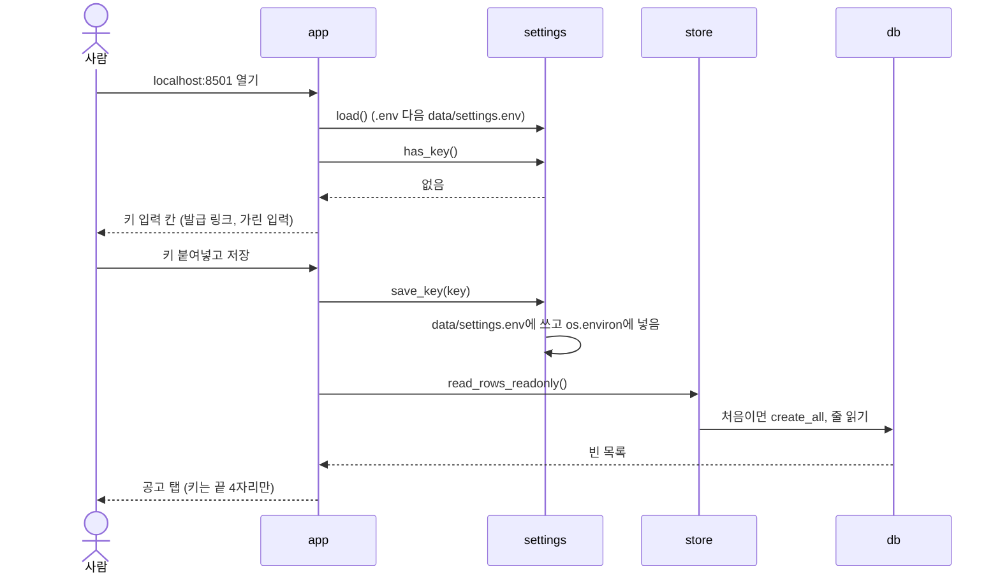
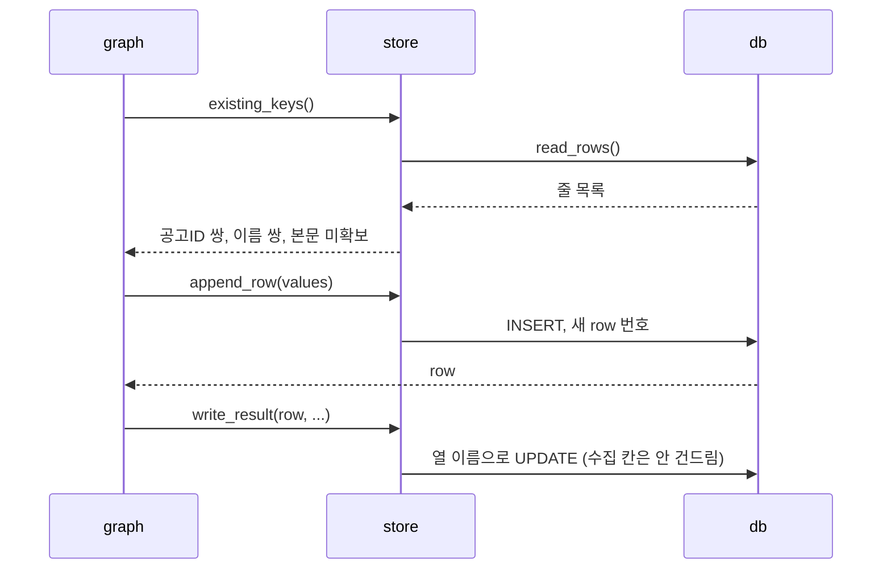

# v0.6 설계

기준 문서: [01-requirements.md](01-requirements.md) (2026-10-22 확정, F1–F13, N1–N5). 괄호 안 ID는 요구사항 번호. 기준 코드는 v0.5.5(PR #38).

수집·평가 그래프의 노드와 State, 점수 계산, 시트 열은 바뀌지 않음. 바뀌는 곳은 "어디에 저장하나"(시트 또는 DB)와 "어떻게 띄우나"(Docker)임.

## 결정

| 번호 | 결정 | 이유 |
| --- | --- | --- |
| D1 | 저장 함수 모양은 지금 `sheets` 모듈 그대로 두고, 새 `store` 모듈이 `JOBVIS_STORAGE`를 보고 `sheets` 또는 `db`로 넘김. 그래프·화면·받은함은 `sheets.` 대신 `store.`를 부름 (F6) | 부르는 쪽 코드가 거의 안 바뀜. 두 방식이 같은 함수를 갖추는지 테스트 하나로 확인 |
| D2 | `JOBVIS_STORAGE`가 없으면 `sheet`. Docker compose는 `db`로 넣음 (F6, F9) | 지금 쓰는 사람의 `.env`는 그대로 둬도 동작이 같음 |
| D3 | DB 표는 `postings` 하나. 열은 시트 열(`sheets.KEYS`)과 같고, 시트 줄 번호 대신 자동 번호 `row` (F7) | 시트와 1:1이라 화면·평가 코드가 쓰는 dict가 같음. 여러 사용자 표 분리는 웹 공개 때(보류) |
| D4 | DB 칸은 모두 글자. 체크는 시트가 돌려주는 것과 같은 `"TRUE"`/`"FALSE"`, 빈칸은 `""` (F6) | `view.py`가 시트 글자를 읽는 코드를 그대로 씀 |
| D5 | DB 연결은 SQLAlchemy Core + psycopg. 표는 처음 연결 때 `create_all`로 만듦 (F8) | 테스트는 같은 코드로 SQLite 메모리 DB를 씀(N1). SQL을 손으로 실행할 일 없음 |
| D6 | 화면에서 넣은 키는 `data/settings.env`에 저장. 실행할 때 `.env` 다음에 읽고, 비어 있는 값만 채움 (F4) | `data/`는 이미 볼륨·`.gitignore` 대상. `.env`에 직접 쓴 키가 있으면 그게 우선 |
| D7 | 프로필 경로를 `JOBVIS_PROFILE`로 바꿀 수 있게 함. compose는 `data/profile.yaml` (F3) | 볼륨 하나(`data/`)에 개인 파일을 모두 모음. 없으면 지금처럼 `profile.yaml` |
| D8 | `JOBVIS_OCR=off`면 `ocr.available()`이 거짓 (F10) | "OCR 미설치"일 때 동작을 그대로 씀 |
| D9 | 이미지는 `python:3.12-slim` 하나. `libgomp1`·`libgl1`·`libglib2.0-0` 설치, OCR 포함, 한국어 모델은 빌드 때 받음 (F1) | 반 사람은 OCR 켜진 이미지 하나만 받음. 3.12는 CI와 같은 버전. 시스템 라이브러리는 시험 빌드에서 필요함을 확인 |
| D10 | `app`만 `127.0.0.1:8501`로 열고 `db`는 포트를 열지 않음. DB 비밀번호는 compose 안 고정값 (F2) | DB는 같은 compose 안에서만 닿음. 밖에서 못 들어오니 고정 비밀번호도 위험이 작음 |
| D11 | CI에 `docker build` 일을 따로 두고 `Dockerfile`·`requirements*.txt`·`docker-compose.yml`이 바뀐 PR과 main push에서만 돌림 (N3) | 이미지가 2.5GB 안팎이라 모든 PR에 돌리면 느림 |
| D12 | 화면 문구의 "시트"는 저장 방식에 맞게 보여줌. DB면 "저장된 공고" (F6) | DB 사용자에게 "시트"는 틀린 말 |

## 모듈 다이어그램

v0.6에서 더하거나 바꾼 것만.

- `existing_keys()`는 `read_rows()`만 쓰므로 `store`로 옮겨 두 방식이 함께 씀.
- `normalize`, `source_code`, `HEADER`, `KEYS`, `SOURCE_NAMES`는 저장과 상관없는 값이라 `sheets`에 그대로 둠.
- `view.error_message`는 DB 연결 오류(`sqlalchemy.exc.OperationalError`) 문구를 더함.

## 배포 다이어그램

## 순서 다이어그램

### 첫 실행과 키 입력 (F4, F5)

### 수집·평가 저장 (F6, F7)

## DB 표

`postings` 하나 (D3).

| 열 | 형 | 내용 |
| --- | --- | --- |
| `row` | 정수, 자동 번호, 기본 키 | 시트의 줄 번호 자리. 화면·평가가 줄을 가리킬 때 씀 |
| `company` … `applied` | 글자, 기본 `""` | `sheets.KEYS` 31개와 같은 이름·순서 |

- 쓰는 값은 `True`/`False` → `"TRUE"`/`"FALSE"`, `None` → `""`, 나머지 `str()`(D4).
- 읽을 때 `row` 순으로 돌려줌(시트의 위에서 아래 순서와 같음).
- `update_cells(row, {"평가": True})`처럼 시트 열 이름을 받아 `HEADER.index`로 `KEYS` 이름을 찾음. `write_result`도 시트의 열 범위(평가–평가시각, 주요업무–기술스택, 신뢰–보정)를 같은 열 이름으로 바꿔 씀.

## 설정 값

| 이름 | 기본 | compose 값 | 쓰는 곳 |
| --- | --- | --- | --- |
| `JOBVIS_STORAGE` | `sheet` | `db` | `store` (D2) |
| `DATABASE_URL` | 없음 | `postgresql+psycopg://jobvis:jobvis@db:5432/jobvis` | `db` |
| `JOBVIS_PROFILE` | `profile.yaml` | `/app/data/profile.yaml` | `user_profile` (D7) |
| `JOBVIS_OCR` | 켜짐 | 켜짐 (끄려면 `off`) | `ocr` (D8) |
| `LLM_MODEL` | 지금과 같음 | `google_genai:gemini-flash-lite-latest` | `graph`, `resume` (F12) |
| `GOOGLE_API_KEY` | 없음 | 화면에서 입력 → `data/settings.env` | LangChain (D6) |

## 파일

| 파일 | 새로/바뀜 | 내용 |
| --- | --- | --- |
| `Dockerfile` | 새로 | D9. 의존성 설치 → OCR 모델 미리 받기 → 코드 복사 → `streamlit run app.py --server.address=0.0.0.0` |
| `docker-compose.yml` | 새로 | `app` + `db`, 볼륨 2개, db 상태 확인(`pg_isready`) 뒤 app 시작 (F2, F3) |
| `.dockerignore` | 새로 | `.env`, `service_account.json`, `profile.yaml`, `data/`, `.git`, 캐시 (F11) |
| `scripts/warm_ocr.py` | 새로 | 빌드 때 PaddleOCR 한국어 모델 받기 |
| `agent/store.py` | 새로 | D1, D2 |
| `agent/db.py` | 새로 | D3–D5 |
| `agent/settings.py` | 새로 | D6 |
| `agent/sheets.py` | 바뀜 | `existing_keys`를 `store`로 옮김 |
| `agent/graph.py`, `inbox.py`, `runner.py`, `main.py`, `app.py` | 바뀜 | `sheets.` 저장 함수 → `store.`, 키 입력 칸(F4), 문구(D12) |
| `agent/ocr.py` | 바뀜 | D8 |
| `agent/user_profile.py` | 바뀜 | D7 |
| `agent/view.py` | 바뀜 | DB 오류 문구, 요약 칸 문구(D12) |
| `requirements.txt` | 바뀜 | `sqlalchemy>=2.0`, `psycopg[binary]>=3.2` (N2) |
| `.github/workflows/ci.yml` | 바뀜 | `docker build` 일 (D11, N3) |
| `README.md` | 바뀜 | 반 사람용 시작하기 (F13) |

## 테스트 계획

모두 Docker·DB 서버·실제 API 없이 돎(N1).

- `db`: SQLite 메모리 DB로 append → read → update_cells → write_result → set_* 를 시트 가짜와 같은 기대값으로 검사. 빈 표, 없는 줄 번호, 예전 열이 비어 있는 줄.
- `store`: `JOBVIS_STORAGE` 없음 → sheet, `db` → db, 이상한 값 → 오류 문구. 두 백엔드가 같은 공개 함수를 갖췄는지.
- `store.existing_keys`: 지금 `sheets` 테스트를 그대로 옮겨 두 백엔드로 돌림.
- `settings`: 키 저장·읽기, `.env` 값 우선, 빈 값만 채움, `masked()`가 끝 4자리만, 키가 오류 문구·로그에 안 나옴(F5).
- `ocr.available`: `JOBVIS_OCR=off`면 거짓.
- `user_profile.DEFAULT`: `JOBVIS_PROFILE`을 따름.
- 화면(`app`): 키가 없을 때 키 칸이 뜨는지, 저장 뒤 사라지는지(Streamlit AppTest).
- Docker 이미지 빌드·실행, 이미지 크기, 첫 실행 시간, OCR 메모리는 `03-test.md`에 실측(N5).

## 확인한 것 (2026-10-22, 설계 중)

- `paddlepaddle==3.3.1`, `paddleocr==3.7.0`, `sqlalchemy`, `psycopg[binary]` 모두 Linux x86_64·파이썬 3.12/3.13 wheel이 있음(`pip download --only-binary`로 확인). paddlepaddle wheel 약 195MB.
- 이 작업 환경에서 OCR 넣은 이미지를 시험 빌드함(`python:3.12-slim`, `requirements.txt` + `requirements-ocr.txt`).
    - `pip install`은 약 2분 20초에 끝남. 모델 없이 이미지 크기 2.47GB(압축 전).
    - slim 이미지에는 `libgomp.so.1`(paddle), `libGL.so.1`(opencv)이 없어 import가 실패함 → Dockerfile에서 `apt-get install libgomp1 libgl1 libglib2.0-0` 필요. 두 라이브러리를 넣은 뒤 `import paddle, paddleocr, cv2` 성공(paddle 3.3.1).
    - opencv를 headless 판으로 바꾸면 libGL은 필요 없지만 paddlex가 OCR 의존성 검사에서 막음 → 바꾸지 않음.
    - OCR 모델 내려받기는 이 작업 환경의 네트워크가 모델 저장소(huggingface 등)를 막아 확인 못 함. 구현 PR에서 GitHub Actions 빌드나 재리 PC로 확인함.

## 정할 것

- 반 사람이 코드를 받는 방법(요구사항 "정할 것"). 구현과 따로 정해도 됨. 추천: public 전환(전환 전 커밋 이력 gitleaks 검사).
