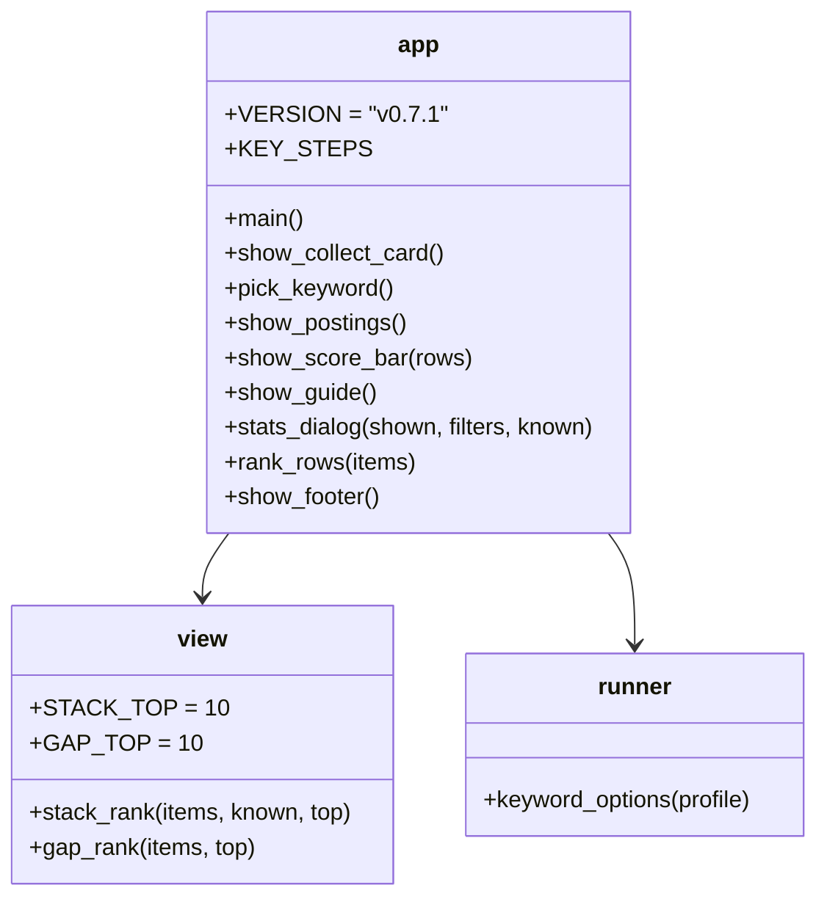
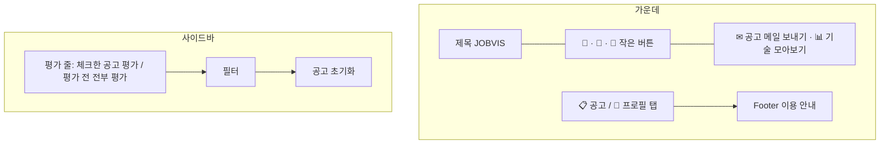

# v0.7.1 설계

기준 문서: [01-requirements.md](01-requirements.md) (2026-10-23 확정, F1–F12, N1–N3). 기준 코드는 v0.7(PR #59).

수집·평가 그래프, State, DB 표, 시트 열, 메일 내용은 바뀌지 않는다. `app.py`(화면 배치·CSS)와 `agent/view.py`(`STACK_TOP` 15 → 10)만 바뀐다. 새 모듈·의존성 없음(N1).

## 정할 것 확인

| 질문 | 확인 | 결정 |
| --- | --- | --- |
| 키워드를 Enter 없이 남기기 | `st.selectbox(accept_new_options=True)`는 Enter를 쳐야 새 값이 들어감. `st.text_input`은 다른 곳을 누르면(blur) 값이 들어감 | 글자 칸 + `st.pills` 추천 버튼(D1) |
| 탭 전환 애니메이션 | `st.tabs`는 탭을 바꿀 때 서버에 다시 묻지 않음. Chromium으로 보니 탭을 바꾸면 보이는 칸(`[data-testid="stTabPanel"]`)이 새로 붙어 CSS 애니메이션이 다시 돎 | 그 칸에 0.2초 떠오름(D7) |
| 도넛 채움 | 도넛은 `conic-gradient`의 `--p`. 보통 변수는 애니메이션이 안 됨 | `@property --p`(숫자형)로 등록해 0에서 차오름(D7) |
| 자세히 펼침 | 자세히는 `st.popover`, 열리면 `stPopoverBody`가 새로 생김. 닫힐 때는 바로 지워짐 | 열릴 때만 `clip-path`로 위에서 아래로(D8). 닫힘 효과 없음 |
| 위 버튼 크기 | 지금은 보통 버튼 2줄(3+2), 칸 폭을 꽉 채워 제목보다 커 보임 | 글자 폭만큼의 작은 버튼, 오른쪽 정렬 두 줄(D9) |

## 결정

| ID | 결정 | 이유 |
| --- | --- | --- |
| D1 | 수집 키워드는 `st.text_input("키워드 *", key="collect-keyword")`. 아래 `st.pills("추천 키워드", runner.keyword_options(raw)[:8], key="keyword-pick", on_change=pick_keyword)`. `pick_keyword`가 고른 말을 `collect-keyword`에 넣고 pills는 비움 (F1) | 콜백은 칸을 그리기 전에 돌아서 글자 칸 값을 바꿀 수 있음. pills를 비워 같은 말을 다시 눌러도 들어감 |
| D2 | 위 버튼·창 이름 "✉ 공고 메일 보내기", "📊 기술 모아보기". key(`mail-open`, `stats-open`)는 그대로 (F2) | |
| D3 | 기술 모아보기 창: "공고 n건 기준 · 필터" 다음 요약 한 줄 "많이 찾는 기술 n개 중 [내 기술] m개"(초록 칩이 범례 역할). `st.tabs(["많이 찾는 기술", "내가 부족한 것"])`, 각 위 10개(`STACK_TOP = 10`). 순위 칩은 폭 9em 고정, 넘치면 … (F3, F7) | 두 칸이 좁고 막대 시작점이 달랐음. 칸 폭을 맞추면 막대 길이를 바로 비교 가능 |
| D4 | `show_score_bar`를 사이드바 필터 위에서 그림. 버튼은 칸 나눔 없이 위아래로, 폭은 사이드바 전체. 0건 한 줄은 그대로 (F4) | 카드를 내리며 체크해도 버튼이 늘 보임 |
| D5 | 사용법: GUIDE에 "공고 메일 보내기", "기술 모아보기" 줄(10줄 이하 유지). 그 아래 `st.expander` 두 개(접힘): 제미나이 API 키 받기(`settings.KEY_PAGES`), Gmail 앱 비밀번호 받기(2단계 인증 → `settings.MAIL_PAGE`). 글은 `KEY_STEPS` 상수 (F5) | 기본 화면은 짧게, 필요할 때만 펼침 |
| D6 | CSS `--jv-danger`(밝은 #e5383b, 어두운 #c43c3c, 글자 흰색). 지우는 버튼 key(`reset-open`, `reset-yes`, `profile-clear-all`, `clear-all-yes`, `key-delete`, `mail-delete`)의 `.st-key-*` 버튼에 마우스를 올리면 빨간 바탕 (F6, N3) | Streamlit이 key로 붙이는 class에만 검(v0.5.1 N5) |
| D7 | 애니메이션은 CSS `@keyframes`만. 탭 칸(`stTabPanel`) `jv-rise`(0.2초, 아래 6px에서 떠오름), 막대 `.jv-bar > div` `jv-grow`(0.4초, `scaleX(0)`에서), 도넛 `@property --p` + `jv-fill`(0.4초), 카드(`st-key-box-card-*`, `st-key-box-dim-card-*`) hover 시 2px 들리고 그림자 8px. `@media (prefers-reduced-motion: reduce)`에서 모두 끔 (F8, F9, N2) | 새 의존성 없음(N1). 다시 그려도 DOM이 남으면 다시 돌지 않음 |
| D8 | 자세히 `div[data-testid="stPopoverBody"]`에 `jv-unfold`(0.2초, `clip-path: inset(0 0 100% 0)` → `inset(0)`). 끝나면 `clip-path`가 없어져 그림자가 보임 (F11, N2) | 창(dialog) 효과는 하지 않음(재리 결정) |
| D9 | 위 버튼: 제목·버튼 칸 1:1.25, 버튼 칸에 `st.container(horizontal=True, horizontal_alignment="right", wrap=False, key="top-tools")`(🔑 · 📖 · 🔄)와 `key="top-actions"`(✉ · 📊) 두 줄. 버튼은 `width="content"`, CSS로 글자 0.85rem·낮은 높이·그림자 3px (F12) | 칸 폭을 꽉 채우던 버튼이 제목보다 커 보였음. 글자 폭만큼이면 잘리지 않음 |
| D10 | Footer: 탭 아래 `jv-footer` 두 줄(흐린 작은 글자, 위 테두리). 이용 안내·데이터·도움말·출처·참고(ai-job-search 링크)·`VERSION = "v0.7.1"` (F10, N3) | 개인 도구라 법적 약관 대신 이용 안내 |

## 구성

## 화면 순서

