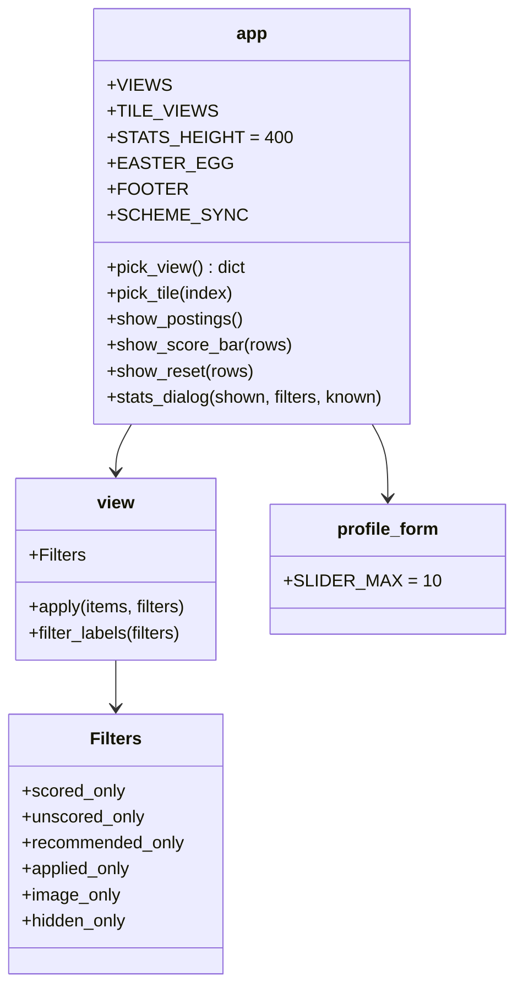
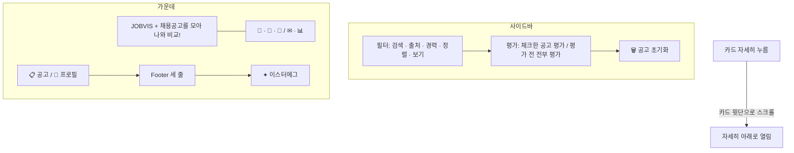

# v0.7.2 설계

기준 문서: [01-requirements.md](01-requirements.md) (2026-10-23 확정, F1–F13, N1–N3). 기준 코드는 v0.7.1(PR #60).

수집·평가 그래프, State, DB 표, 시트 열은 바뀌지 않는다. `app.py`(배치·CSS·스크립트), `agent/view.py`(`Filters.unscored_only`), `agent/profile_form.py`(`SLIDER_MAX`), `agent/runner.py`(`keyword_options` 삭제)가 바뀐다. 새 의존성 없음(N1).

## 정할 것 확인

| 질문 | 확인 | 결정 |
| --- | --- | --- |
| 자세히 열리는 방향 | Chromium으로 보니 자세히 버튼에 `aria-expanded`가 있고, 화면을 먼저 움직이면 Streamlit이 아래 공간을 보고 아래로 엶. 스크롤 칸은 `[data-testid=stMain]` | 문서 click(capture)에서 열 때만 `scrollIntoView`(D5) |
| 형광 띠 겹침 | 자세히 칸은 `overflow-y: auto`, 띠는 칸 바탕(`background`). 바탕은 기본이 칸에 고정이라 글만 띠 밑으로 지나감 | `background-attachment: local`로 띠가 글과 같이 올라감(D7) |
| 사이드바 높이 | v0.7.1은 900px 창에서 사이드바 909px(스크롤). 카드 여백과 위 여백이 큼 | 여백 줄이고 설명 글은 도움말로(D2). 900px에서 스크롤 없음 확인 |
| 평가 전 공고 | 점수 없는 공고에는 평가 전과 "제외 (경력 요구)"가 있음 | 평가 전만(`verdict == NOT_SCORED`). 제외 공고는 평가한 것 |

## 결정

| ID | 결정 | 이유 |
| --- | --- | --- |
| D1 | 사이드바: 필터 카드 → 평가 줄 카드 → 🗑 공고 초기화 버튼(카드 없음). `show_score_bar`를 필터 다음 `with st.sidebar`에서 부름 (F1) | |
| D2 | 사이드바 카드 여백 `12px 14px`, 사이드바 위 여백 0. 평가 줄 안내 글은 `run-score` 버튼 `help`, 공고 초기화 설명은 `reset-open` 버튼 `help`. 필터 제목 옆 글 없앰 (F2, F12) | 미니멀 원칙. 설명은 마우스를 올리면 |
| D3 | 토글 다섯 개 → `st.selectbox("보기", list(VIEWS), key="view")`. `VIEWS = {"전체": None, "평가된 공고": "scored_only", "평가 전 공고": "unscored_only", "추천 이상": "recommended_only", "지원한 공고": "applied_only", "이미지 필요": "image_only", "관심 없음": "hidden_only"}`. `pick_view()`가 고른 칸만 `True`인 dict를 `view.Filters`에 넘김. 요약 칸은 `TILE_VIEWS`로 보기 칸을 바꿈 (F3) | `view.Filters`의 칸은 그대로 두고 `unscored_only` 하나만 더함. `apply`·`filter_labels`는 이 칸을 더 봄 |
| D4 | 추천 키워드 버튼(`st.pills`)·`pick_keyword`·`runner.keyword_options` 삭제 (F4) | 쓰는 곳이 없어짐 |
| D5 | `SCHEME_SYNC` 스크립트에 click 듣기 하나(capture, 한 번만 등록): 자세히 버튼이고 `aria-expanded`가 `true`가 아니면 그 카드를 `scrollIntoView({block: "start"})`. 움직임 줄이기면 바로 이동, 아니면 부드럽게. 카드에 `scroll-margin-top: 4.5rem`(위 메뉴에 가리지 않게) (F8, N2) | 팝오버는 그대로(재리 결정). 맨 아래 공고는 더 내려갈 곳이 없으면 위로 열릴 수 있음 |
| D6 | 제목: `✦ AI 취업 비서` 표시 삭제, `h1`은 `clamp(3.6rem, 6vw, 5.2rem)` + 줄바꿈 없음, 소개 문장 `TAGLINE = "채용공고를 모아 나와 비교!"` 줄바꿈 없음 (F5, F6) | 고정 5.2rem은 1100px 창에서 "JOBVI / S"로 갈라짐(Chromium 확인). 창 폭에 맞춰 줄어들게 |
| D7 | 자세히 칸 `background-attachment: local, local` (F10) | |
| D8 | Footer: `<b>이용</b>`·`<b>데이터</b>`·`<b>도움말</b>` 세 줄, 맨 아래 `.jv-egg`(✦ + 숨긴 `EASTER_EGG`, hover 시 `opacity: 1`) (F7) | 이스터에그 문장: "J.O.B.V.I.S. — Just One Better Vacancy, Intelligently Sorted" |
| D9 | 보통 버튼(`stBaseButton-secondary`, 자세히 `stPopoverButton`) hover 바탕 `color-mix(lime 22%, card)`. 지우는 버튼 빨강 규칙보다 앞에 둬서 빨강이 이김 (F9, N3) | |
| D10 | 기술 모아보기 두 탭 안을 `st.container(height=STATS_HEIGHT=400)`로 감쌈 (F11) | 탭마다 줄 수가 달라 창 높이가 바뀌었음 |
| D11 | `profile_form.SLIDER_MAX = 10`. 슬라이더 최댓값은 지금처럼 `max(SLIDER_MAX, 저장된 값)` (F13) | 저장된 값이 잘리지 않게 |

## 구성

## 화면 순서

