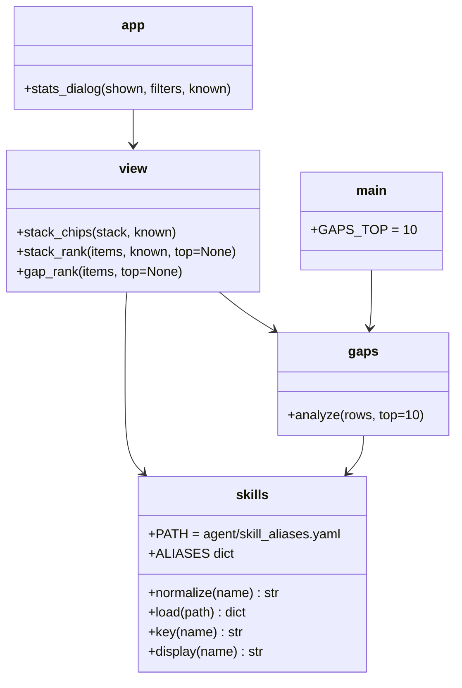
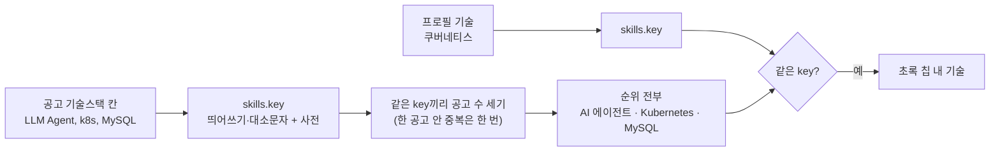

# v0.7.3 설계

기준 문서: [01-requirements.md](01-requirements.md) (2026-10-23 확정, F1–F4, N1–N3). 기준 코드는 v0.7.2(PR #61), README는 PR #63.

수집·평가 그래프, State, DB 표, 시트 열은 바뀌지 않는다. 새 모듈 `agent/skills.py`와 사전 파일 `agent/skill_aliases.yaml`을 더하고, `agent/view.py`·`agent/gaps.py`가 이름 비교를 `skills.key`로 바꾼다. `app.py`는 순위를 자르지 않는다. 새 의존성 없음(N1).

## 정할 것 확인

| 질문 | 확인 | 결정 |
| --- | --- | --- |
| 지금 같은 기술 판단 | `view._skill_key`는 띄어쓰기 삭제 + casefold, `gaps.analyze`는 앞뒤 공백 + casefold로 서로 조금 다름 | 둘 다 `skills.key` 하나로(D2). 그래서 `--gaps`에서 "Spring Boot"와 "SpringBoot"도 같게 됨 |
| 사전을 어디에 | 코드 안 dict는 고치려면 코드를 알아야 함. 프로필이 이미 YAML(PyYAML) | `agent/skill_aliases.yaml`(D1). Docker 이미지는 `COPY . .`로 들어가고 `.dockerignore`에 걸리지 않음 |
| 전부 보이면 칸 | 칸은 v0.7.2부터 `st.container(height=400)`라 넘치면 칸 안 스크롤 | 칸 그대로, 자르기만 없앰(D3). 시험 데이터 16줄에서 scrollHeight 510 > clientHeight 400 확인 |
| 크기 | 사전 한 줄 50–60바이트, 34묶음 약 1.6KB(보완 후 84묶음 약 3.2KB) | 걱정 없음. 찾기는 dict라 개수와 상관없음 |

## 결정

| ID | 결정 | 이유 |
| --- | --- | --- |
| D1 | 사전 형식 `대표 이름: [다른 이름, ...]`. `skills.load()`가 `{normalize(이름): 대표 이름}`을 만들고 대표 이름 자신도 넣음. 한 이름이 다른 대표 이름 두 곳에 있으면 `ValueError` (F2, N2) | 잘못 묶기를 테스트에서 바로 잡음 |
| D2 | `skills.normalize(name)` = 띄어쓰기 삭제 + casefold. `skills.key(name)` = 사전에 있으면 대표 이름의 normalize, 없으면 normalize. `skills.display(name)` = 사전에 있으면 대표 이름, 없으면 그대로. `view._skill_key`와 `gaps.analyze`가 `skills.key`를 씀 (F2–F4) | 화면·자세히 칩·`--gaps`가 같은 기준 |
| D3 | `view.stack_rank(items, known, top=None)`, `view.gap_rank(items, top=None)`. 기본은 전부. `STACK_TOP`·`GAP_TOP` 삭제. `gaps.analyze(rows, top=10)`은 `top=None`을 받으면 전부, `main.py --gaps`는 지금처럼 10 (F1, F4) | |
| D4 | 순위에 보이는 이름: 사전에 있으면 대표 이름, 없으면 처음 나온 모양(v0.7 D8 그대로). 자세히의 칩 글자는 공고에 적힌 그대로 두고 색만 같은 기준 (F2, F3) | 칩은 원문을 보여 주는 곳 |
| D5 | 첫 사전 34묶음: AI·데이터(AI 에이전트, LLM, RAG, 머신러닝, 딥러닝, NLP, LangChain, LangGraph, PyTorch, TensorFlow), 언어(Python, Java, JavaScript, TypeScript, C++, C#, Go), 프레임워크(Spring Boot, Node.js, React, Vue.js, Next.js), 인프라(PostgreSQL, Kubernetes, Docker, AWS, GCP, Azure, Linux, Git, GitHub Actions, CI/CD), 방식(REST API, MSA). 영어 줄임말·한글 표기만 | SQL·MySQL, Java·JavaScript는 넣지 않음(N2) |
| D7 | 보완(2026-10-23 재리 "진행"): 50묶음 더해 84묶음. 널리 쓰는 줄임말(MSSQL, EC2, S3, sklearn, GenAI, EF Core), 한글 표기(스프링, 판다스, 젠킨스, 오라클), 버전 표기(HTML5, CSS3, SQLite3, JUnit5), Apache 접두어(Kafka, Spark, Airflow, Hadoop). 빈 묶음·대표 이름 다시 적기·띄어쓰기/대소문자만 다른 이름은 두지 않고 테스트로 막음. Spring·Spring Boot, SQL Server·SQL, GitHub·GitHub Actions, EC2·AWS는 따로. 실제 공고로 빈도는 확인하지 않음(재리에게 데이터 요구하지 않음), 확실히 같은 말만 넣음 | 잘못 묶기가 유일한 손해라 확실한 것만 |
| D6 | `app.VERSION = "v0.7.3"`, README 배지도 같이 | |

## 구성

## 흐름

## 테스트 계획

| 대상 | 테스트 |
| --- | --- |
| 사전 | `tests/test_skills.py`: 불러오기·대표 이름, SQL·MySQL·Java·JavaScript·C·C++·C# 따로, 사전에 없는 이름, 두 묶음 거부, 빈 파일 |
| 순위 | `test_stack_rank_shows_all_and_merges_same_words`, `test_stack_chips_mark_same_words_as_mine`, `test_same_words_in_dictionary_merge_under_main_name`, `test_top_none_keeps_all` |
| 화면 | `test_stats_dialog_lists_every_skill_in_scroll_box`(13줄 모두 보임), 기존 모아보기 테스트는 사전에 없는 이름(Kotlin·Jenkins)으로 "처음 나온 모양" 규칙을 계속 검사 |
