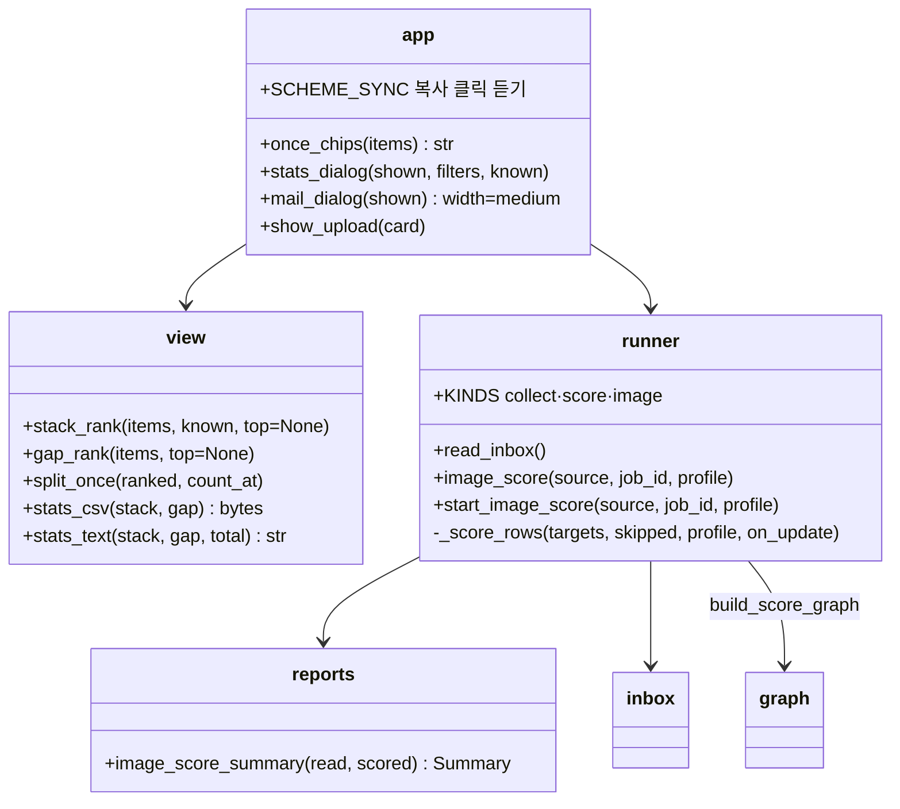
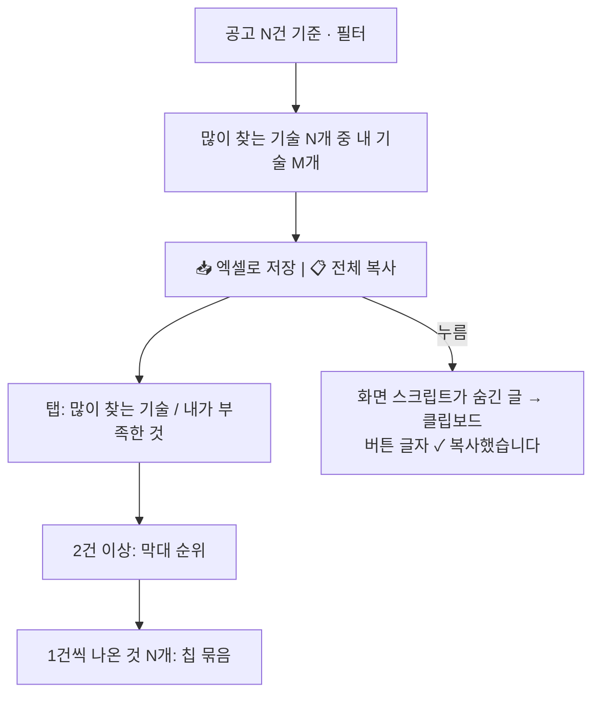
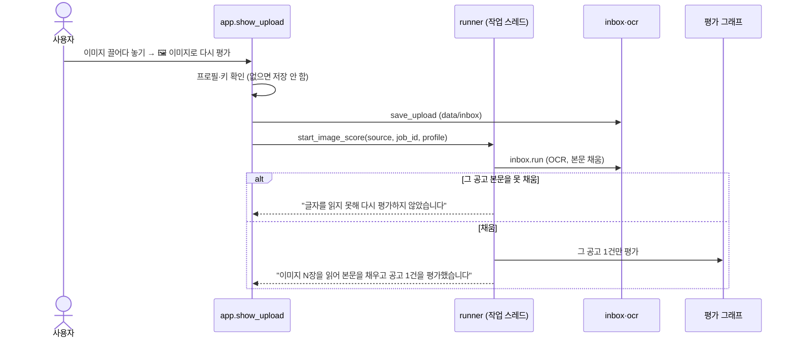

# v0.7.4 설계

기준 문서: [01-requirements.md](01-requirements.md) (2026-10-23 확정, F1–F8, N1–N4). 기준 코드는 v0.7.3(PR #64).

수집·평가 그래프, State, DB 표, 시트 열은 바뀌지 않는다. `agent/view.py`(나누기·CSV·글 함수), `agent/runner.py`(이미지로 다시 평가), `agent/reports.py`(결과 글), `app.py`(모아보기·메일 창·이미지 칸·CSS·스크립트)가 바뀐다. 새 의존성 없음(N1).

## 정할 것 확인

| 질문 | 확인 | 결정 |
| --- | --- | --- |
| 엑셀 파일 | .xlsx는 openpyxl이 필요하고 `requirements.txt`에 없음(작업 환경엔 따로 깔려 있었을 뿐) | CSV + UTF-8 BOM. 엑셀이 한글을 바로 읽음(D3) |
| 내려받기 뒤 창 | `st.download_button` 기본은 다시 그리기 | `on_click="ignore"`로 창이 그대로(Chromium 확인) |
| 복사 방법 | Streamlit에 복사 버튼이 따로 없음. `st.code`는 복사 아이콘이 있으나 긴 글 칸이 생김 | 보통 버튼 + 화면 스크립트가 숨긴 칸 글을 `navigator.clipboard`로(D4). 127.0.0.1은 보안 컨텍스트라 허용 |
| 버튼 HTML로 직접 그리기 | 마크다운 안 `<button>`은 Streamlit 보통 버튼과 바탕색이 달라짐(Chromium 비교) | 진짜 `st.button`을 쓰고 스크립트는 그 버튼 클릭만 들음 |
| 숨긴 글 줄바꿈 | 마크다운은 빈 줄에서 HTML 블록을 끊음 | 줄바꿈을 `&#10;`로 바꿔 한 줄로 넣음 |
| 메일 창 폭 | 기본 small 500px. 1.66은 small·medium·large | medium(752px), 그래도 길면 말줄임(D5) |
| 받은함 흐름 | 지금은 카드에서 저장 → 위 받은함 카드 "받은함 읽기"(모든 이미지 OCR, 바뀐 줄 "평가" 체크) → 사이드바 평가. `inbox.run`은 본문 상태가 그대로면 "평가"를 켜지 않음 | 한 작업으로 이어 붙임(D7). 그 공고는 체크 여부와 상관없이 고름 |
| 자세히 칸에서 실행 | 자세히는 따로 다시 그리는 칸(fragment). `start_job`의 `st.rerun()` 기본 범위는 app | 화면 전체를 다시 그려 위 실행 칸에 진행이 보임 |

## 결정

| ID | 결정 | 이유 |
| --- | --- | --- |
| D1 | `view.split_once(ranked, count_at)`: (공고 수 > 1, 1 이하)로 나누고 1건은 이름순(대소문자 무시). `app.once_chips(items)`가 `.jv-once` 칩 묶음 HTML (F1) | 두 탭이 같은 함수 |
| D2 | 막대 순번은 2건 이상 안에서 1부터. 1건이 하나도 없으면 칩 묶음은 그리지 않음, 모두 1건이면 막대 없이 칩만 (F1) | |
| D3 | `view.stats_csv(stack, gap)` → `utf-8-sig` bytes. 열: 구분·순위·이름·공고 수·내 기술(O)·가중치(소수 둘째). `st.download_button("📥 엑셀로 저장", file_name="jobvis-기술모아보기.csv", key="stats-csv", on_click="ignore")` (F4) | CSV 순위는 전체 순위(1건 포함) 그대로 |
| D4 | `view.stats_text(stack, gap, total)`: 제목 줄, `[많이 찾는 기술]` 번호 줄 + "1건씩: …", `[내가 부족한 것]` 같은 모양, 없으면 "없음". 화면은 `st.button(key="stats-copy")` + `
`. `SCHEME_SYNC` 스크립트가 `.st-key-stats-copy button` 클릭(capture)에서 그 글을 클립보드로. 버튼 콜백은 `stats-copied`를 켜서 다시 그릴 때 "✓ 복사했습니다" (F5) | 버튼 모양·테마는 다른 보통 버튼 그대로(N3) |
| D5 | 메일 창 `@st.dialog(width="medium")`, 공고 목록 칸 `key="mail-list"`, 칸 안 체크 글자 `white-space: nowrap; text-overflow: ellipsis`. 모두 고르기 버튼 `padding: 0.3rem 1rem` (F2, F3) | |
| D6 | `stDownloadButton`에도 보통 버튼 테두리·그림자 규칙 적용 (N3) | 지금까지 내려받기 버튼이 없어 규칙이 없었음 |
| D7 | `runner.image_score(source, job_id, profile)`: `read_inbox()`(OCR 없으면 `RunError`, 아무 파일도 안 건드림) → `filled`에 그 공고가 없으면 `(read, None)` → 있으면 그 공고 줄만 `check=TRUE`로 보고 `scoring.select_targets(.., "checked")` → `_score_rows`(기존 `score()`에서 그래프 부르는 부분을 떼어 냄). `start_image_score`가 작업 종류 `"image"`(이름 "이미지로 다시 평가")로 스레드 실행 (F7, F8) | 받은함에 전에 남은 다른 공고 이미지도 함께 읽히지만(본문 채움·"평가" 체크) 평가는 이 공고만 |
| D8 | `reports.image_score_summary(read, scored)`: 본문을 못 채웠으면 "이미지에서 글자를 읽지 못해 다시 평가하지 않았습니다…", 채웠으면 "이미지 N장을 읽어 본문을 채우고 공고 1건을 평가했습니다." 자세히는 읽기 줄(터미널 안내 "다음:" 줄 뺌) + 평가 줄 (F7, F8) | |
| D9 | `app.show_upload`: OCR 없으면 안내만. 있으면 넣는 칸 + `🖼 이미지로 다시 평가`(primary, 파일 없거나 실행 중이면 누를 수 없음). 누르면 프로필·키 확인 → 저장 → `start_job(runner.start_image_score, ...)`. `show_inbox_card`, `UPLOAD_DONE` 알림, `runner.start_inbox`·`inbox_count`, `reports.inbox_summary` 삭제(화면에서 쓰는 곳이 없어짐). 사용법·초기화 확인 문구의 "받은함"을 바꿈 (F6) | 명령줄 `--inbox`는 `inbox.run`·`reports.inbox_result`를 그대로 씀(N4) |

## 구성

## 기술 모아보기 창

## 이미지로 다시 평가

