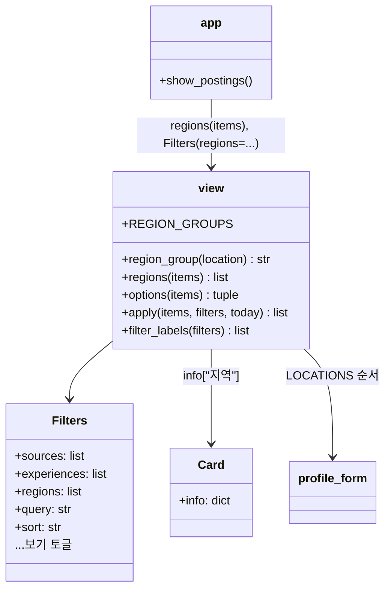
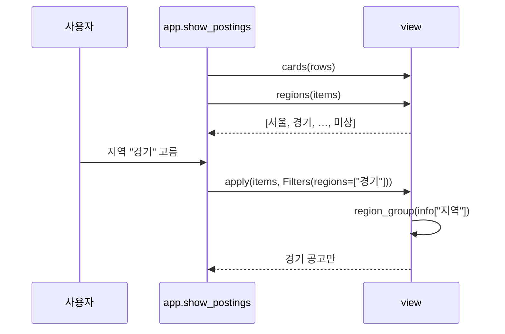

# v0.7.5 설계

기준 문서: [01-requirements.md](01-requirements.md) (2026-10-27 확정, F1–F3, N1–N2). 기준 코드는 v0.7.4(PR #69 시점 main).

수집·평가 그래프, State, DB 표, 시트 열은 바뀌지 않는다. `agent/view.py`(지역 묶기·필터)와 `app.py`(사이드바 고르기 칸)만 바뀐다.

## 정할 것 확인

| 질문 | 확인 | 결정 |
| --- | --- | --- |
| 지역 값 위치 | 시트·DB "지역" 칸(`location`)이 `Card.info["지역"]`에 이미 있음(v0.5.2 F31) | 새 칸 없이 `info`에서 읽음 |
| 실제 표기 | 사람인 "서울 강남구", 잡코리아 "서울 강남구 외 1"(테스트 고정 HTML) | 첫 낱말만 봄(D2) |
| 묶음 이름 | 프로필 희망 지역(`profile_form.LOCATIONS`)과 사람인 코드표(`codes.REGIONS`)가 같은 시·도 이름 | 프로필 순서를 쓰고 "재택·원격"은 빼고 "전국"을 더함(D1) |
| "경기 광주시" | 첫 낱말이 "경기"라 광주광역시와 섞이지 않음 | 테스트로 고정 |
| `Filters` 인터페이스 | 테스트·화면이 `Filters(sources, experiences, ...)` 위치 인자로 부름 | `regions`는 맨 뒤 기본값 빈 목록(D3) |

## 결정

| ID | 결정 | 이유 |
| --- | --- | --- |
| D1 | `view.REGION_GROUPS` = 프로필 희망 지역 순서(재택·원격 뺌) + "전국". `OTHER_REGION="기타"`, `BLANK_REGION="미상"` (F1) | 프로필과 같은 순서라 익숙함 |
| D2 | `view.region_group(location)`: 첫 낱말을 `_LONG_REGIONS`(충청북도→충북 등 6개)로 바꾼 뒤 `REGION_GROUPS` 중 앞 글자가 맞는 것. 없으면 기타, 빈 칸은 미상 (F2) | "서울특별시"·"전북특별자치도"는 앞 두 글자로 맞음 |
| D3 | `view.Filters.regions: list[str] = []`, `view.apply`가 비어 있지 않으면 `region_group(card.info.get("지역", ""))`로 거름. `view.regions(items)`가 보기 목록 (F1) | `options()` 반환 모양은 그대로 두어 다른 곳 영향 없음 |
| D4 | `app.show_postings`: 출처 다음에 `st.multiselect("지역", view.regions(items), placeholder="전체", key="regions")` (F1) | 출처·경력과 같은 모양 |
| D5 | `view.filter_labels`: 출처 다음 "지역 …" (F3) | 사이드바 순서와 같음 |

## 구성

## 흐름

