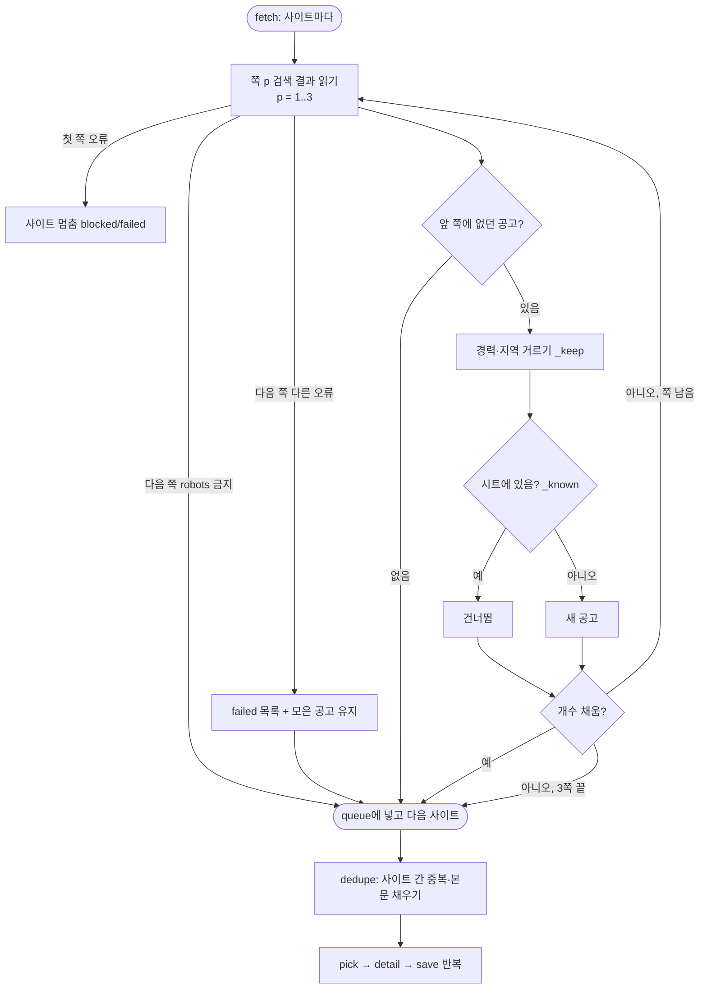
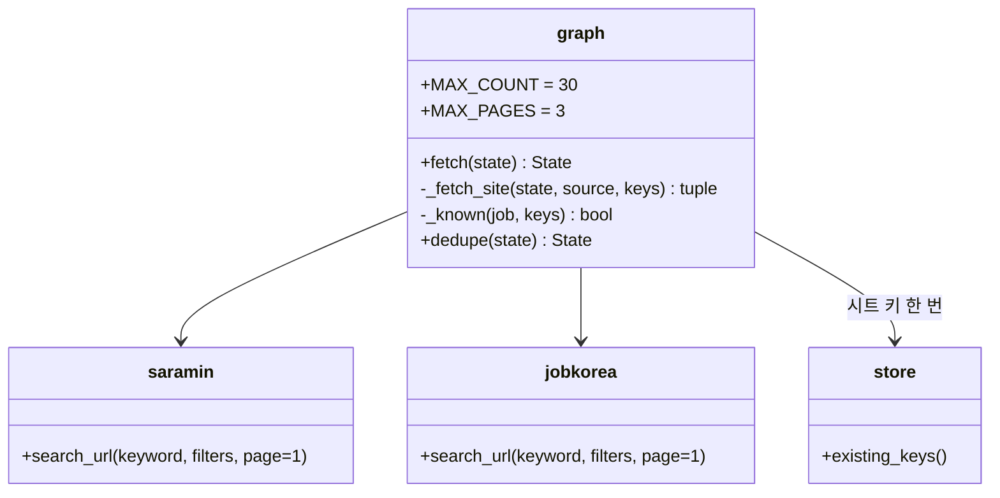

# v0.7.6 설계

기준 문서: [01-requirements.md](01-requirements.md) (2026-10-27 확정, F1–F5, N1–N2). 기준 코드는 v0.7.5(PR #70).

수집 그래프의 노드·간선, State 칸, DB 표, 시트 열은 바뀌지 않는다. `fetch` 노드 안쪽과 두 사이트의 `search_url`만 바뀐다.

## 정할 것 확인

| 질문 | 확인 | 결정 |
| --- | --- | --- |
| 다음 쪽 주소 | 사람인 `recruitPage`, 잡코리아 `Page_No`(공개 검색 화면의 쪽 번호 칸). 작업 환경에서 두 사이트에 접속할 수 없어 실제 응답은 미확인 | 첫 쪽 주소는 그대로, 2쪽부터 칸을 더함(D1) |
| 중복 판단 위치 | `dedupe`가 시트 키(`store.existing_keys`)로 거름. 그 전에 `fetch`가 개수로 자름 | `fetch`가 같은 키로 이미 있는 공고를 먼저 빼고 셈. 같은 실행 안 사이트 간 중복·본문 채우기는 `dedupe`가 그대로(D3) |
| 시트 읽기 횟수 | 공고가 없으면 시트를 읽지 않는 테스트(`test_no_jobs_ends_without_reading_sheet`) | 남길 공고가 처음 나올 때 한 번 읽어 사이트끼리 같이 씀(D3) |
| 사이트가 쪽 칸을 무시할 때 | 같은 공고만 다시 옴 | 새로 본 공고가 없으면 멈춤(D2) |
| 쪽 수 | 사람인 40건/쪽. 최대 3쪽이면 사이트당 요청 최대 3번 늘어남(간격 지킴) | `graph.MAX_PAGES = 3` |

## 결정

| ID | 결정 | 이유 |
| --- | --- | --- |
| D1 | `saramin.search_url(keyword, filters, page=1)`, `jobkorea.search_url(..., page=1)`. page > 1이면 쪽 칸 추가 (F2) | 기존 호출·테스트 그대로 |
| D2 | `graph._fetch_site(state, source, keys)`: 1–3쪽 반복. 쪽마다 `parse_list` → 앞에서 본 (출처, ID) 빼기 → 비면 멈춤 → `_keep`(경력·지역) → `_known`이면 건너뜀 목록, 아니면 새 목록 → 개수 차면 끝 (F1–F3) | |
| D3 | `graph._known(job, keys)`: (출처, ID)가 있거나, 회사+제목이 있고 본문 미확보 줄이 아님. `dedupe`가 건너뛰는 규칙과 같음 (F1) | 본문 미확보 줄 채우기(v0.5 F46)는 그대로 `dedupe`가 함 |
| D4 | 첫 쪽 오류는 지금처럼 그 사이트 멈춤(`blocked`)·실패. 다음 쪽 robots 금지는 멈춤만, 다른 오류는 `failed`에 단계 "목록"으로 남기고 모은 공고는 그대로 (F5) | 앞 쪽 공고를 버리지 않음 |
| D5 | `fetch`가 `skipped`도 돌려줌(State는 이어 붙이는 칸). `fetched[source]` = 새 공고 + 건너뜀 (F4) | 결과 글 "가져옴 / 새로 저장 / 건너뜀"이 그대로 맞음 |

## 흐름

## 구성

