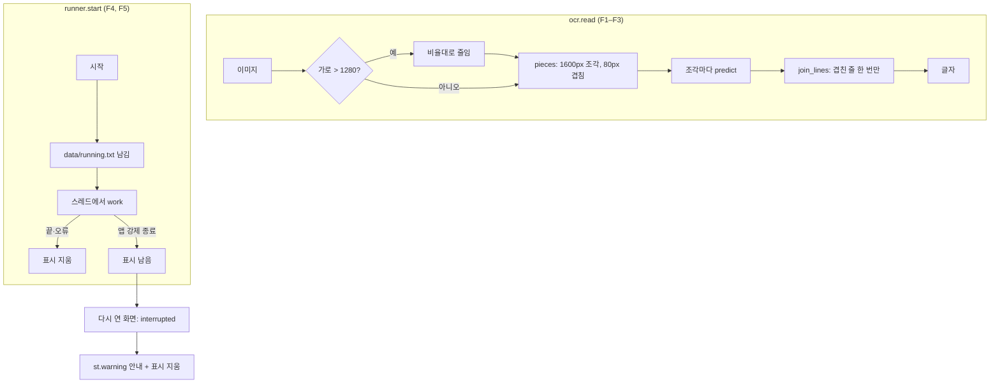
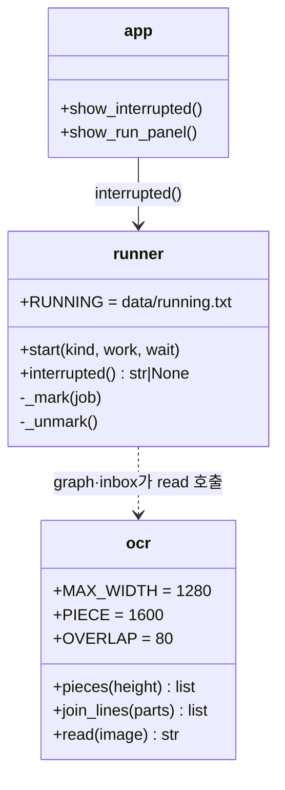

# v0.7.7 설계

기준 문서: [01-requirements.md](01-requirements.md) (2026-11-06 확정, F1–F5, N1–N3). 기준 코드는 v0.7.6(PR #71) 뒤 main.

수집·평가 그래프의 노드·간선, State 칸, DB 표, 시트 열은 바뀌지 않는다. `ocr.read` 안쪽, `runner.start`, 화면 실행 칸 위 알림만 바뀐다.

## 정할 것 확인

| 질문 | 확인 | 결정 |
| --- | --- | --- |
| 어디서 메모리가 커지나 | 재리 PC 로그: "Resized image size (950x6744) exceeds max_side_limit" 직후 OOM. 이미지 한 장을 통째로 `predict`에 넘김 | 조각마다 `predict`를 따로 부름(D1). 조각 크기만큼만 메모리 씀 |
| 조각 크기 | 로그 문구로 보아 PaddleOCR 안에 긴 변 상한(max_side_limit)이 있음. 실제 값과 메모리 측정은 작업 환경에 PaddleOCR이 없어 미확인 | 가로 최대 1280, 조각 높이 1600, 겹침 80(D1, D2) |
| 겹친 줄 | 겹친 80px 안 줄은 두 조각에서 모두 읽힘 | 다음 조각 첫 줄들이 앞 조각 끝 세 줄에 있으면 뺌(D3) |
| 앱이 죽은 걸 어떻게 아나 | 작업은 streamlit 프로세스 안 스레드라 프로세스가 죽으면 기록이 사라짐 | 시작할 때 파일 표시, 끝나면(오류 포함) 지움. 다음 화면이 남은 표시를 보고 알림(D4) |
| 창이 여러 개면 | 표시를 읽은 창 하나만 알림 | 한 번 알리면 지움. 같은 창 안에서는 session_state로 새 작업 전까지 계속 보임(D5) |

## 결정

| ID | 결정 | 이유 |
| --- | --- | --- |
| D1 | `ocr.pieces(height)`: 높이 1600 이하면 한 조각, 넘으면 (위, 아래) 구간들을 80px 겹치게. `ocr.read`가 조각마다 `_model().predict` (F1) | 순수 함수로 두어 PaddleOCR 없이 시험 |
| D2 | `ocr.read`: RGB로 바꾼 뒤 가로 > `MAX_WIDTH`(1280)면 비율대로 줄임 (F2) | 넓은 이미지는 글자 찾기 단계에서 다시 줄어드므로 읽기 품질 손해 적음 |
| D3 | `ocr.join_lines(parts)`: 조각별 줄을 이을 때 앞 끝 세 줄에 있는 첫 줄들은 뺌 (F3) | 경계에 같은 글이 우연히 반복되면 하나가 빠질 수 있음(감수) |
| D4 | `runner.RUNNING = data/running.txt`. `start`가 잠금 안에서 `_mark(job)`(종류·시작 시각), 스레드 `finally`에서 `_unmark()` (F4, F5, N2) | 정상·오류 끝은 지워지고, 프로세스가 죽을 때만 남음 |
| D5 | `runner.interrupted()`: 실행 중이면 None. 표시가 있으면 지우고 문구를 돌려줌. `app.show_interrupted()`가 실행 칸 위 `st.warning`으로, 새 작업(`runner.current()`)이 생기면 안 보임 (F4, F5) | |

## 흐름

## 구성

