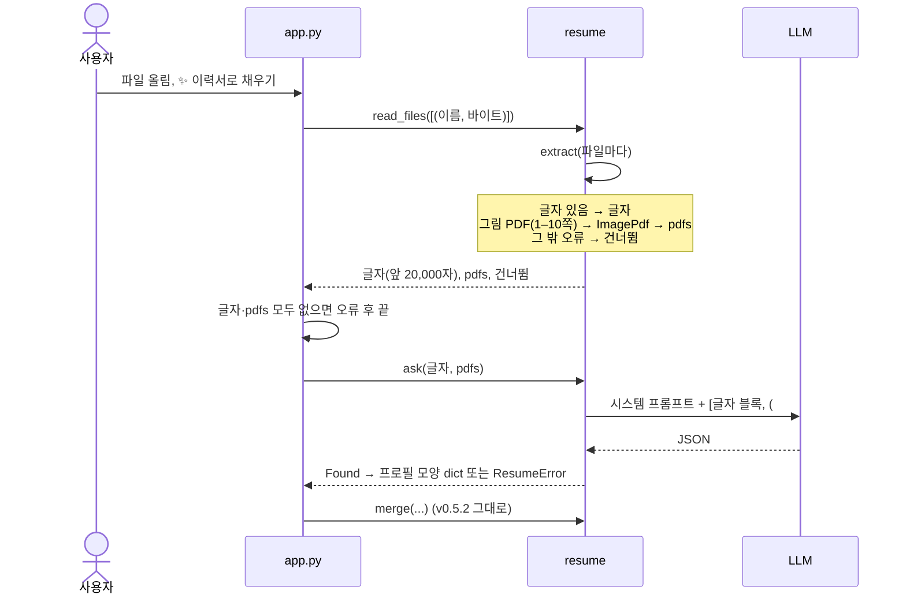
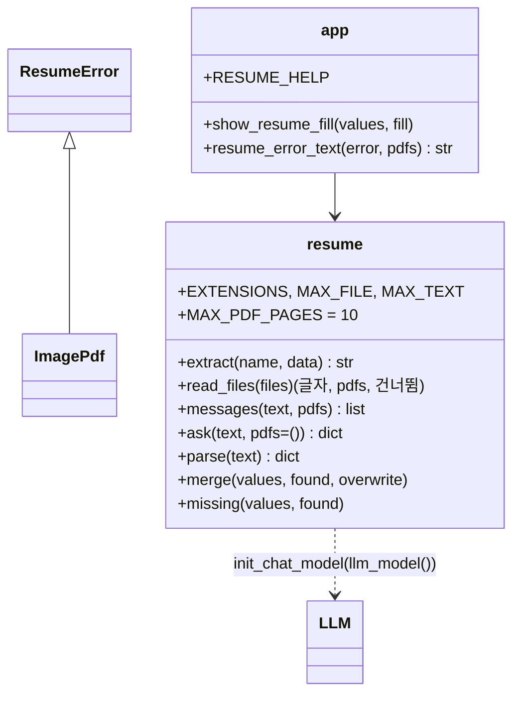

# v0.7.8 설계

기준 문서: [01-requirements.md](01-requirements.md) (2026-11-06 확정, F1–F6, N1–N4). 기준 코드는 main(PR #77 머지 시점, v0.7.6 코드).

바뀌는 곳은 `agent/resume.py`의 읽기·LLM 호출과 `app.py`의 이력서 채우기 칸뿐이다. 프로필 칸, `Found`, 합치기(`merge`), 프롬프트 규칙은 그대로다.

## 정할 것 확인

| 질문 | 확인 | 결정 |
| --- | --- | --- |
| PDF를 LLM에 넣는 형식 | LangChain 표준 파일 블록 `{"type": "file", "base64": …, "mime_type": "application/pdf"}`. `langchain-google-genai`가 Gemini `inline_data`로 바꿈(`_compat.py`에서 확인). Claude(`langchain-anthropic`)도 같은 블록을 받음(문서 기준, 실행 미확인) | 표준 블록만 씀. 제공자 클래스 import 없음 (N3, D3) |
| 그림 PDF 판단 | `extract`가 글자 0자면 "글자를 뽑지 못함" | PDF이고 쪽이 1개 이상인데 글자가 비면 그림 PDF로 보고 파일째 보냄 (F1, D1) |
| 쪽 수 세기 | `PdfReader(...).pages` 길이 | 같은 `PdfReader`로 셈. 새 의존성 없음 (F3, N1) |
| 모델이 PDF를 못 받을 때 | 제공자마다 예외 이름이 달라 하나로 못 고름 | 그림 PDF를 보낸 호출에서 키·모델·한도 오류(`reports.llm_hint`)가 아닌 예외면 PDF 안내 (F5, D4) |

## 결정

| ID | 결정 | 이유 |
| --- | --- | --- |
| D1 | `resume.ImagePdf(ResumeError)` 추가. `extract`는 PDF 쪽이 1–10개이고 글자가 비면 `ImagePdf`를 낸다. 쪽 0개면 지금처럼 "글자를 뽑지 못함", 10쪽 넘으면 `ResumeError("10쪽 초과 (그림 PDF)")` (F1, F3, F4) | `extract`의 "글자 돌려줌 / 못 읽으면 예외" 모양 유지 |
| D2 | `read_files(files)` → `(글자, pdfs, 건너뜀)`. `ImagePdf`면 `(이름, 바이트)`를 `pdfs`에 넣음. 글자 쪽 20,000자 자르기는 그대로 (F2) | 호출하는 곳은 `app.py` 한 곳 |
| D3 | `ask(text, pdfs=())`: `prompt.format_messages(text=…)`로 만든 사람 메시지를 내용 목록으로 바꿈 → 글자 블록 하나 + PDF마다 `# 파일: 이름` 글자 블록과 파일 블록. LLM 호출은 지금처럼 한 번 (F2, N3) | 시스템 프롬프트·글자 부분은 그대로라 v0.5.2 테스트가 그대로 맞음. `pdfs`가 비면 지금과 같은 메시지 |
| D4 | `app.show_resume_fill`: 글자도 `pdfs`도 없을 때만 "글자를 읽을 수 있는 파일이 없습니다". LLM 예외가 `llm_hint`에 걸리면 그 안내, 아니고 `pdfs`가 있었으면 "이 모델은 그림 PDF를 읽지 못함 (예외 이름)" (F5) | 예외 메시지는 쓰지 않음(파일 내용이 섞일 수 있음, N2). `runner.error_text`로 키 가림은 그대로 |
| D5 | `RESUME_HELP`: "PDF·Word·txt·md. 파일 글자(앞 20,000자)가 LLM 제공자(기본 Gemini)로 전송됩니다. 글자가 그림인 PDF(10쪽까지)는 파일 전체가 전송됩니다. 파일은 저장하지 않습니다." (F6) | |
| D6 | 스피너 "LLM이 이력서를 읽는 중"은 그대로 | 사용자에게 보이는 흐름 같음 |

## 흐름

## 구성

- `messages(text, pdfs)`는 테스트에서 가짜 LLM 없이 메시지 모양을 확인하려고 따로 둔다. `ask`는 `(messages | llm)` 대신 `llm.invoke(messages(...))`로 부른다.
- `app.resume_error_text(error, pdfs)`가 D4 문구를 고른다. 키 가림은 `runner.error_text`에 맡긴다.
- 글자가 없고 그림 PDF만 있으면 글자 블록은 "# 이력서·포트폴리오"만 담는다.

## 테스트 (N4)

- 그림 PDF(글자 없는 1쪽 PDF를 pypdf로 만들어 씀) → `read_files`가 `pdfs`에 넣음, 건너뜀 없음
- 11쪽 그림 PDF → 건너뜀 "10쪽 초과 (그림 PDF)", 쪽 0개·깨진 PDF → 지금 이유 그대로
- 글자 파일 + 그림 PDF → `messages`에 글자 블록과 파일 블록(`mime_type` PDF, base64가 원본과 같음)이 한 사람 메시지에 있음
- `pdfs` 없음 → 메시지가 v0.5.2와 같음
- 가짜 LLM이 JSON을 돌려주면 칸 채움, 모르는 예외를 내면 화면에 "그림 PDF" 안내, 키 오류는 키 안내(가짜 예외 이름)
- 오류 문구에 파일 바이트·글자가 없는지 확인
