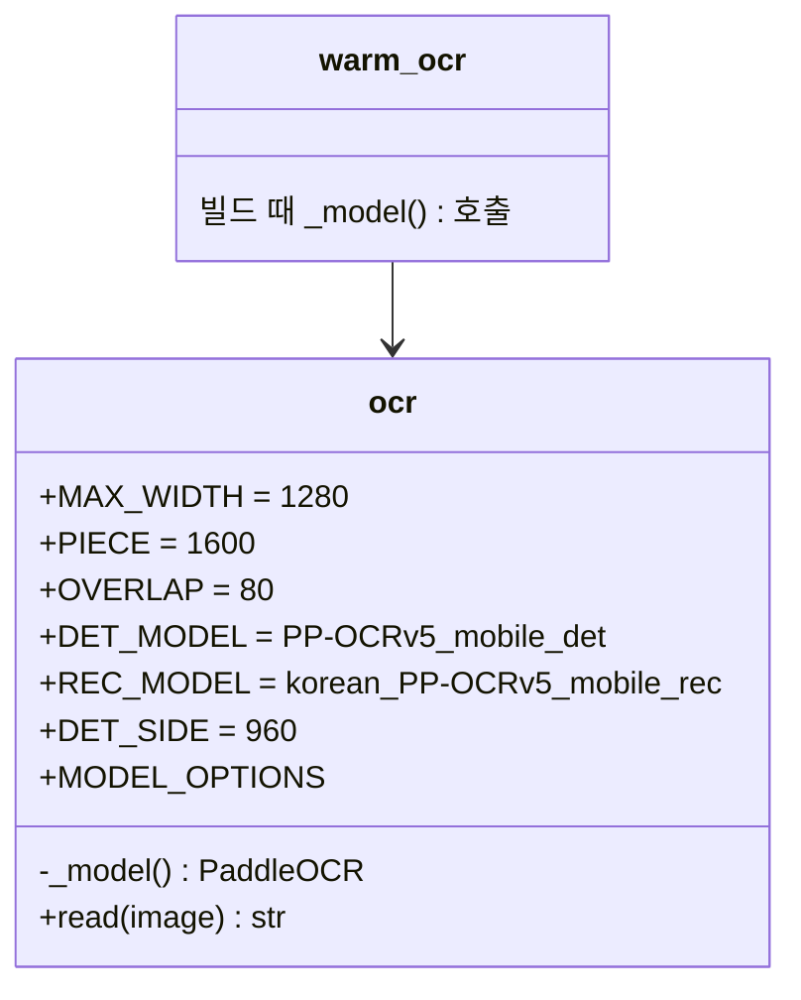

# v0.7.9 설계

기준 문서: [01-requirements.md](01-requirements.md) (2026-11-06 확정, F1–F3, N1–N2). 기준 코드는 v0.7.8(PR #79)·쉬운 문구(PR #80) 뒤 main.

그래프·State·DB·시트·화면은 바뀌지 않는다. `agent/ocr.py`의 PaddleOCR 설정만 바뀐다.

## 결정

| ID | 결정 | 이유 |
| --- | --- | --- |
| D1 | `ocr.DET_MODEL`, `ocr.REC_MODEL`, `ocr.DET_SIDE` 상수와 `ocr.MODEL_OPTIONS` 딕셔너리. `_model()`은 `PaddleOCR(**MODEL_OPTIONS)` (F1, F2) | 설정을 한곳에 두어 테스트와 빌드 스크립트가 같은 값을 씀 |
| D2 | 기존 칸(`lang="korean"`, `enable_mkldnn=False`, 방향·펴기·줄 방향 끔)은 그대로 | 윈도우 mkldnn 오류 대비(v0.4) 유지 |
| D3 | `read`의 조각 읽기(v0.7.7)는 그대로. 조각(최대 1280×1600)은 글자 찾기 단계에서 긴 변 960으로 다시 줄어듦 | 실측에서 가벼운 모델은 1920×9964도 1GB 아래 |
| D4 | Dockerfile·`scripts/warm_ocr.py`는 그대로. 빌드 때 `_model()`이 새 모델을 받음 (N1) | |

## 구성

