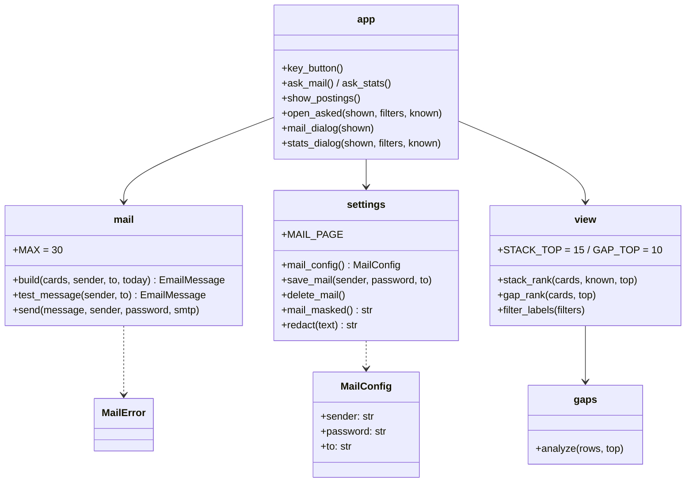
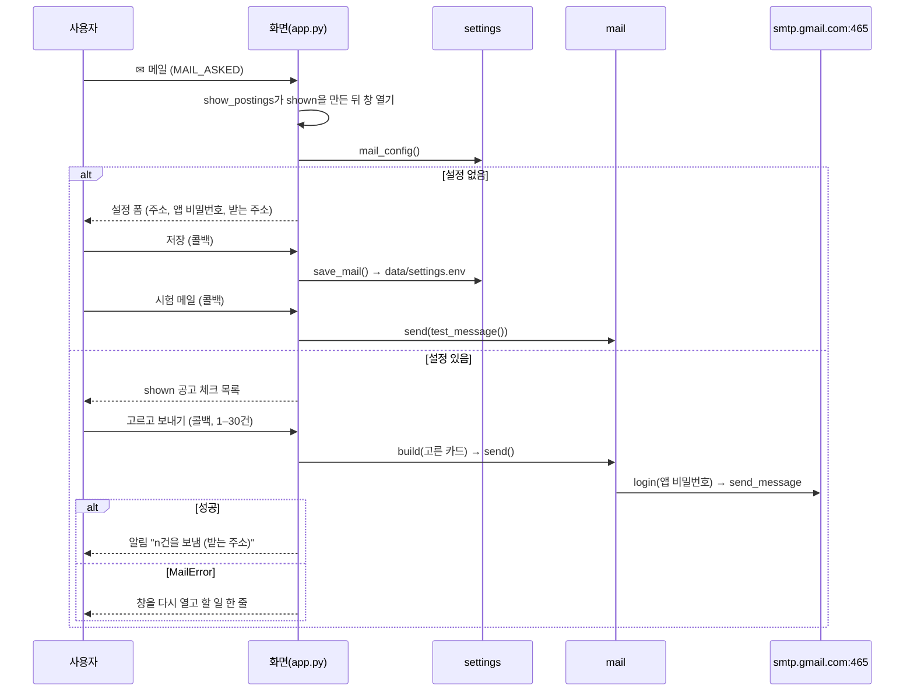
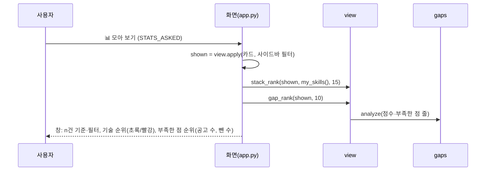

# v0.7 설계

기준 문서: [01-requirements.md](01-requirements.md) (2026-10-22 확정, F1–F13, N1–N5). 기준 코드는 v0.6.2(PR #57).

수집·평가 그래프, State, DB 표, 시트 열은 바뀌지 않는다. 새 모듈 `agent/mail.py`(메일 만들기·보내기)가 생기고, `agent/settings.py`(메일 설정 저장), `agent/view.py`(모아 보기 집계), `app.py`(버튼 2개, 창 2개)가 바뀐다.

## 정할 것 확인

| 질문 | 확인 | 결정 |
| --- | --- | --- |
| 버튼 위치 | 화면 위 줄은 제목 · 🔑 키 · 📖 사용법 · 🔄 새로고침 | 제목 오른쪽 칸을 두 줄로: 🔑 · 📖 · 🔄 / ✉ 메일 · 📊 모아 보기. 한 줄 다섯 개는 1280px 창에서 글자가 잘렸음(구현 중 Chromium 확인, 2026-10-23). 사이드바는 필터로 차 있음 |
| 고르는 목록 | `show_postings`가 사이드바 필터·검색·관심 없음을 거친 `shown`을 만듦 | 두 창 모두 `shown`을 받음. 위 버튼은 표시만 켜고, `shown`이 만들어진 뒤 창을 엶(D3) |
| Gmail 앱 비밀번호로 SMTP가 되나 | 알려진 Gmail 안내: 2단계 인증을 켠 계정은 앱 비밀번호(16자)로 `smtp.gmail.com` 465(SSL)·587(STARTTLS)에 로그인. 작업 환경에서는 메일 서버에 나갈 수 없어 확인 못 함 | 465 + `smtplib.SMTP_SSL`. 실제 발송은 재리 계정으로만 확인(미확인) |
| 순위 개수·그림 | 카드 자세히의 점수 막대(`jv-bar-row`)와 기술 칩(`jv-chip`)이 이미 있음 | 기술 15개, 부족한 점 10개. 이름 칩 + 막대 + 숫자 줄. 새 차트 없음 |

## 결정

| ID | 결정 | 이유 |
| --- | --- | --- |
| D1 | 새 모듈 `agent/mail.py`: `MAX = 30`, `MailError`, `build(cards, sender, to, today) -> EmailMessage`, `send(message, sender, password, smtp=smtplib.SMTP_SSL)`, `test_message(sender, to)`. LLM·사이트 요청 없음 (F5–F7, N1, N4) | 외부 서비스 호출은 노드·화면 밖 모듈에 둠(CLAUDE.md). 테스트는 `smtp`에 가짜 클래스를 넣음(N3) |
| D2 | 본문은 `EmailMessage.set_content(글자판)` + `add_alternative(HTML, subtype="html")`. 공고마다 회사·직무(원문 링크, http(s)만), 종합점수·판정(평가 전이면 "평가 전"), 마감 D-n, 출처·경력, 강점 첫 줄·부족한 점 첫 줄. 시트 글자는 `html.escape`. 제목 `[JOBVIS] 공고 n건 (YYYY-MM-DD)` (F5–F7) | 메일 앱은 CSS를 많이 버려서 표(`<table>`)와 인라인 스타일만 씀 |
| D3 | 위 버튼(✉ 메일, 📊 모아 보기)은 `on_click`(`ask_mail`·`ask_stats`)으로 `MAIL_ASKED`·`STATS_ASKED`만 켬. `show_postings`가 `shown`을 만든 뒤 `open_asked`가 표시를 꺼내 `@st.dialog` 창을 엶. 창 안 안내(`MAIL_NOTE`)·오류(`MAIL_ERROR`)가 남아 있으면 다시 엶. 공고를 못 읽었거나 0건이어도 창은 열고 안내 한 줄 (F1, F10, F13) | 위 줄은 탭보다 먼저 그려져 `shown`을 모름. v0.6.2 `KEY_ASKED`와 같은 방식 |
| D4 | 메일 설정은 `data/settings.env`의 `JOBVIS_MAIL_FROM`, `JOBVIS_MAIL_PASSWORD`, `JOBVIS_MAIL_TO`. `settings.mail_config() -> MailConfig \| None`, `save_mail(sender, password, to)`, `delete_mail()`, `mail_masked()`. 앱 비밀번호는 빈칸을 빼고 영문 16자인지 확인. 주소는 `이름@도메인.점` 모양 확인, 도메인은 막지 않음(회사 Google Workspace 주소도 같은 서버를 씀). 받는 주소 비우면 보내는 주소 (F8, F9, N2) | 키 저장(v0.6 D6)과 같은 파일·권한(0600)·`.env` 우선 규칙 |
| D5 | `settings.redact`가 키와 함께 `JOBVIS_MAIL_PASSWORD`(빈칸 뺀 값과 4자씩 띄운 값 모두)도 가림. `mail.send`의 예외는 `MailError`로 바꾸고 원래 예외 글은 버림: `SMTPAuthenticationError` → "Gmail 앱 비밀번호가 맞지 않습니다…", `OSError`·`SMTPException`·`TimeoutError` → "메일 서버에 연결하지 못했습니다…" (F9, N2) | 라이브러리 오류에 계정·서버 응답이 섞여 나올 수 있음 |
| D6 | 메일 창(`@st.dialog("✉ 메일")`): 설정이 없거나 `MAIL_SETTINGS`가 켜져 있으면 설정 폼, 아니면 보내기. 보내기는 `shown` 공고마다 체크(`mail-pick-{row}`, 처음엔 꺼짐), "보이는 공고 모두 고르기"(콜백으로 모두 켬), "n건 고름", 보내기 버튼은 0건·30건 초과면 눌리지 않고 이유 한 줄. 보내기·시험 메일·저장·삭제는 모두 `on_click` 콜백, 결과는 `MAIL_DONE`(알림) / `MAIL_ERROR`(창을 다시 열어 보임) (F2–F4, F8, F9) | 창 안 버튼은 창만 다시 그림. 공고 초기화 창(v0.6.1 D30)과 같은 방식이라 AppTest로도 확인됨 |
| D7 | 모아 보기 창(`@st.dialog("📊 모아 보기", width="large")`): 위에 "공고 n건 기준" + 켜진 필터 이름(`view.filter_labels(filters)`). 두 칸: 기술 스택 순위(`view.stack_rank(shown, known, 15)` → `[(이름, 공고 수, 내 기술인지)]`), 부족한 점 순위(`view.gap_rank(shown, 10)` → `gaps.analyze` 결과 + 뺀 수) (F10–F12) | 집계는 `view`에 두어 화면 없이 테스트(N5). 부족한 점 가중치는 v0.3 `--gaps`와 같은 함수를 그대로 씀 |
| D8 | `view.stack_rank`: 공고마다 `split_items(기술스택)`을 `_skill_key`(빈칸·대소문자 무시)로 묶어 한 번만 셈. 이름은 목록(점수 높은 순)에서 처음 나온 모양. 같은 수면 이름 순. 내 기술 판단은 자세히 칩과 같은 `my_skills()`. 내 기술은 자세히 칩과 같은 초록(`jv-mine`), 없는 기술은 F11대로 빨강(`jv-lack`, 신뢰 낮음 배지 색). 자세히 칩의 없는 기술은 지금처럼 흰색 (F11, N5) | 칩 색과 순위 색이 다르면 헷갈림 |
| D9 | 0건(공고 없음, 필터 결과 없음, 모을 칸 없음)이면 각 칸에 "모을 공고가 없습니다. 필터를 바꾸거나 평가를 먼저 해 주세요" (F13) | |

## 구성

## 메일 보내기 순서

## 모아 보기 순서

## 테스트 계획

- `mail.build`: 제목·받는 주소·글자판과 HTML 두 판, 평가 전 공고 "평가 전", 마감 D-n, 시트 글자 escape(`<b>` → `&lt;b&gt;`), `javascript:` 주소는 링크 아님 (F5–F7).
- `mail.send`: 가짜 SMTP로 로그인·보내기 호출 확인. 인증 오류·연결 오류·시간 초과 → `MailError` 문구, 문구에 비밀번호 없음 (F9, N2, N3).
- `settings`: 저장·읽기·삭제, 앱 비밀번호 빈칸 빼기·16자 확인, 주소 모양 확인, `.env` 우선, `redact`가 비밀번호(띄운 모양 포함)를 가림 (F8, N2).
- 화면(AppTest): 설정 없으면 설정 폼, 저장 뒤 보내기 창, 0건·31건이면 보내기 비활성, 모두 고르기, 보내면 알림, 실패면 창에 문구. 모아 보기 창에 n건 기준·필터 이름·순위, 0건 안내 (F1–F4, F10–F13).
- `view.stack_rank`·`gap_rank`·`filter_labels`: 같은 공고 안 중복 한 번, 대소문자·빈칸 합치기, 같은 수 이름 순, 점수 없는 공고 뺀 수, 내 기술 표시 (F11, F12, N5).
- 실제 Gmail 발송은 재리 계정으로만 확인(03-test에 미확인으로 남김).
